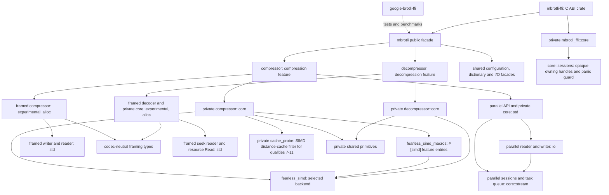

# Architecture

Specifications describe how the implementation works today: ownership, APIs,
data flow, state transitions, SIMD dispatch, errors and known gaps. To use the
crate, read the [guides](../docs/README.md) instead; for checks and repository
layout, see [development](../docs/development.md).

## Where to start

| You want to understand | Read, in order |
| --- | --- |
| How a `compress` call becomes bytes | [Compressor](compressor.md) → the encoder for your quality ([fast](fast-encoder.md), [greedy](greedy-encoder.md), [high-quality](hq-encoder.md)) → [Bit output](bit-output.md) |
| How a stream is decoded | [Native decompressor](decompressor.md) → [Decoder SIMD](decoder-simd.md) → [Owned decoder output](decoder-owned-output.md) |
| Why memory is reused between calls | [Encoder workspace](encoder-workspace.md) → [Uninitialized output](uninit-output.md) |
| How one input is split across threads | [Parallel compression](parallel-compression.md) → [Parallel streaming sessions](parallel-stream.md) |
| How containers and dictionaries work | [Shared Brotli](shared-brotli.md) → [Framed compressor](framing.md) → [Framed decoder](framed-decoder.md) |
| How correctness is established | [Decoder verification](decompressor-compatibility.md) → [Fuzzing](fuzzing.md) → [Formal verification](formal-verification.md) |
| Which features compile which code | [Codec features](codec-features.md) → [No standard library](no-std.md) |

Specifications share an outline: module and ownership boundaries, public
surface, control and data flow with Mermaid diagrams, and error propagation.
Most close with a list of known gaps.

## Module map

Public modules own ergonomic configuration and high-level errors. Private `core`
modules own algorithms and state machines; implementation errors, SIMD types and
FFI do not appear in public signatures. Each codec compiles independently.

## Common boundaries

Feature gates and primitives that both codecs share.

| Specification | Scope |
| --- | --- |
| [Codec features](codec-features.md) | Codec gates, shared types and isolated consumer checks. |
| [No standard library](no-std.md) | Alloc-backed APIs, feature precedence and compile-time SIMD. |
| [Shared primitives](shared-primitives.md) | Common data, const repetition tables, transforms, fixed boxed tables, the baseline SIMD level, prefetch and mask scans. |
| [Uninitialized output](uninit-output.md) | Write-only destinations for sessions and one-shot calls, and the C ABI's use of them. |

## Compression

From the public `Compressor` down to the three encoder cores and the bit writer.

| Specification | Scope |
| --- | --- |
| [Compressor](compressor.md) | Public API, sessions, size-hint inference, I/O, dispatch and errors. |
| [Encoder workspace](encoder-workspace.md) | Retained output backing, reset, parked match-finder tables, accounting and backpressure. |
| [Bit output](bit-output.md) | Destinations, command-prefix lookup, literal tables, whole-command packing, direct Vec appends, bit operations and overflow. |
| [Serial output identity](universal-encoding.md) | Shared scheduling, empty finalization and C compatibility. |
| [Fast encoder](fast-encoder.md) | Qualities 0–1: fragments, direct encoding, table-driven command emission, entropy coding, prefix-code builders and SIMD scans. |
| [Greedy encoder](greedy-encoder.md) | Qualities 2–9: hash tables and their growth, SIMD range hashing, match scoring, distance-cache prefilter and meta-blocks. |
| [High-quality encoder](hq-encoder.md) | Qualities 10–11: tree search, SIMD distance-cache and dictionary filters, command pricing and clustering. |
| [Owned sessions](owned-sessions.md) | Lifetime-free raw and framed sessions, `reinit` and input-free `flush`/`finish`. |
| [Parallel compression](parallel-compression.md) | Planning, encoder reconfiguration, caller-run tasks, staging and assembly. |
| [Parallel streaming sessions](parallel-stream.md) | Chunked input into queued segment tasks, ordered delivery, flush, queue closure and the blocking adapters. |

## Decompression

The native decoder, its performance paths and the framed container readers.

| Specification | Scope |
| --- | --- |
| [Native decompressor](decompressor.md) | Parsing, sessions, history, the single-exit command loop, dictionaries, budgets and I/O. |
| [Owned decoder output](decoder-owned-output.md) | Stored members, allocation transfer, linear slice history and read-ahead accounting. |
| [Literal and stored-header decoding](decoder-literal-performance.md) | Literal batches, per-context roots, byte-exact literal runs and stored-member recognition. |
| [Decoder SIMD](decoder-simd.md) | Command-loop dispatch and bounded fixed-size history copies. |
| [Decoder verification](decompressor-compatibility.md) | C/RFC oracles, feature profiles and test limitations. |
| [Framed decoder](framed-decoder.md) | Structured containers, detection, events, dictionaries, validation, budgets and lending reader. |
| [Framed seek reader](framed-seek-reader.md) | Footer/directory indexing, lazy metadata, sparse dependency decoding and resource `Read`. |

## Extended formats

Large Window, shared dictionaries and the experimental framing container.

| Specification | Scope |
| --- | --- |
| [Shared Brotli](shared-brotli.md) | Large Window declarations and prepared prefix dictionaries. |
| [Serialized dictionaries](serialized-dictionary.md) | Experimental wire format, transforms and resource limits. |
| [Custom encoding and continuations](rfc9841-encoding.md) | Static indexes, contexts and headerless stream offsets. |
| [Framed compressor](framing.md) | Reusable owner, structured input, sessions, std adapters, metadata and wire compatibility. |

## Language bindings

| Specification | Scope |
| --- | --- |
| [C ABI](c-abi.md) | `mbrotli-ffi`: one-shot and session C functions, pointer validation, panic poisoning and status mapping. |

## Development tools

How the repository measures, tests, proves and publishes itself.

| Specification | Scope |
| --- | --- |
| [Implementation comparison](benchmark-comparison.md) | Isolated library comparisons, validation, provenance and charts. |
| [Fuzzing](fuzzing.md) | Target inputs, oracles, campaigns, regression replay and the libFuzzer adapters. |
| [Continuous integration](ci.md) | Triggers, checks, Miri and AddressSanitizer, fuzz campaigns and corpus merge budgets, coverage gating and release publishing. |
| [Documentation publishing](documentation.md) | Source staging, navigation, section pages, recipe execution, link validation and Pages deployment. |
| [Formal verification](formal-verification.md) | Charon/Aeneas translation to Lean 4, function specifications, round-trip theorems and the trusted base. |
