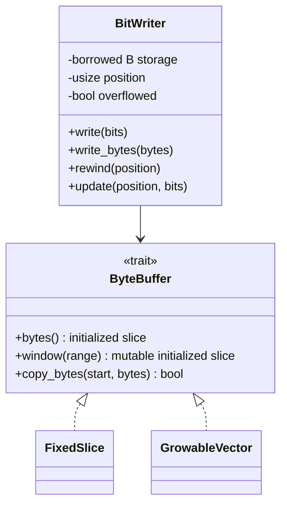
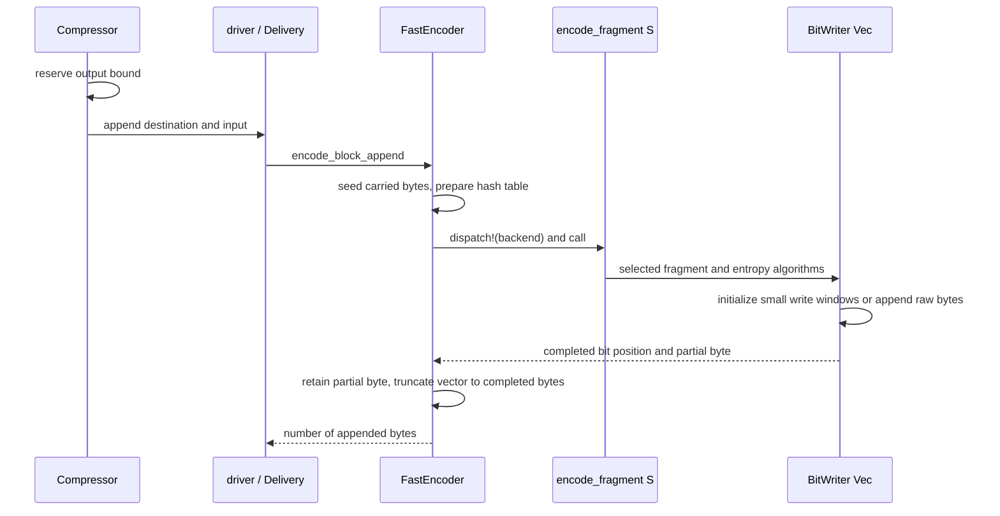
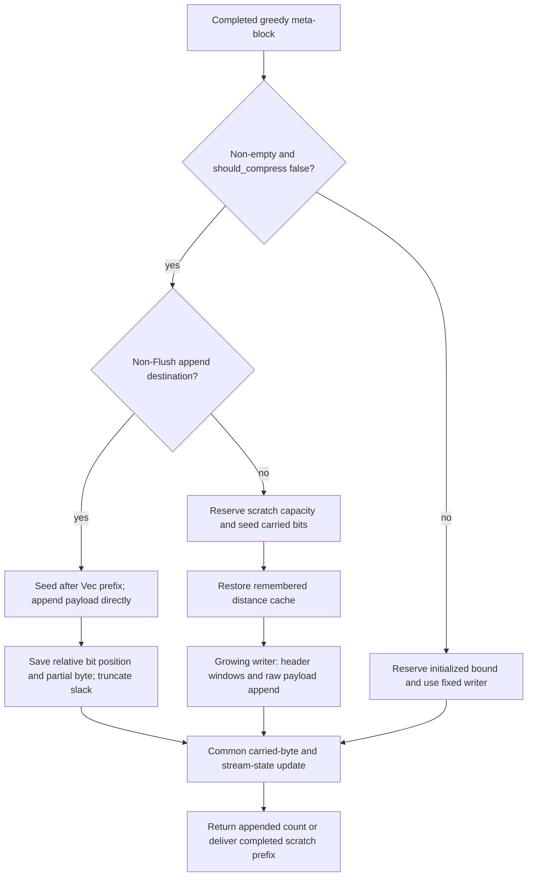
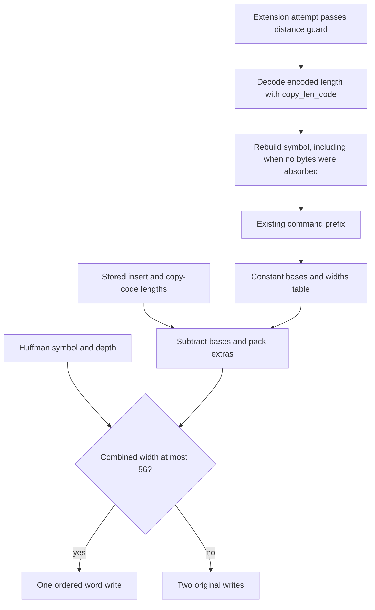
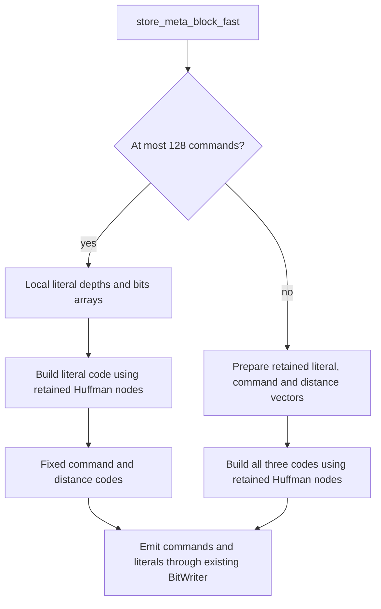
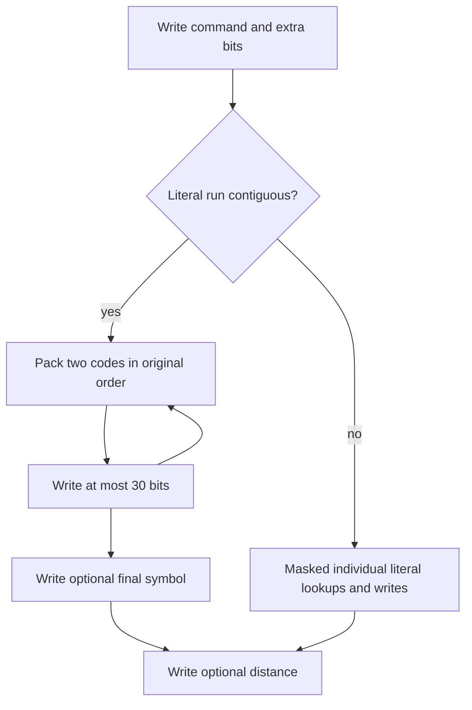

# Bit output and destination storage

`shared::bits` owns the private least-significant-bit-first bit writer.
Public vector, slice and streaming APIs retain the same output and error contracts;
no storage trait, bit position or SIMD token appears in those APIs.

## Ownership and dispatch

`BitWriter<'a, B>` borrows initialized storage through the private `ByteBuffer`
trait. Its default type is `[u8]`. Fast one-shot vector output and early
uncompressed greedy scratch or direct appends specialize it for `Vec<u8>`; their helpers are
generic over that storage type. These
are static specializations, with no trait-object calls in the bit-writing loop.

`Compressor` reserves the one-shot vector bound before entering the driver. For
non-flush fast blocks, `Delivery::encode` selects `FastEncoder::encode_block_append`
for append destinations. The encoder seeds its carried bytes after the existing
prefix and checks conversion of that offset into a bit position. The encoder
dispatches its retained `Backend` and passes the concrete token to the
`#[simd]` `encode_fragment`, which enters the token's feature context and runs
the same q0/q1 algorithms used by the slice path.

Fast slice output uses the fixed writer when the destination meets its fragment
reservation. An uninitialized destination (`Destination::Uninit`) cannot be read
back. For non-flush fast session blocks, both that destination and a short slice
receive bytes from the compressor's initialized pending backing, encoded with
the fixed writer. The backing retains its length; `pending_end` limits which
bytes are complete, and `served` limits which remain to be delivered. Growth
initializes only the new tail, and a drain resets cursors without clearing the
backing. See [encoder workspace](encoder-workspace.md#initialized-backing-and-completed-output).

One-shot uninitialized output, flushes, compressed greedy trials and HQ blocks
still use encoder scratch (see [uninitialized output](uninit-output.md)). Sessions copy any
unserved scratch suffix into the pending backing without overwriting its
initialized length. Failed one-shot appends roll back to the caller's original
length; failed session encodes publish no new completed end.

## Byte and lifetime invariants

A word write accepts at most 56 bits and touches eight initialized bytes. It
preserves the partial first byte and clears the higher bits and following bytes.
No storage implementation reads uninitialized capacity. Both implementations use
safe Rust borrows and slice operations.

The fixed buffer refuses a range outside its length. The writer sets its overflow
flag and preserves its existing position-advance behavior, allowing the encoder to
report the failure at its normal boundary. `set_byte(usize::MAX, ...)` also sets
that flag without overflowing index arithmetic.

The vector buffer initializes write windows in batches ending at a 256-byte
boundary, capped by existing capacity when that capacity covers the requested
range. Allocation and initialization live in an outlined cold helper, leaving
only the bounds check in each symbol write. This avoids a resize for every symbol.
Raw-byte writes copy any already
initialized portion and use `Vec::extend_from_slice` for the remaining bytes,
avoiding a zero-fill before copying an uncompressed block. Rewinds and header
updates operate on initialized bytes already emitted. After a fragment, padding
is truncated and the encoder retains the unfinished byte for the next fragment.

## Early uncompressed greedy blocks

The greedy encoder decides whether a non-empty meta-block is uncompressed before
reserving initialized scratch. That path reserves capacity, seeds the carried
bits in two initialized bytes and restores the remembered distance cache, because
its match commands will be discarded. Generic uncompressed header/payload helpers
write through `BitWriter<Vec<u8>>`: small header windows are initialized on demand
and the raw payload is copied directly into spare capacity. Reused initialized
scratch is overwritten in place. This avoids clearing a full compression bound
before copying incompressible input.

For a non-Flush append destination, `Delivery::encode` selects the private
`GreedyEncoder::encode_block_append`. Known verbatim blocks seed carried bits
after the existing Vec prefix and copy ring bytes directly into that destination,
removing the intermediate scratch copy. Checked prefix/bit positions and sixteen
extra bytes cover headers (including the initial fourteen-bit large-window
header), final empty block and writer slack. Visible output is truncated to its
completed byte boundary after retaining the unfinished byte.

Compressed trials, their later incompressible fallback, and empty final blocks
retain the fixed-slice writer. `BlockEmission` carries a relative bit position,
partial byte and direct-append flag to the same encoder state update, which
advances stream positions and clears completed command counts. Scratch
`output_len` is zero when bytes were directly appended; other completed scratch
bytes are copied by the append entry. Overflow remains a typed encoder error.
Fixed/uninitialized destinations and Flush retain their prior scratch paths.

## Command fields

`shared::command::Command` already stores its combined insert/copy prefix.
`extra_bits` reverses that prefix through a constant table instead of classifying
both lengths again. Each 64-bit table entry packs the insert and copy bases,
insert width and total width. The 704 valid symbols are padded to 1024 entries
for masked indexing. `Command::new`, `insert_only` and command extension keep
the prefix consistent with the stored lengths, including the copy-length delta;
this invariant makes the lookup equivalent to the length-based calculation.
The table is shared read-only data, with no per-compressor allocation.

After a command-extension attempt passes its distance guard, the wrapper
rebuilds the symbol from `copy_len_code()`, the same encoded copy length read
by `extra_bits`. This decodes signed dictionary deltas and experimental
absolute-length tags before selecting a class. The attempt can absorb no bytes
when no attached prefix is available; even then, rebuilding must preserve the
symbol of the original valid command. Reading the upper modifier as an
unsigned additive delta would give a different class for these representations.

The fixed-code writer joins a command symbol with its length extras, and a
distance symbol with its distance extras, using `BitWriter::write_pair`.
The helper emits one word when the combined width is at most 56; otherwise it
performs the two original writes. It retains field order and the writer's
initialized-storage/slack requirements. No command or dictionary decisions,
public APIs or SIMD dispatch points change.

## Short greedy prefix-code scratch

`MetaBlockWriter::store_meta_block_fast` uses fixed command and distance codes
when a meta-block contains at most 128 commands. Only the literal code is built
for these blocks. Its depths (`[u8; 256]`) and bits (`[u16; 256]`) are initialized
local arrays, borrowed by the Huffman builder and literal writer for this call.
They add no retained heap allocation. The variable Huffman-node pool remains in
`MetaBlockWriter::tree` and grows only for a larger used-symbol population.

Above 128 commands the fast writer builds all three prefix codes into its
retained vectors. Full block-splitting and trivial-code writers retain their
existing vector workspaces. Moving between these paths never assumes that a
static-code block updated the retained literal vectors: each builder writes the
active symbols it later emits. A reused writer therefore produces the same
bytes as fresh scratch across static/dynamic/static transitions.

This storage choice introduces no backend detection or dispatch boundary. The
existing backend selection and output overflow/error handling are unchanged;
all code tables stay private. Focused tests cover single-symbol and wider
literal alphabets, the 128-command boundary, and transitions in a reused writer.

## Greedy literal packing

`shared::bitstream::store_data_with_huffman_codes` emits the command, its extra
bits, literal run and optional distance in reference order. A contiguous literal
run is split into pairs and an optional final symbol. Two literal codes are
packed least-significant first into one writer call: the second code starts at
the first code's width. General literal trees have depth at most 15, so a pair
needs at most 30 of the writer's 56 supported bits. Zero-width singleton codes
also preserve the same bit position and output. This scalar bit packing has no
SIMD dispatch boundary; it reduces the sequential writer calls.

Ring-wrapped or incomplete input retains individual masked lookups, including
its existing zero fallback for an absent byte. Huffman trees, command decisions
and the resulting stream are unchanged. The caller provides the encoder's
reserved initialized output with writer slack; overflow remains reported at the
encoder boundary.

## Verification and known gaps

Differential tests cover every insert/copy command class, extra-value endpoints,
implicit and explicit distances, copy-length deltas and insert-only commands.
Paired-field tests exercise both sides of the 56-bit limit at every alignment.
A differential test compares packed and individual literal writes across every
bit alignment, zero and maximum code widths, odd/even run lengths, ring wrapping
and incomplete input.

Unit tests compare growing and fixed storage across bit/byte boundaries, rewinds,
updates, prefixes, large raw writes and invalid byte indices. Fast-fragment tests
compare both destinations across consecutive blocks and every host backend,
including independent-fragment kernels. Integration tests and AFL compare full
streams with C, and exercise append rollback and exact-sized slice behavior.

Direct growing output serves fast one-shot appends and known verbatim greedy
append blocks. Fast I/O adapters use fixed output backing through the session
scheduler. Compressed greedy trials, other greedy destinations, HQ output and
all flushes continue to use encoder scratch before delivery. Focused tests cover
direct greedy prefixes, carry offsets including the large-window header,
remembered/derived distance history, output counts, capacity overflow before
mutation, block transitions, explicit flush, empty finish and retained reuse.
