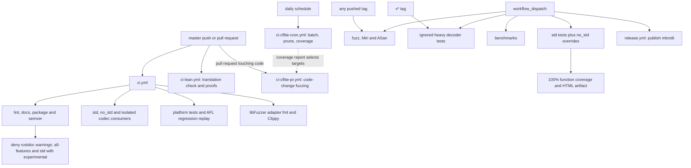
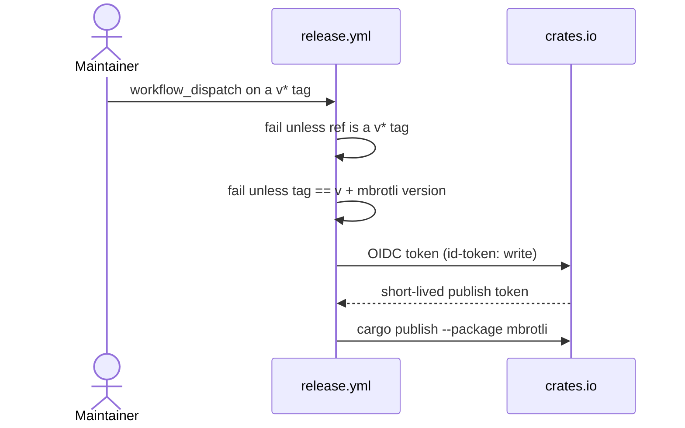
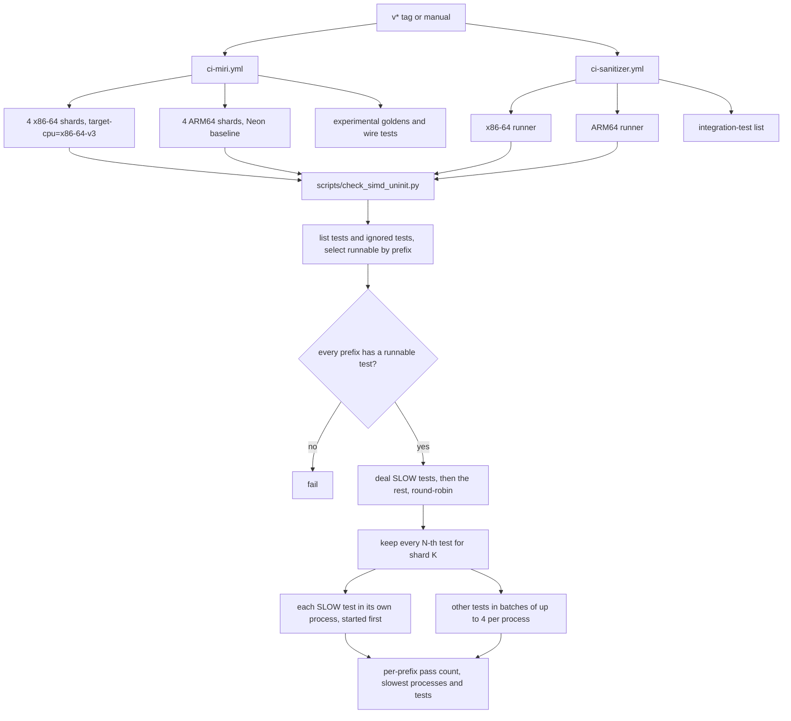
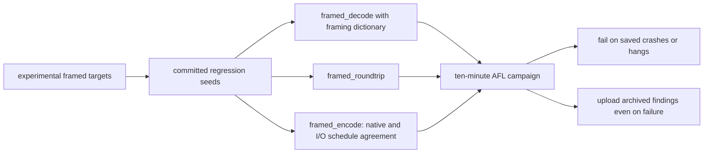
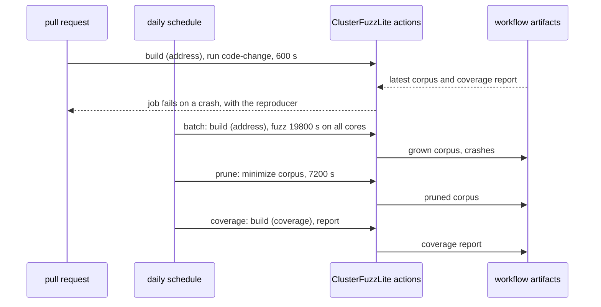

# Continuous integration

Workflow definitions live in [`.github/workflows/`](../.github/workflows/).
All checkouts include vendored submodules. Local commands are in
[development](../docs/development.md).

## Triggers and checks

| Workflow | Trigger | Scope |
| --- | --- | --- |
| `ci.yml` | Push to master, pull request | Formatting, Clippy, docs, packaging, API compatibility, feature checks, tests and AFL replay |
| `ci-lean.yml` | Push to master, pull request | Lean translation drift check and Lean proofs with axiom audit; see [formal verification](formal-verification.md) |
| `ci-coverage.yml` | Manual | Std and no_std function coverage; 100% gate and HTML report |
| `ci-benchmarks.yml` | Manual | Criterion validation and timing on Linux x86-64 and ARM64 |
| `ci-fuzz.yml` | Every tag, manual | Bounded AFL campaigns in stable and experimental profiles |
| `ci-cflite-pr.yml` | Pull request touching code, fuzz or build files | ClusterFuzzLite libFuzzer/ASan run on the changed code |
| `ci-cflite-cron.yml` | Daily, manual | ClusterFuzzLite batch fuzzing, corpus pruning and coverage report |
| `ci-miri.yml` | Every tag, manual | SIMD and uninitialized-memory tests on x86-64 (`x86-64-v3`) and ARM64, four shards each; experimental decoder goldens |
| `ci-sanitizer.yml` | Every tag, manual | AddressSanitizer: SIMD and uninitialized-memory tests on x86-64 and ARM64, plus integration tests |
| `ci-decompressor-heavy.yml` | `v*` tag, manual | Actual 25–30-bit history and counters beyond 4 GiB in four decoder profiles |
| `release.yml` | Manual, from a `v*` tag | Publishes `mbrotli` to crates.io through trusted publishing |

Routine tests cover Linux x86-64, Linux ARM64 and macOS, with an MSRV 1.89 job.
All-features builds activate `no_std`; separate std checks retain I/O, parallel
and framing coverage. Alloc-only jobs also compile `thumbv7em-none-eabi`.
Consumer scripts check available imports and imports that must fail.

Documentation builds deny warnings in both the all-features and std experimental
profiles, covering alloc-only and std-only API links. Crate-level type links use
shortcut references with feature-dependent definitions: enabled APIs resolve to
local items, while disabled APIs link to the feature-selection section. This
preserves navigation without redundant explicit link targets.

The semver job compares the default `mbrotli` API with the latest published
release. Experimental APIs and the development-only C FFI crate are outside
that gate. A violation requires a sufficient package version bump.

## Release publishing

`release.yml` runs only on manual dispatch and refuses any ref that is not a
`v*` tag. It checks that the tag equals `v` plus the `mbrotli` package version,
then exchanges the job's GitHub OIDC token for a short-lived crates.io token
with `rust-lang/crates-io-auth-action` and runs `cargo publish --package
mbrotli`, which builds the packaged crate before uploading it. No registry
token is stored in the repository. The job runs in the `release` environment,
which must match the trusted publisher configured on crates.io. The
development-only `mbrotli-ffi` and `google-brotli-ffi` crates are not published.

## Miri and AddressSanitizer

Both tools run `scripts/check_simd_uninit.py`, which owns the list of unit-test
modules (every module with a SIMD kernel, a backend dispatch or a
`MaybeUninit` destination), integration binaries and the `uninit` doc tests.
It builds once, lists each binary's tests with `--list` and its ignored ones
with `--list --ignored`, and keeps the runnable names that start with a listed
prefix. A prefix with no runnable test fails the run: `cargo test` itself
passes when a filter matches nothing, and a substring filter such as
`compressor::core::stream` would also match `decompressor::core::stream`.
`--shard K/N` deals the selected tests round-robin and keeps every N-th; shard
1 also runs the doc tests. The tests in the script's `SLOW` list, which take
Miri minutes each, are dealt first, so no shard draws two of the slowest, and
each runs in a process of its own, started first. The other tests run in
batches of up to `--batch` (4) per process, passed as `--exact` names, since
starting `cargo miri` costs seconds per process; a batch takes every n-th
test of its binary, so one module's tests spread across batches. Each
selected test must report `ok` in libtest's output. The script prints a
per-prefix summary, the five slowest processes and the slowest tests by
libtest's `--report-time` clock, which under Miri counts interpreted work
rather than wall time.

Miri reports runtime-detected CPU features as absent, so it interprets only the
SIMD levels compiled in. The x86-64 Miri jobs set
`RUSTFLAGS=-Ctarget-cpu=x86-64-v3`, which makes `Backend::available()` list
SSE2, SSE4.2 and AVX2; `native` is not used, because Miri has no shims for the
AVX-512 intrinsics and the hosted runner pool mixes AVX2 and AVX-512 machines.
On ARM64, Neon is part of the baseline. The script copies `RUSTFLAGS` into an
unset `RUSTDOCFLAGS`, since a doc test built without the library's target
features calls its kernels without them, which Miri reports as undefined
behavior. It also sets `-Zmiri-deterministic-floats`, without which Miri
perturbs `log2` and exact cost comparisons fail. Miri lacks shims for the Neon `vsliq_n_u8` and
`vminq_f64` intrinsics behind `fearless_simd`'s `mask8x32::to_bitmask` and
`f64x2::min`; tests reaching them, and three doc tests the script skips by
name, do not run under Miri on ARM64. Tests that call the C oracle, read files,
or are scalar-only and slow carry `cfg_attr(miri, ignore)`; differential SIMD
tests shrink their inputs under `cfg!(miri)` instead. Each quality 10 or 11
stream spends most of a minute in histogram clustering under Miri, so only
`hq::encoder`'s backend comparison and the hq kernel tests encode at those
qualities there. `tests/uninit_output.rs` reads back only reported prefixes of
destinations that start uninitialized, so Miri checks that every reported byte
was written. Shards are sized to finish within ten minutes, under a 15-minute
job timeout.

AddressSanitizer runs the same list natively in release mode, with real feature
detection, which reaches the Neon paths Miri cannot. Its integration list also
includes the C-oracle tests `encode_uninit` and `decode_uninit`. The older
ASan job keeps its integration-test list.

## AFL execution and artifacts

AFL jobs cache Cargo downloads/tools but disable target caching: instrumented
builds can use CPU-specific instructions. Each job force-installs the pinned
`cargo-afl` and runs `cargo afl config --build --force` to restore its sources
and runtime for the current compiler.

Campaign runners configure direct core dumps before starting AFL. Target-specific
seed selection uses generated corpora or committed lifecycle, framing and parallel
regressions. Base decoder targets run in both feature profiles; custom targets
require `experimental`.

The experimental matrix includes `framed_decode`, `framed_roundtrip` and `framed_encode`, each
using its committed `regressions/TARGET` seeds. The arbitrary-byte framed decoder
also uses `dictionaries/framed.dict`. Campaigns run for ten minutes, with a
five-second per-input timeout for decoder targets and a one-second default for
other targets.

Saved crashes or hangs fail the job. Findings are archived as tar.gz and uploaded
when present, including after failures; this preserves AFL filenames with colons.
Regression replay does not start a campaign or require host core-dump configuration.

## ClusterFuzzLite

Both ClusterFuzzLite workflows build `.clusterfuzzlite/Dockerfile` with
`google/clusterfuzzlite/actions/build_fuzzers@v1` and run the binaries that
`build.sh` produces from `fuzz/libfuzzer` (see
[fuzzing](fuzzing.md#libfuzzer-adapters-and-clusterfuzzlite)). The actions do
their own checkout, so the workflows have no checkout step and `build.sh`
fetches the vendored Brotli submodule itself. Runs use libFuzzer with
AddressSanitizer, the only engine and sanitizer ClusterFuzzLite supports for
Rust, and the coverage job builds with the coverage sanitizer. All jobs use
read-only permissions; corpora, crashes and coverage reports are kept as
workflow artifacts, ClusterFuzzLite's default storage on GitHub.

`ci-cflite-pr.yml` runs only when a pull request touches `src/`,
`brotli-ffi/`, `mbrotli-ffi/`, `fuzz/`, `Cargo.toml`, `.clusterfuzzlite/`,
`.dockerignore` or the workflow itself, and a newer push cancels the run in
progress. Code-change mode runs only the targets whose coverage reaches the
changed lines once a coverage report exists, and every target before that.
The 600 seconds are split among the targets it runs.

Batch fuzzing gets 19800 seconds (5.5 hours) with `parallel-fuzzing`, which
runs one libFuzzer process per runner core for each target; the targets still
take turns, 792 seconds each. GitHub-hosted jobs stop at six hours including
the image and fuzzer builds, so the job's `timeout-minutes: 360` leaves about
half an hour for building and uploading the corpus.

Pruning gets 7200 seconds. ClusterFuzzLite splits the budget evenly among the
targets and uses each share as the timeout of that target's corpus merge, so
600 seconds left 24 seconds per target. That was not enough to merge `c_abi`'s
5035 inputs after the first batch run, and the job stopped at that target.

In `ci-cflite-cron.yml` the jobs are chained: pruning follows batch fuzzing
(ClusterFuzzLite requires pruning whenever batch fuzzing runs), and coverage
follows pruning, so the report reflects the pruned corpus. A failed batch job
still lets pruning and coverage run.

`.dockerignore` keeps target directories, local AFL seeds and findings, and
Lean's `verification/lean/.lake` package cache out of the image, but keeps
`.git`, which the submodule fetch needs.

## Coverage and limitations

Coverage cleans workspace profiles first, then accumulates a std workspace run
with explicit experimental, diagnostics and profiling features plus a no_std
unit/API run. Both use test optimization level 1 and `CARGO_INCREMENTAL=1` to keep
coverage code generation consistent. The report enforces 100% function coverage;
HTML rendering and upload run even if tests or the gate fail.

The only scheduled workflow is `ci-cflite-cron.yml`, and publishing never
starts on its own: a pushed tag runs checks only. Each manual dispatch starts only its selected
workflow. Apart from ten minutes of ClusterFuzzLite fuzzing on pull requests
that touch code, ordinary branches do not run heavy tools; coverage and
benchmarks always require explicit dispatch. Bounded fuzz campaigns and shared-runner timings
provide limited evidence, not exhaustive verification or stable speed guarantees.
