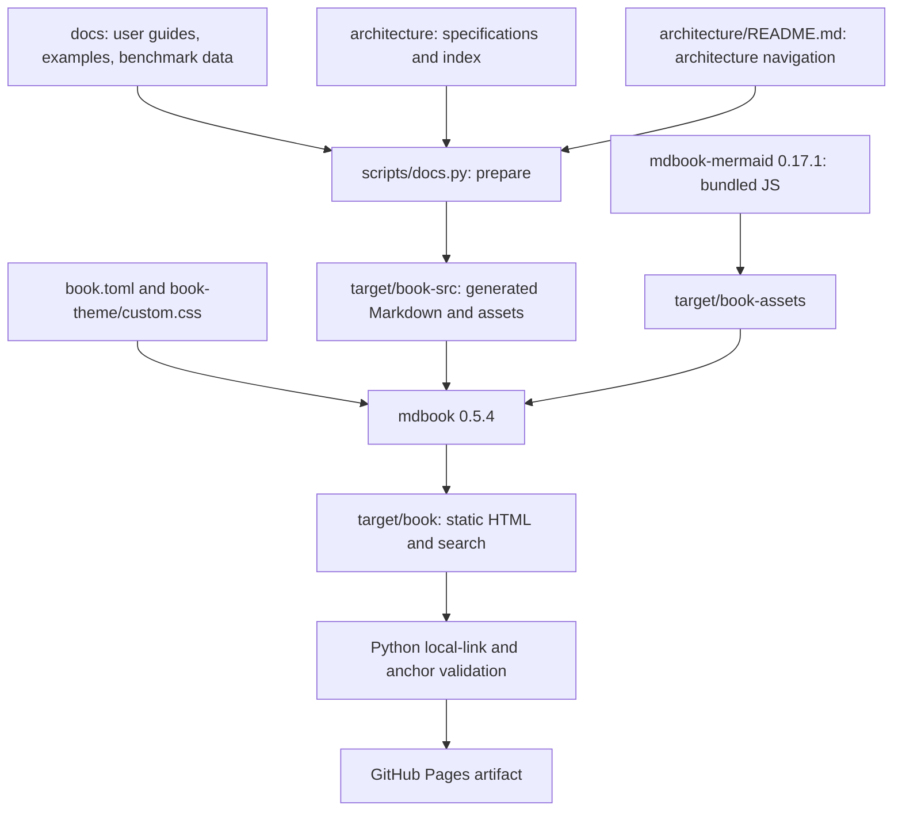
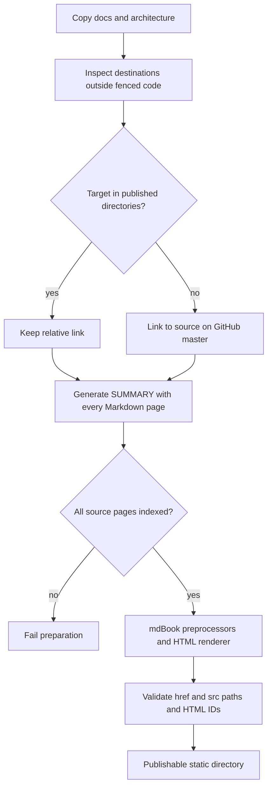
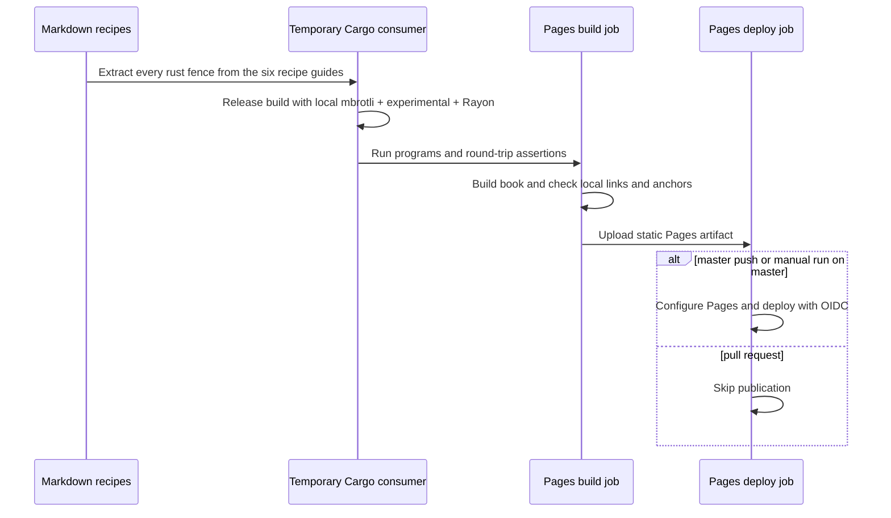

# Documentation publishing

The repository publishes a static **mdBook** through GitHub Pages. The book
contains every Markdown page and associated asset in `docs/` and `architecture/`.
These directories remain the canonical sources; generated book sources, Mermaid
assets, consumer examples, and HTML are local artifacts under ignored `target/`.

## Modules and ownership

The root `book.toml` owns renderer, theme, search, folding, output path, and
Mermaid preprocessor settings. `book-theme/custom.css` extends mdBook's built-in
light and dark palettes and the introductory page. Search, keyboard navigation,
theme selection, Rust syntax highlighting, and code copying come from mdBook.
Rust playground execution is disabled because its environment lacks mbrotli.

`scripts/docs.py` has five repository-local entry points:

| Command | Behavior |
| --- | --- |
| `prepare` | Recreate the staged source tree, navigation, and bundled diagram assets |
| `build` | Prepare, build HTML, then check local links and heading anchors |
| `serve` | Prepare, then serve the generated tree on loopback port 3000 |
| `check-links` | Validate a previously built HTML tree |
| `test-examples` | Compile and run Rust recipes in a separate Cargo consumer |

## Source and link flow

Curated guide entries lead with getting started, examples, Sans I/O compression
and decompression, std I/O, parallel compression, and frames. Benchmark quality
pages are grouped under their codec indexes.
Architecture chapters follow the section headings and specification tables in
`architecture/README.md`; unindexed architecture Markdown fails preparation.
New guide pages are included automatically. No source guide or specification is
excluded merely because it has no manually configured navigation entry.

Preparation preserves fenced code. Relative links to files outside the published
directories are checked for existence and rewritten to GitHub `blob` or `tree`
URLs. Staging maps README pages to `index.md` and the introduction to the root
`index.md`, adjusting relative links and summary entries to their final locations.
CSV, JSON, and SVG assets retain their source directory layout. All generated
HTML local destinations and fragments are checked after rendering.

The preprocessor's `install` command writes bundled Mermaid assets into a small
generated book under `target/book-assets/`; the real book references those files.
The site needs no runtime CDN, Node package manager, or application server.

## Examples and deployment

Recipes in getting started, parallel, frames, Sans I/O compression/decompression,
and the I/O guide
are complete Rust programs. `test-examples` generates a separate package beneath
`target/book-examples/`, enables default std codecs plus `experimental`, and adds
Rayon. It runs each binary and propagates build or assertion failures. It does
not change the workspace, public codec APIs, state machines, SIMD dispatch, or
error propagation; normal codec tests remain separate.

`.github/workflows/pages.yml` runs source and recipe checks on matching pull
requests, `master` pushes, and manual dispatch. Only its deployment job has
`pages: write` and `id-token: write`; pull requests cannot deploy. The
`github-pages` environment records the deployed URL. Deployment is serialized
and the output is hosted at `https://m-compressors.github.io/mbrotli/`.

## Known gaps

- The Pages source setting must be configured to **GitHub Actions** in repository
  settings before the first deployment. Adding a workflow alone does not enable it.
- `serve` watches generated files. Restart the command after editing canonical
  sources so preparation runs again.
- The checker validates local destinations and anchors, not external network
  URLs or Mermaid syntax. Browser QA is needed for rendered diagrams.
- Recipe validation covers the six listed guides, not every historical code
  fragment in the implementation specifications.
