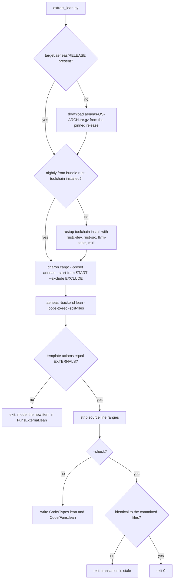
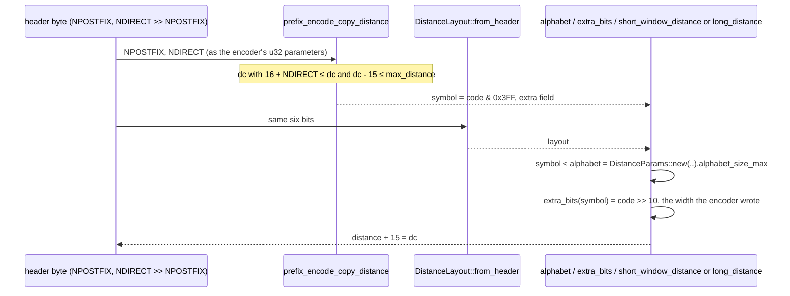
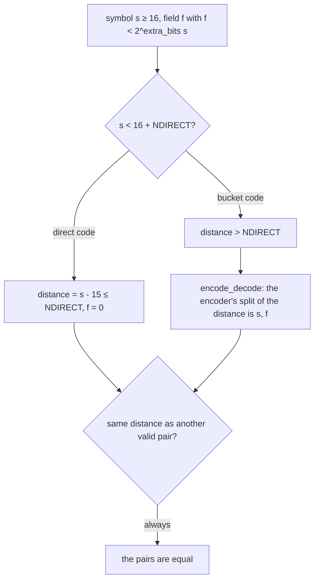
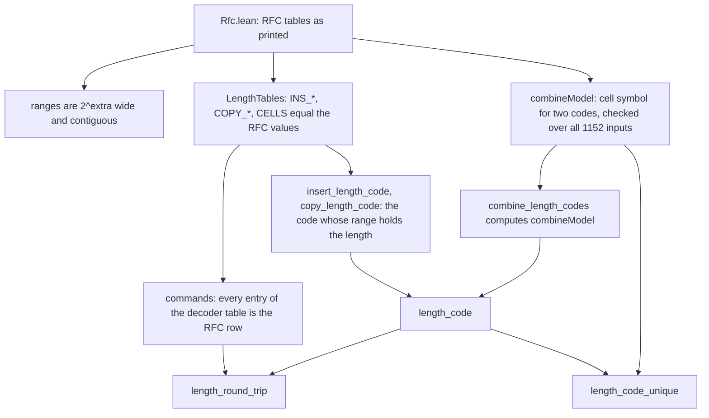
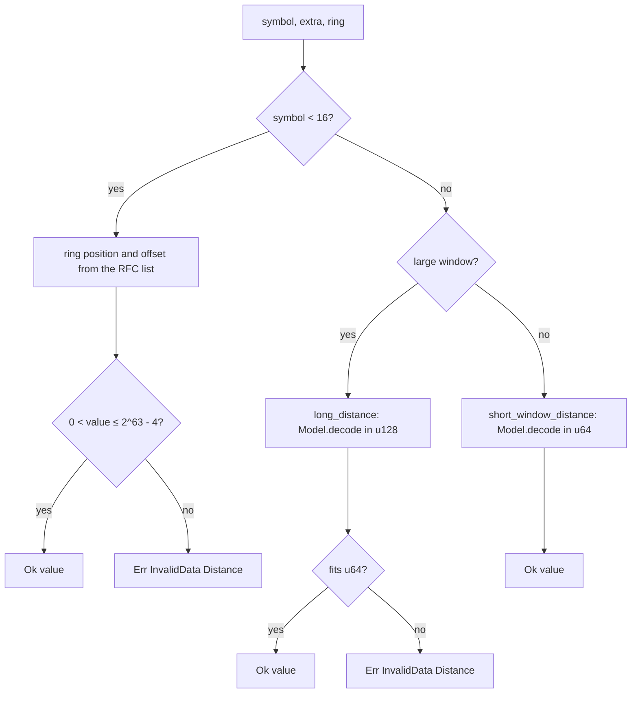
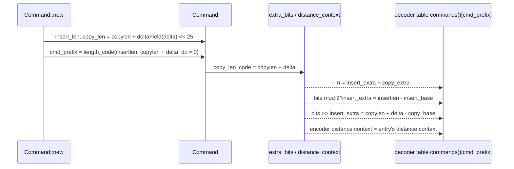
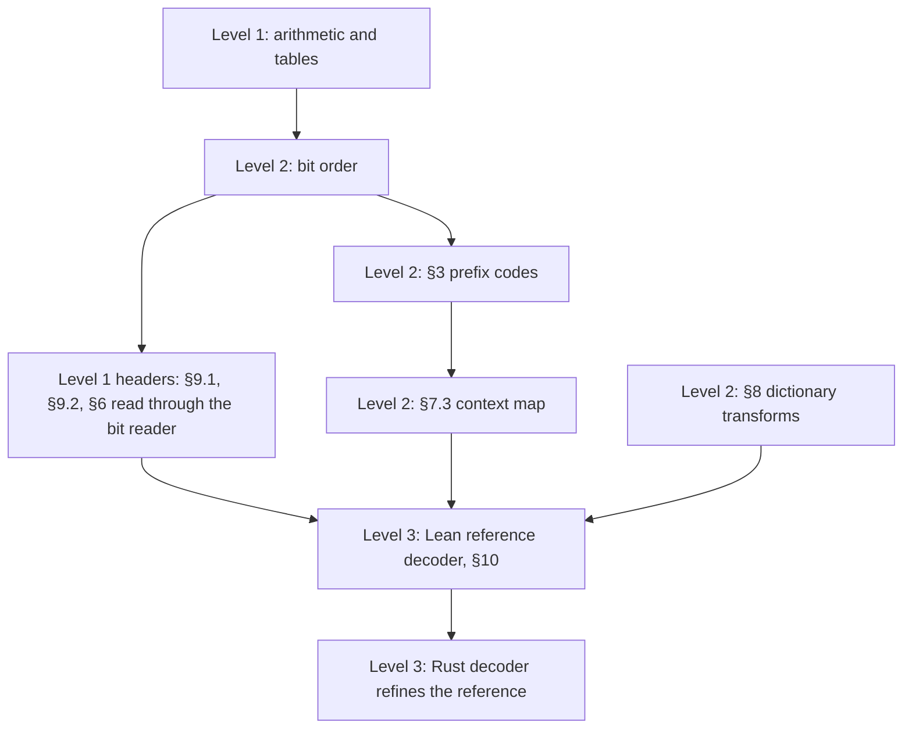

# Formal verification

Machine-checked Lean 4 proofs about the Rust implementation. The Rust source of
selected items is translated into Lean by [Charon](https://github.com/AeneasVerif/charon)
and [Aeneas](https://github.com/AeneasVerif/aeneas); hand-written theorems then
prove properties of that translation. Today the proofs cover, on both sides of
the codec, the distance prefix codes of RFC 7932 section 4 and RFC 9841, and the
insert-and-copy length codes of section 5 with the distance context of section
7.2.
This document describes what is verified, how the translation stays tied to the
Rust code, what the proofs trust, and what is not covered.

## Ownership boundaries

| Path | Owner | Contents |
| --- | --- | --- |
| `scripts/extract_lean.py` | hand-written | Pins the Aeneas release, lists the translated items, regenerates or checks the translation |
| `verification/lean/Mbrotli/Code/Types.lean`, `Code/Funs.lean` | generated, never edited | Aeneas translation of the listed Rust items |
| `verification/lean/Mbrotli/Code/FunsExternal.lean` | hand-written models | The four standard-library functions the translation calls and the Aeneas library does not model |
| `verification/lean/Mbrotli/Model.lean` | hand-written specification | RFC distance arithmetic over unbounded naturals |
| `verification/lean/Mbrotli/Rfc.lean` | hand-written transcription | The section 4 short codes and initial ring, the section 5 length code tables and cell diagram and the section 7.2 rule, as printed, with consistency checks |
| `verification/lean/Mbrotli/*.lean` (others) | hand-written proofs | Specifications of the generated functions, the round-trip and uniqueness theorems |
| `verification/lean/lakefile.lean`, `lean-toolchain`, `lake-manifest.json` | hand-written pins | Lean 4.35.0 and the Aeneas Lean library at the same commit as the binaries |

The Lean project is not part of the Cargo workspace and nothing in `src/` refers
to it: no attribute, feature or dependency was added to the crate. Charon
compiles the ordinary crate with its own nightly toolchain into
`target/charon/`, so the stable build is untouched.

```mermaid
graph TD
    Rust[src: command.rs, shared/distance.rs, shared/format.rs, fast_log.rs, decompressor/core/distance.rs, commands in decompressor/core/stream.rs] -->|Charon: rustc MIR| LLBC[LLBC]
    LLBC -->|Aeneas -split-files| Code[Mbrotli/Code/Types.lean, Funs.lean: generated]
    Ext[Mbrotli/Code/FunsExternal.lean: std models] --> Code
    Script[scripts/extract_lean.py] -.drives and pins.-> LLBC
    Script -.--check compares.-> Code
    Script -.EXTERNALS must match.-> Ext
    AeneasLib[Aeneas Lean library: Result monad, scalar models, step tactic] --> Code
    Mathlib[Mathlib] --> Model
    Model[Mbrotli/Model.lean: RFC formulas] --> Dec
    Model --> Enc
    Code --> Basic[Mbrotli/Basic.lean: platform facts, log2 spec]
    Basic --> Dec[Mbrotli/DecoderDistance.lean]
    Basic --> Enc[Mbrotli/EncoderDistance.lean]
    Dec --> RT[Mbrotli/DistanceRoundTrip.lean]
    Enc --> RT
    RT --> Uniq[Mbrotli/DistanceUniqueness.lean]
    RT --> Audit[Mbrotli/Audit.lean: axiom check]
    Uniq --> Audit
    Rfc[Mbrotli/Rfc.lean: RFC tables] --> Tables[Mbrotli/LengthTables.lean]
    Basic --> Tables
    Tables --> Cmd[Mbrotli/DecoderCommands.lean]
    Tables --> EncL[Mbrotli/EncoderLength.lean]
    Cmd --> LRT[Mbrotli/LengthRoundTrip.lean]
    EncL --> LRT
    LRT --> EncC[Mbrotli/EncoderCommand.lean]
    Enc --> EncC
    EncC --> Audit
    LRT --> Audit
    Basic --> Ring[Mbrotli/DistanceCache.lean]
    Rfc --> Ring
    Ring --> Res[Mbrotli/DecoderDistanceResolve.lean]
    Dec --> Res
    Res --> Audit
```

## Translation

`START` in the script names the items to translate; Charon follows everything
they call. `EXCLUDE` drops the decoder methods that allocate (`table`,
`fill_table`, which call `Vec::try_reserve_exact`) and the SIMD-generic
command-extension search in `shared::command`.

Aeneas runs with `-split-files`, writing the types to `Code/Types.lean` and the
functions to `Code/Funs.lean`. Standard-library functions the Aeneas library
has no model for land in a template of axioms; the script compares their names
with `EXTERNALS` and fails if the set changes. Today there are four:
`u64::try_from(u128)`, `u64::checked_add_signed`, `Option::ok_or_else` and
`Option::filter`, modelled by hand in `Code/FunsExternal.lean` after their
documented behaviour. No axiom reaches the proofs.

Aeneas runs with `-loops-to-rec`. The translated code lives in Aeneas'
`Result` monad: every `+`, `-`, `*`, shift, cast and index becomes an operation
that fails on overflow, out-of-range shift or out-of-bounds index, exactly as a
debug build panics. `wrapping_*` calls are modelled as wrapping. A proof that a
function returns `ok` is therefore a proof that it cannot panic on those inputs.

Aeneas records each item's source line range; the script strips the ranges and
keeps the file name, so moving code without changing it leaves the
translation unchanged. `--check` regenerates into a temporary directory and fails on any
difference.



## Specification

`Mbrotli/Model.lean` restates the arithmetic with unbounded naturals. For
`NPOSTFIX = p`, `NDIRECT = nd` and an encoder distance code `dc` past the
short and direct codes:

- `dist p nd dc = 2^(p+2) + dc - 16 - nd`, the value the encoder splits;
- `nbits`, `prefixBit`, `postfixBits`, `extra` and `symbol` are the encoder's
  split of `dist` (the bucket width, the bit below the leading one, the low `p`
  bits, the extra field and the emitted symbol);
- `width p nd sym` and `decode p nd sym ex` are the decoder side, the formulas
  of RFC 7932 section 4 verbatim.

RFC 7932 fixes only the decoder. `decode` and `width` are the specification;
the encoder-side definitions describe what this encoder computes and are
justified only by the round-trip theorem below, not by agreement with the C
library.

Pure lemmas over the model:

| Lemma | Statement |
| --- | --- |
| `decompose` | every `d ≥ 2^(p+2)` equals `(2 + prefixBit)·2^(nbits+p) + extra·2^p + postfixBits`, with `nbits ≥ 1`, `prefixBit < 2`, `extra < 2^nbits`, `postfixBits < 2^p` |
| `symbol_fields` | the decoder's `code >> p & 1`, `code & (2^p - 1)` and `1 + (code >> (p+1))` of an emitted symbol are its prefix bit, postfix bits and width |
| `decode_symbol` | `decode p nd (symbol p nd d) (extra p d) + 2^(p+2) = d + nd + 1`, and the extra field fits the width the decoder reads |
| `symbol_lt` | `d < 2^(n+p+2)` keeps the symbol below `16 + nd + 2n·2^p` and the width at most `n` |
| `split_unique` | the converse of `decompose`: a value written in that form has exactly those fields |
| `encode_decode` | for every symbol past the direct codes and every extra field of its width, re-encoding the decoded value returns the same symbol and field |
| `decode_injective` | two symbols `≥ 16` with extra fields of their widths that decode to the same distance are equal, field included; direct codes decode to at most `nd`, all others to more |

## Function specifications

Each theorem is tagged `@[step]` and states, in the `f args ⦃ r => P r ⦄`
form, that the generated function returns `ok r` (no panic, no overflow) and
that `r` satisfies `P`.

| Rust item | Preconditions | Result |
| --- | --- | --- |
| `shared::fast_log::log2_floor_non_zero` | `value ≠ 0` | `Nat.log 2 value` |
| `shared::command::prefix_encode_copy_distance` | `p ≤ 3`, `nd ≤ 120`, `16 + nd ≤ dc ≤ 2^31 + 15` | `code = 1024·nbits + symbol`, `extra = Model.extra` |
| `shared::distance::DistanceParams::new` | `p ≤ 3`, `nd ≤ 120` | `alphabet_size_max = 16 + nd + 48·2^p`, `max_distance + 2^(p+2) = nd + 2^(26+p)` |
| `DistanceLayout::from_header` | `header < 64` | `postfix = header % 4`, `direct = header / 4 · 2^(header % 4)` |
| `DistanceLayout::alphabet` | `postfix ≤ 3`, `direct ≤ 120` | `16 + direct + (48 or 124)·2^postfix` |
| `DistanceLayout::extra_bits` | layout bounds, `symbol < 2048` | `Model.width` |
| `DistanceLayout::short_window_distance` | `16 ≤ symbol < 16 + nd + 48·2^p`, `extra < 2^width` | `Model.decode`, computed in `u64` |
| `DistanceLayout::long_distance` | `16 ≤ symbol < 16 + nd + 124·2^p`, `extra < 2^width` | `Model.decode`, computed in `u128` |
| `shared::format::INS_BASE`, `INS_EXTRA`, `COPY_BASE`, `COPY_EXTRA` (indexing) | `i < 24` | the RFC row's first length or extra-bit count |
| `decompressor::core::stream::CELLS` (indexing) | `k < 11` | the RFC cell's first insert code plus its first copy code divided by eight |
| `decompressor::core::stream::commands` | none | for every symbol `s < 704`, the entry is `Command.Rfc s` (see below) |
| `shared::command::insert_length_code` | `insertlen ≤ 16799809` | the code whose RFC range holds `insertlen` |
| `shared::command::COPY_LENGTH_CODES` | none | entry `l` is the code of length `l`, for `2 ≤ l < 2118` |
| `shared::command::copy_length_code` | `2 ≤ copylen ≤ 16779333` | the code whose RFC range holds `copylen` |
| `shared::command::combine_length_codes` | both codes `< 24` | `combineModel`, the RFC cell's symbol (see below) |
| `shared::command::length_code` | both lengths in range | a symbol below 704 whose RFC codes hold both lengths, implicit exactly when asked and allowed |
| `shared::command::prefix_encode_copy_distance` (`spec_direct`, `spec_any`) | `dc < 16 + nd`; any `dc ≤ 2^31 + 15` | the code is `dc` with no extra bits; the low ten bits are 0 exactly for `dc = 0` |
| `Command::new` | lengths in range, `copylen < 2^25`, `-64 ≤ delta ≤ 63`, `dc ≤ 2^31 + 15` | `Command.Lengths`: the insert length, `copy_len = copylen + deltaField delta · 2^25`, and a symbol whose RFC codes hold the insert length and `copylen + delta`, implicit only for `dc = 0` |
| `Command::copy_len_code` | `copy_len = L + deltaField d · 2^25`, `L < 2^25`, `-64 ≤ d ≤ 63`, `0 ≤ L + d` | `L + d` |
| `Command::extra_bits` | as above, lengths in range | the insert field `insertlen - lo` in the low `INS_EXTRA` bits, the copy field `K - lo` above, width the sum of both extra-bit counts |
| `Command::distance_context` | none | `encoderContext`, which equals the section 7.2 context of every copy length the symbol can carry |
| `Command::has_distance` | none | a copying command writes a distance symbol exactly when its symbol is not implicit |
| `Command::insert_only` | `insertlen ≤ 16799809` | `Command.Lengths` with no copy and copy code of length 4, never implicit |
| `Cache::default` | none | `ring = [4, 11, 15, 16]`, the RFC's initial ring, most recent first |
| `Cache::recent` | `back < 4` | the `back`-th most recent distance |
| `Cache::push` | none | `ring' = d :: ring.take 3` |
| `Cache::pop` | none | returns the most recent distance; `ring' = ring.tail ++ [most recent]`, so `pop` then `push y` gives `y :: ring.tail` (`Cache.pop_push`) |
| `DistanceLayout::short` | `symbol < 16` | `Ok` of the RFC value (the listed past distance plus its offset) when it lies in `1..=2^63 - 4`, `Err(InvalidData(Distance))` otherwise |
| `DistanceLayout::resolve_large` | as `long_distance` | `Ok(Model.decode)` when it fits in `u64`, the distance error otherwise |
| `DistanceLayout::resolve` | symbol in the layout's alphabet, extra of its width | `Ok(rfcDistance)`: short symbols against the ring, the others by `Model.decode`; the distance error exactly as `short` and `resolve_large` give it |
| `DistanceLayout::validate_symbol` | layout bounds | `Ok` exactly for `ValidSymbol`: inside the alphabet and, past the short codes, unable to exceed `2^63 - 4` with any extra field |

All statements hold for both 32- and 64-bit `usize`: the proofs only use
`32 ≤ System.Platform.numBits ≤ 64`.

## Round-trip theorems

`distance_round_trip` (standard window) and `large_distance_round_trip`
(RFC 9841) compose the encoder and decoder specifications:



For every header, every encoder alphabet `DistanceParams::new(p, nd)` and every
distance code with `16 + nd ≤ dc` and `dc - 15 ≤ max_distance`:

1. the encoder returns without panicking;
2. the decoder's alphabet for that header equals the encoder's
   `alphabet_size_max`, and contains the emitted symbol;
3. the decoder reads exactly the width the encoder packed into bits 10..15;
4. `short_window_distance` returns `dc - 15`, the distance.

The large-window theorem gives the same for every distance up to
`MAX_ALLOWED_DISTANCE` (`2^31 - 4`), the 124-bucket alphabet and
`long_distance`.

## Uniqueness theorems

`distance_code_unique` and `large_distance_code_unique` take the same
hypotheses as the round-trip theorems and state the converse: for every symbol
`s ≥ 16` inside the alphabet and every field shorter than the width
`extra_bits(s)` returns, if `short_window_distance` (respectively
`long_distance`) resolves them to the distance, then `s = code & 0x3FF` and the
field is the encoder's extra field.



The statements cover explicit distance codes only. The sixteen short codes
refer to the decoder's cache of recent distances, so an encoder may also write
a distance as one of them (this one and Google's C encoder do, on a cache
hit). Among explicit codes, any encoder that produces a decodable stream,
Google's included, must write the pair this encoder writes.

## Length codes

RFC 7932 section 5 sends an insert length and a copy length as one of 704
insert-and-copy length symbols plus two extra fields. `Mbrotli/Rfc.lean`
transcribes the two code tables (extra bits and printed range for codes 0 to
23), the cell diagram (the first insert and copy code of each 64-symbol block),
the rule that symbols below 128 reuse the last distance, and the section 7.2
distance context. It checks its own transcription: every printed range holds
`2^extra` lengths and each range starts where the previous one ends.



`Command.Rfc s e` says the decoder's entry `e` for symbol `s` holds the insert
and copy codes the cell diagram gives `s`, their first lengths and extra-bit
counts, `implicit = (s < 128)`, and, for every copy length in the copy code's
range, the distance context section 7.2 assigns to that length. The decoder
stores the context of the code's first length; `distanceContext_of_code` shows
that this is the context of every length of the code, because codes starting at
four or below have no extra bits.

`combineModel` restates the encoder's bit arithmetic, including the constant
`0x520D40` that packs the cell order. Over all 24 · 24 · 2 inputs, checked by
`decide +kernel`, it lands in the RFC cell of its two codes and is implicit
exactly when the caller asked for the last distance and the codes allow it
(insert code below 8, copy code below 16); over all 704 symbols it inverts the
cell diagram, so the diagram is a bijection.

`length_round_trip`: for every insert length up to 16799809 and copy length
from 2 to 16779333, the decoder's entry for the encoder's symbol has
`insert_base ≤ insertlen < insert_base + 2^insert_extra`, the same for the copy
length, the implicit flag the encoder asked for, and the copy length's distance
context.

`length_code_unique`: every symbol whose RFC codes cover the same two lengths
and which agrees on reusing the last distance is the encoder's symbol, so any
encoder emitting these lengths with this distance choice emits the same symbol.

## Short codes and the ring of last distances

`Mbrotli/Rfc.lean` transcribes section 4's list of the sixteen short symbols
(which past distance each refers to and the offset added to it) and the ring
the stream starts with, `4, 11, 15, 16` most recent first. `Cache.ring` reads
the decoder's four slots off in that order: the `k`-th most recent distance is
slot `(index + 3 - k) mod 4`, which `Cache::recent` computes as
`(index - 1 - k) & 3` with a wrapping subtraction, equal because the width of
`usize` is a multiple of four.



`validated_resolve`: for a symbol `validate_symbol` accepted, past the short
codes, every extra field of its width resolves to `Ok(Model.decode)`. The
distance grows with the extra field (`decode_mono`), the header checked the
largest one against `2^63 - 4`, and that is below `u64::MAX`, so the
large-window conversion cannot fail, as the comment in `resolve` claims.

RFC 7932 rejects a short symbol that resolves to zero or a negative value. The
decoder also rejects values above `2^63 - 4`; that bound is an implementation
limit, stricter than the RFC, and no window or dictionary reference reaches it.

## Commands

`Command` (in `shared/command.rs`) stores the copy length in bits 0..24 of
`copy_len` and a seven-bit signed delta in bits 25..31, the difference between
the length a static-dictionary match copies and the length its symbol encodes.
`deltaField d` is that seven-bit field. `Command::new` writes it as
`delta as i8 as u8 as u32` shifted by 25; `copy_len_code` reads it back by
copying bit 6 into bit 7 and reading the byte as `i8`. Both are checked over all
128 deltas from -64 to 63.



`command_round_trip`: for every command `Command::new` builds from lengths and
a delta the format can carry, the decoder's table entry for its symbol reads the
command's extra bits back as both lengths: the low `insert_extra` bits added to
`insert_base` give the insert length, the bits above them added to `copy_base`
give `copylen + delta`, and `bits < 2^n`. The entry is implicit only for
distance code 0, and the encoder's `distance_context` equals the entry's, the
section 7.2 context of the copy length. Reading the low bits as the insert field
is the RFC's order on the assumption, not yet proved, that the bit writer emits
a field least significant bit first.

`Mbrotli/Audit.lean` checks with `#guard_msgs` that the four distance theorems,
`length_round_trip`, `length_code_unique`, `commands.spec`,
`command_round_trip`, `resolve.spec`, `validated_resolve`, `Cache.pop_push` and
`Cache.default.spec` depend only on
`propext`, `Classical.choice` and `Quot.sound`; a `sorry`, `native_decide` or
new axiom fails `lake build`.

## Trusted base

A theorem here is a statement about the Rust code only if these hold:

- Charon and Aeneas translate the MIR of the listed items faithfully, including
  overflow, shift and cast semantics;
- the Aeneas Lean models of the scalar operations used (`leading_zeros`,
  shifts, casts, `wrapping_*`) match Rust;
- rustc's MIR for those items matches the code the release build runs (the
  translation is of the nightly MIR Charon sees, without optimizations);
- the models in `Code/FunsExternal.lean` of `u64::try_from(u128)`,
  `u64::checked_add_signed`, `Option::ok_or_else` and `Option::filter` match
  the standard library; each is a few lines and follows its documentation;
- Lean's kernel and the three standard axioms;
- `Model.decode` and `Model.width` transcribe RFC 7932 section 4 correctly,
  and `Mbrotli/Rfc.lean` transcribes the section 4 short codes and initial
  ring, the section 5 tables and the section 7.2 rule correctly. Both are short enough to read against the RFC; the tables
  also check their own widths and contiguity.

Finite facts (table contents, the 1152 symbol combinations, the 704-symbol
inverse) are checked with `decide +kernel`, which the kernel evaluates; no
`native_decide` is used.

Nothing relies on a hand-written restatement of the Rust code.

A mutation check confirms the coupling: changing `- 4` to `- 5` in
`short_window_distance` makes `extract_lean.py --check` fail, and after
regeneration `DistanceLayout.short_window_distance.spec` no longer proves.
Changing the last entry of the decoder's `CELLS` from 18 to 17 does the same to
the table proof in `LengthTables.lean`, and widening the sign bit in
`copy_len_code` with `<< 2` instead of `<< 1` breaks `Command.copy_len_code.spec`,
and starting the ring at `17, 15, 11, 4` instead of `16, 15, 11, 4` breaks
`Cache.default.spec`.

## Checks

```sh
python3 scripts/extract_lean.py --check   # translation matches the Rust source
cd verification/lean && lake exe cache get && lake build   # proofs and axiom audit
```

`ci-lean.yml` runs both on every push to master and every pull request. The
proofs check in under a minute once Mathlib's prebuilt cache is present.

## Known gaps

### Inside the verified items

Open RFC items are tracked in the [coverage checklist](#coverage-checklist);
these are the limits of what is already proved.

- The decoder's command loop, which adds the extra fields to `insert_base` and
  `copy_base`, lives in `decompressor/core/stream.rs` and is not translated; the
  proofs cover the table it reads, not the addition. Likewise the constant
  `COMMANDS` is `commands()` by its Rust definition, which is not translated.
  The loop's slow path, `Stage::Command` to `Stage::CopyExtra`, recomputes the
  insert and copy codes from `CELLS` inline instead of reading the table, so
  that copy of the cell formula is not covered either.
- The `experimental` branches of `Command::new` and `Command::copy_len_code`,
  which store an absolute length for long RFC 9841 transforms, are outside the
  default-feature translation.
- When the decoder pushes to the ring is decided in the command loop of
  `decompressor/core/stream.rs`, which is not translated: that symbol 0 and
  static dictionary references are not pushed is not proved, only that `pop`
  then `push` replaces the most recent distance and `push` adds one.
- That the bit writer emits each field least significant bit first, which turns
  `command_round_trip`'s split of `bits` into the RFC's insert-then-copy order,
  is the bit-order item of the checklist.
- Uniqueness says nothing about when an encoder should prefer a short
  (cache) code over the explicit one; that choice affects compression only.
- Byte-for-byte agreement with Google's C library is outside the proofs; it
  stays with the differential tests and fuzzing.

## Coverage checklist

Progress against RFC 7932, ticked when an item's theorems build and pass the
axiom audit. RFC 7932 constrains the format and the decoder; the encoder only
has to emit what that decoder accepts and reads back, so match finding, block
splitting, clustering and cost models stay out of scope. Levels are ordered by
cost; each later level builds on the earlier ones.



### Level 1: arithmetic and tables

- [x] §4 explicit distance codes: encoder and decoder arithmetic, round trip
  and uniqueness in standard and large-window streams
  (`DistanceRoundTrip.lean`, `DistanceUniqueness.lean`).
- [x] §4 short codes: the sixteen codes' indices and offsets as the RFC lists
  them, rejection of zero and overflowing distances (`DistanceLayout::short`,
  `DecoderDistanceResolve.lean`).
- [x] §4 distance cache: the four-slot ring with its initial `4, 11, 15, 16`
  (most recent first), `push`, `pop` and `recent` (`DistanceCache.lean`).
- [x] §4 full resolution: `DistanceLayout::resolve`, `resolve_large` and
  `validate_symbol` against the RFC, and `validated_resolve`
  (`DecoderDistanceResolve.lean`).
- [ ] §4 ring update policy: symbol 0 and static dictionary references are not
  pushed (the command loop in `decompressor/core/stream.rs`).
- [ ] §4 table-driven split: `DistanceLayout::entry` and `standard_table`
  give `base + (extra << NPOSTFIX)` equal to the RFC distance.
- [ ] §4 large-window alphabet limit: `DistanceParams::new_large` and
  `distance_code_limit` against RFC 9841.
- [x] §5 length code tables: `INS_BASE`, `INS_EXTRA`, `COPY_BASE`,
  `COPY_EXTRA` and `CELLS` equal the RFC's (`LengthTables.lean`).
- [x] §5 decoder command table: every entry of `commands()`, including the
  §7.2 distance context (`DecoderCommands.lean`).
- [x] §5 encoder length codes: `insert_length_code`, `copy_length_code`,
  `combine_length_codes`, `length_code`; round trip and uniqueness
  (`EncoderLength.lean`, `LengthRoundTrip.lean`).
- [x] §5 commands: `Command::new`, `copy_len_code`, `extra_bits`,
  `distance_context`, `has_distance`, `insert_only` and `command_round_trip`
  (`EncoderCommand.lean`).
- [ ] §5 decoder addition of the extra fields in the command loop
  (`decompressor/core/stream.rs`; needs the cell formula and the additions
  factored out of the streaming state machine).
- [ ] §9.1 WBITS: one-, four- and seven-bit forms round-trip, are unique and
  reject the reserved value; the RFC 9841 large-window form
  (`decompressor/core/header.rs` `window`, the encoder's header writer).
- [ ] §9.2 MNIBBLES and MLEN round-trip; a nibble count above four with a zero
  top nibble is rejected (`shared/bitstream.rs` `encode_mlen`, `header.rs`
  `metablock`).
- [ ] §6 block switches: block type codes (previous, last + 1, explicit) on
  both sides; the 26 block count codes equal the RFC table
  (`decompressor/core/block.rs`, `PREFIX_CODE_RANGES` in `shared/format.rs`).
- [ ] §7.1 context lookup: the LSB6, MSB6, UTF8 and Signed tables equal the
  RFC formulas (`CONTEXT_LUT_*` in `shared/format.rs`, `context_lut` in
  `stream.rs`).

The §9 and §6 decoder functions read through the bit reader, so their
decoder-side proofs need the level 2 bit-order lemmas first; the encoder-side
arithmetic does not.

### Level 2: stateful decoding

- [ ] Bit order (section 2): what `shared::bits::BitWriter` writes least
  significant bit first is what the decoder's `Bits` reservoir reads; the
  reservoir keeps `count ≤ 64`, and `refill` and `unread` lose no byte.
- [ ] §3.2 canonical prefix codes from code lengths.
- [ ] §3.4 simple prefix codes with NSYM and tree-select.
- [ ] §3.5 complex prefix codes: the code length code order, repeat codes 16
  and 17 including accumulated repeats, and the requirement that
  `32768 >> length` sums to 32768.
- [ ] Decoder Huffman tables: the two-level tables in
  `decompressor/core/huffman.rs` decode like a bit-by-bit canonical walk, and
  incomplete or oversubscribed codes are rejected.
- [ ] Encoder Huffman lengths (`shared/huffman.rs`): at most 15, Kraft with
  equality, and their run-length form reads back to them.
- [ ] §7.3 context maps: RLEMAX zero runs and inverse move-to-front in
  `decompressor/core/context_map.rs` against the encoder's move-to-front in
  `shared/bitstream.rs`.
- [ ] §8 and appendix B: the 121 transforms equal appendix B; `ferment` follows
  the RFC's UTF-8 uppercasing; the word address follows NDBITS. The 122 KiB
  word list itself is better compared with the RFC data by a test.

### Level 3: the decoder as a whole

- [ ] A Lean reference decoder transcribing the section 10 pseudo-code,
  compiled and used as a second oracle beside C in the fuzz targets and tests:
  evidence rather than proof, but independent of the C implementation.
- [ ] A refinement proof that the baseline path of the Rust decoder in
  `decompressor/core/stream.rs` computes the reference decoder's output for any
  chunking of the input. SIMD paths, which Aeneas cannot translate, stay with
  the differential tests, Miri and AddressSanitizer.

Outside RFC coverage, SIMD kernels, the parallel and framed layers, match
finding and the rest of the crate are not verified.
