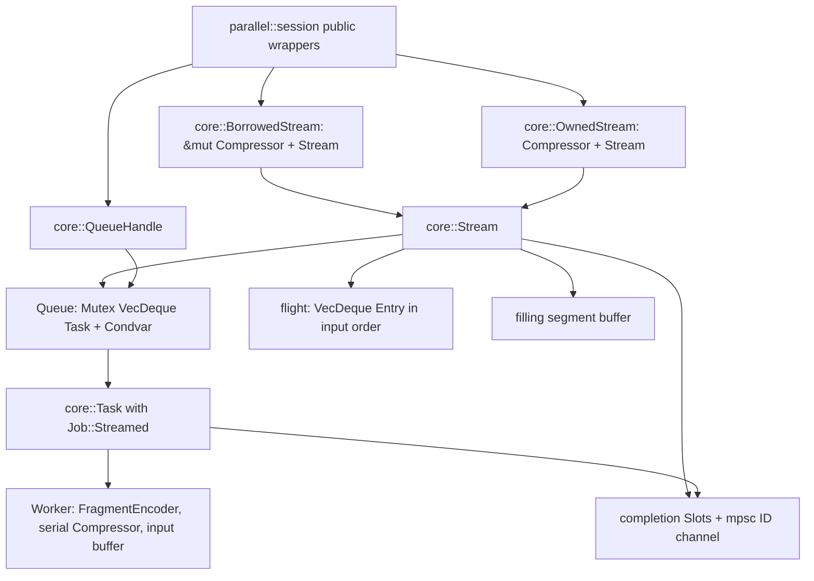
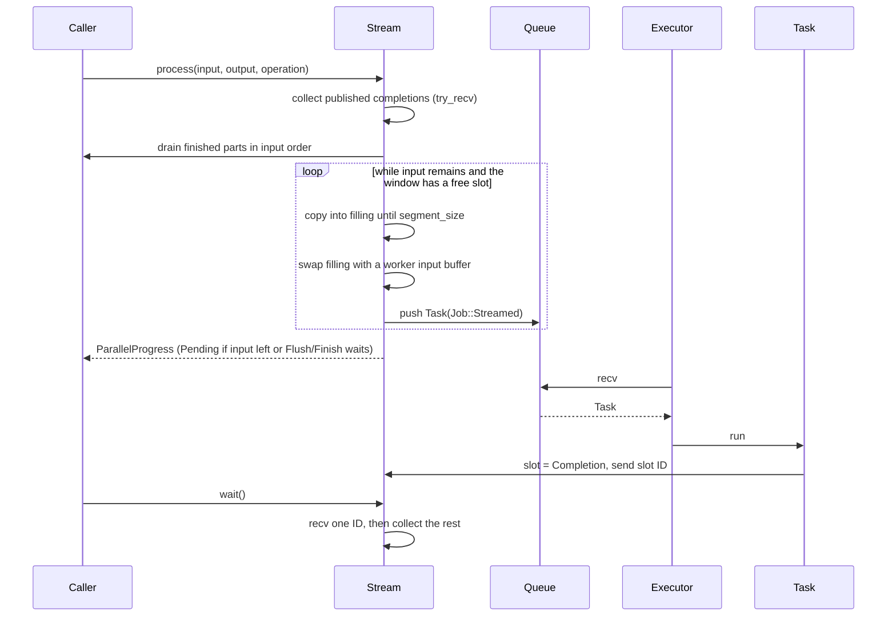
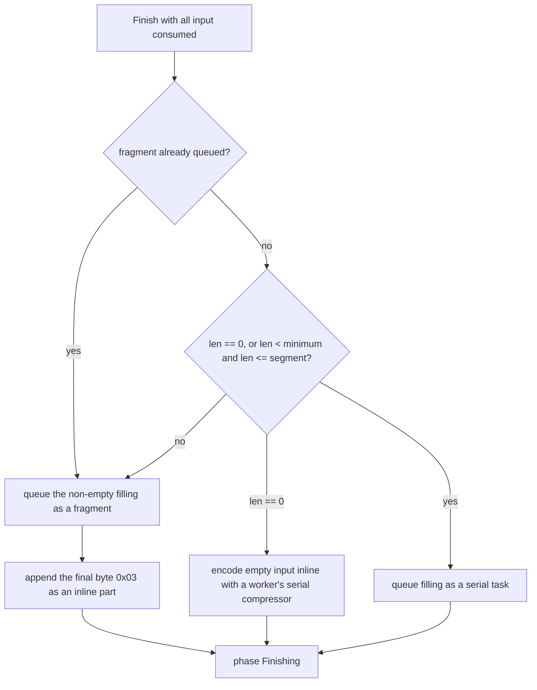
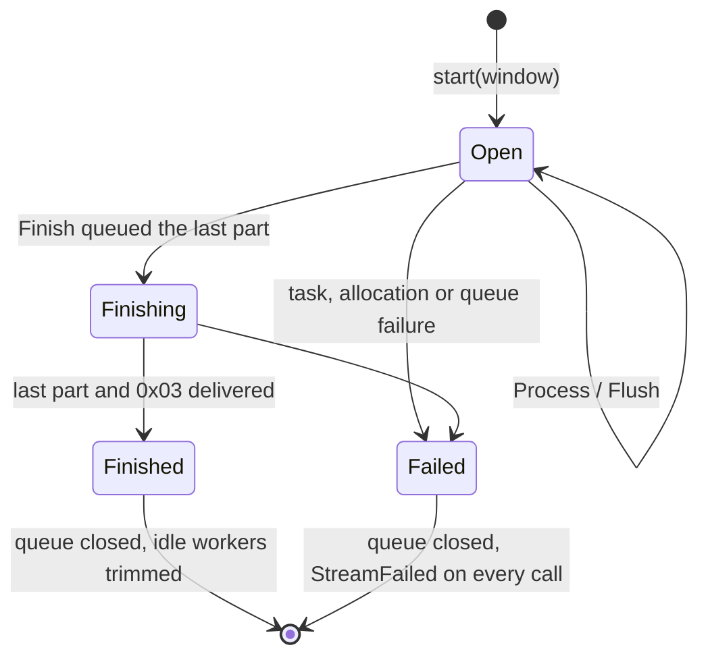
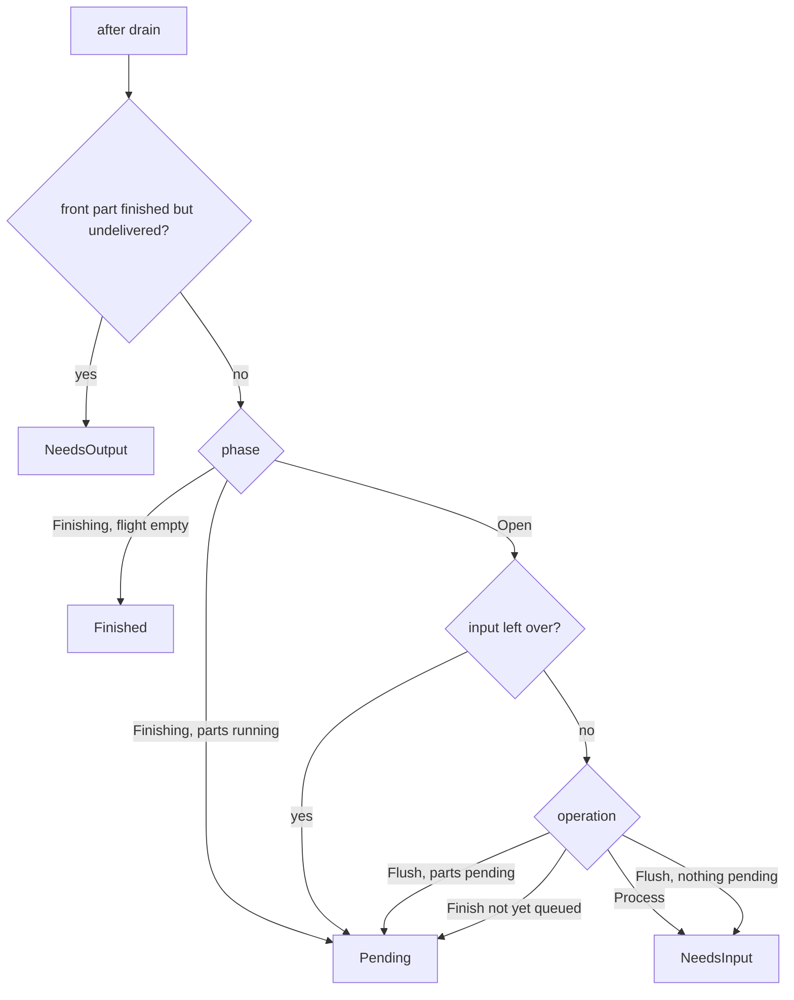

# Parallel streaming sessions

This subsystem is omitted when `no_std` is enabled. It extends
[parallel compression](parallel-compression.md) from a known input to input that
arrives in chunks: a session accepts bytes incrementally, turns every full
segment into a task on a shared queue, and delivers finished parts in input
order while later segments still encode.

## Public and ownership boundaries

`compressor::parallel` exposes:

| Item | Role |
| --- | --- |
| `ParallelCompressor::start(window)` | Borrowed session `ParallelEncoderSession<'c>` plus a `ParallelTaskQueue`. |
| `ParallelCompressor::into_session(window)` | Owned `ParallelEncoderSessionOwned` plus a queue; `into_compressor` returns the parent. |
| `ParallelEncoderSession{,Owned}` | `process`, `flush`, `finish`, `wait`, `wait_timeout`, `is_finished`. |
| `ParallelEncoderStatus`, `ParallelProgress` | `NeedsInput`, `NeedsOutput`, `Pending`, `Finished`, with exact `consumed`/`produced`. |
| `ParallelTaskQueue`, `ParallelTasks` | `Clone + Send + Sync` handle with blocking `recv`, non-blocking `try_recv`, and a blocking iterator. |

`Operation` and `WaitStatus` are reused from the serial session and the batch
API. Errors are `ParallelEncodeError`, with two variants added for streams:
`StreamFailed(Arc<ParallelEncodeError>)` and `TaskQueueClosed`.

The public module `compressor::parallel::session` only wraps the private
`parallel::core::stream` module. There is still no executor trait, no
runtime dependency and no hidden thread: the caller's executors take tasks from
the queue.

`Stream` holds every piece of stream state except the parent compressor, which
each operation takes as an argument; the borrowed and owned sessions differ only
in where the parent lives, as the serial sessions do. `BorrowedStream`'s `Drop`
and `OwnedStream::into_parent` run the same `release` path. `Stream`'s own
`Drop` cancels and closes the queue, so an owned session dropped without
`into_compressor` still stops executors.

## Tasks and the shared job type

`core::Task` carries a `Job`:

- `Job::Planned { range, input, plan }` encodes a batch task's contiguous
  segments read from its slice or source.
- `Job::Streamed { segment, source, first, serial }` encodes one segment that
  the session has already moved into the worker's input buffer.

Both kinds share `Task::run` (unwind capture, cancellation checks, single
publication into a slot) and one `encode` helper that writes either a fragment
or the serial fallback into a memory `Artifact` and records its descriptor.
`ScopedParallelTask::segment_range` reports `segment..segment + 1` for streamed
tasks; `id` is the completion slot, at most `window - 1`.

The completion channel is an unbounded `mpsc` channel of slot IDs for both
batches and streams. A stream may outlive any fixed task count, and a bounded
channel would preallocate `window` entries.

## Data flow

Input is copied once, into `filling`. Dispatch swaps `filling` with the worker's
`input` buffer, so the session keeps the worker's previous allocation and the
task owns the segment without another copy. Output is copied once from a
finished part into the caller's slice; a part may take several calls.

## Window and backpressure

`window` (a `TaskCount`) bounds the parts that are queued, running, or finished
but not yet fully delivered. Each such part owns one completion slot; slots are
created on demand up to `window` and freed only when the part's last byte is
delivered. Workers come from the parent's idle reservoir or are created, and
return to it on completion, so a session creates at most `window` workers.
When the window is full and `filling` is full, `process` stops consuming input
and reports `Pending`. Memory is therefore bounded by `window` parts (worker,
input and staged output each) plus the filling buffer.

With an aggregate memory limit configured, `start` checks
`window * (worker estimate + 3 * segment + 5 KiB) + segment + retained bytes`
and returns `WorkerMemoryLimit` or `SizeOverflow` before creating anything. The
worker estimate is the batch planner's conservative per-quality ceiling.

## Byte identity and the serial fallback

Segments are `segment_size` bytes at stream offsets `k * segment_size`; the
first queued fragment carries the window header. A stream without `Flush` is
therefore byte-identical to `prepare_slice` over the same bytes, for every
chunking, window and execution order. Only the first segment is special: the
batch encodes an input serially when `len == 0` or
`len < minimum_parallel_size && len <= segment_size`. A full first segment is
held while that is still undecided, until a following byte arrives (fragments)
or `Finish` (serial, if the rule holds).

A queued part that cannot get a slot leaves the phase `Open`; the same `Finish`
call returns `Pending` and the next call retries.

`Flush` queues the non-empty filling buffer as a short fragment and reports
`NeedsInput` once every accepted byte has been delivered. Every fragment ends
byte-aligned, so the delivered prefix is decodable. A flush moves all later
segment boundaries, and once any fragment has been queued the serial fallback is
gone.

## Lifecycle and status

A call computes its status after draining:

After `Finish` has queued the last part, calls consume no input whatever their
operation and only deliver. `Finished` is idempotent.

`process` never blocks. `wait` blocks for one completion, or returns `Ready` at
once when nothing is running; `wait_timeout` returns `TimedOut` without
cancelling. A session whose queue handles are alive but never drained cannot
progress, which is why single-thread callers run `try_recv` tasks before
waiting.

## Queue closure, cancellation and errors

The queue is a `Mutex<VecDeque<Task>>` with a `Condvar`, a `closed` flag, and a
count of live handles. Only bookkeeping runs under its lock. It closes when the
stream finishes, fails, is released or dropped, and when the last handle drops.
Closing wakes every blocked `recv`, which then returns `None`, so
`for task in queue` loops end. Tasks still queued at closure are dropped outside
the lock; each publishes `TaskAbandoned`, returning its worker through its slot.

Errors propagate as follows:

| Cause | Stream observes |
| --- | --- |
| Every handle dropped before a push | `TaskQueueClosed` |
| Every handle dropped with tasks queued, or a taken task dropped | `TaskAbandoned` |
| Encoding, panic, or a staged-length violation in a task | the task's typed error |
| Allocation while filling or preparing a part | `Allocation` |
| Malformed or duplicate completion | `FragmentInvariant` |

Any failure sets the shared cancellation flag, closes the queue and moves the
stream to `Failed(Arc<cause>)`; that call and every later one return
`StreamFailed` with the cause as its source. A failing task sets the flag before
publishing, so another task can publish `Cancelled` first. The stream waits for
the originating error while parts still run and then reports the
lowest-segment non-cancellation cause.

Dropping or releasing a session sets the flag, closes the queue, collects the
completions already published without waiting, and trims the parent to its
retention policy. Tasks an executor already took keep their worker and release
it on completion; it cannot return to the parent.

## SIMD and dispatch

The session adds no dispatch. Workers build their fragment and serial encoders
on the backend the `ParallelCompressor` selected at construction, exactly as
batch workers do.

## Verification

- `tests/parallel_stream.rs`: byte identity with `prepare_slice` at every
  quality for whole, 1000-, 4097- and 64 KiB-byte chunks, windows 1–4, inline
  and 1–4 thread executors, and output buffers down to one byte; serial
  fallback and segment edges (0–3 bytes, one segment ±1, two segments) with
  and without the threshold; window backpressure; flush prefixes decoded by C;
  finishing and idempotent `Finished`; queue closure and task abandonment;
  session drop; owned sessions; memory limits; `Send`/`Sync` and `Debug`.
- Private unit tests cover malformed completions, cancellation-versus-cause
  ordering, queue-handle counting and single-segment artifact extraction.
- `fuzz/afl` target `parallel` streams each input with input-derived chunk
  size, window and optional mid-stream flush, running queued tasks in reverse
  order, and requires batch identity (or a round trip after a flush).
- `benches/parallel.rs` measures `stream-tasks/{1,4}` beside the batch
  `tasks/{1,4}` on the same corpora, after checking identical output.

## Known gaps

- No `process_uninit`, reader or writer adapter over the session yet.
- No directory staging: streamed parts are always staged in memory, bounded by
  the window.
- Cancellation granularity is that of batch tasks: a running segment finishes
  its codec call.
- `wait` cannot detect executors that hold queue handles but never run tasks.
