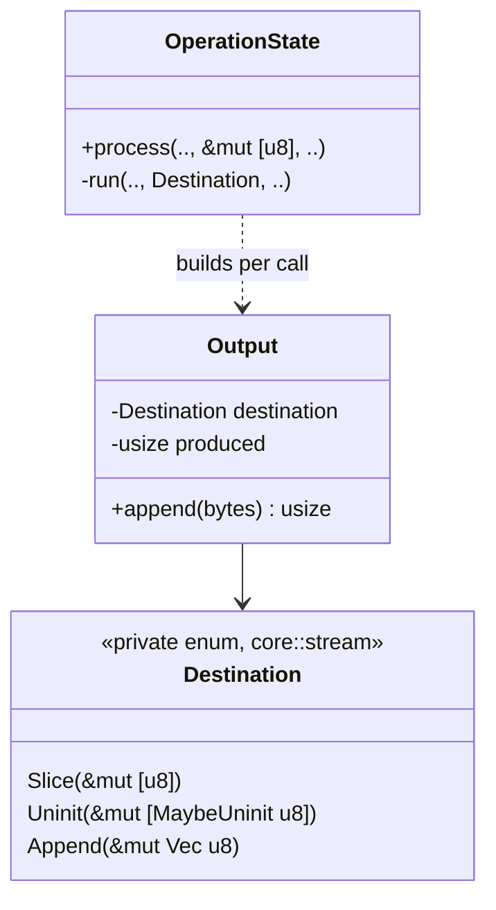
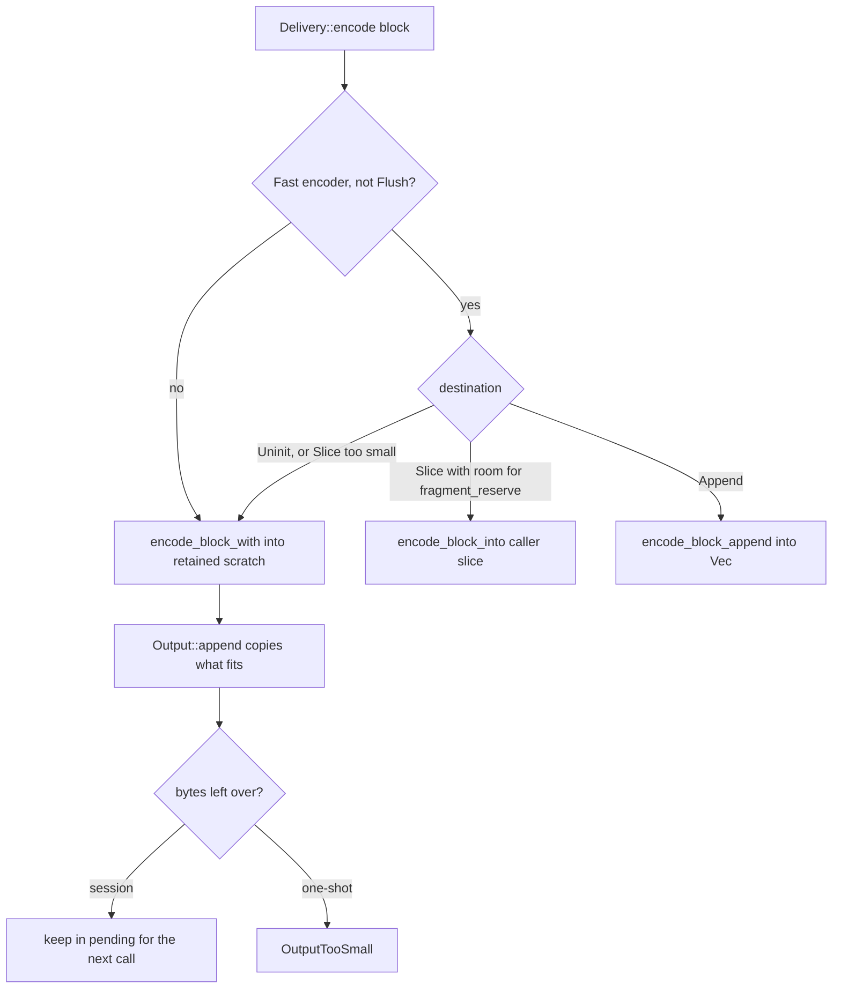
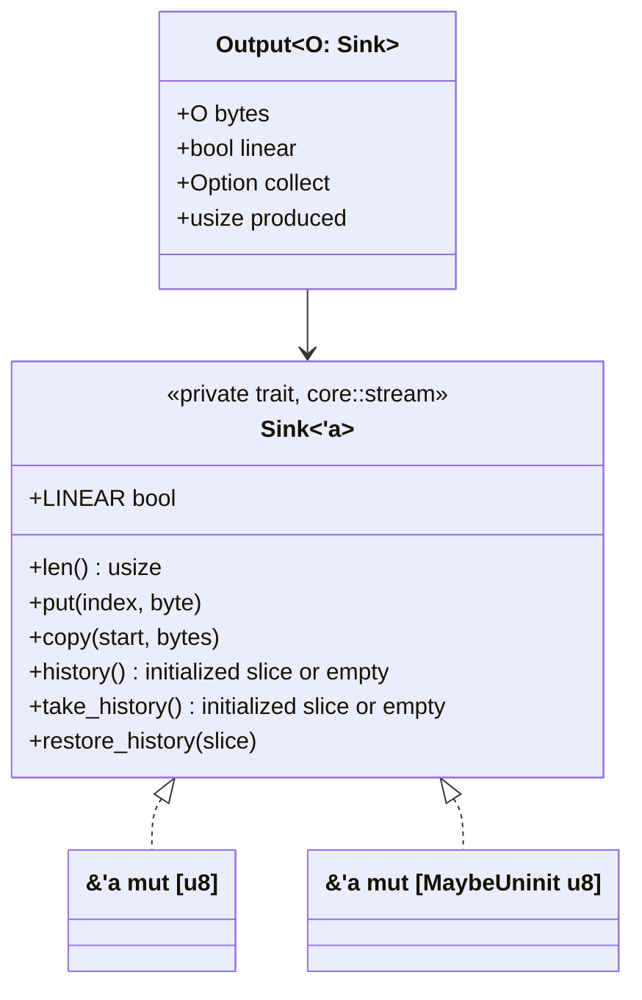
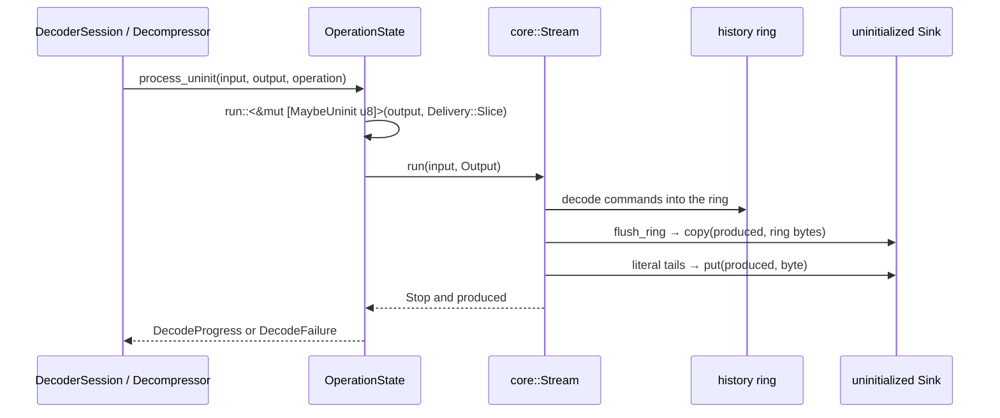
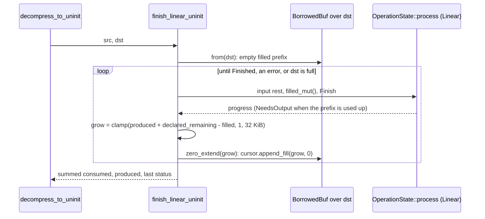
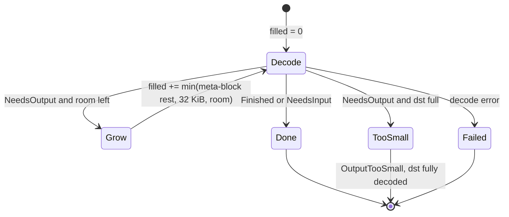

# Uninitialized output

Sessions and one-shot slice APIs have `*_uninit` siblings that write into
`&mut [MaybeUninit<u8>]`: spare `Vec` capacity, a foreign buffer, or C memory
that was never initialized. They produce the same bytes, counts, statuses and
errors as the initialized-slice methods, and the crate stays free of `unsafe`
(`src/lib.rs` forbids it outside tests). The one place that has to read back
what it wrote into such memory, the decoder's one-shot history, does it
through the `borrowed-buf` crate's `BorrowedBuf`, whose filled prefix is safe
to view as `&mut [u8]`.

## Public API surface

| Initialized | Uninitialized | Owner |
| --- | --- | --- |
| `EncoderSession::process` | `EncoderSession::process_uninit` | `compressor::session` |
| `EncoderSessionOwned::process` | `EncoderSessionOwned::process_uninit` | `compressor::session` |
| `Compressor::compress_to_slice` | `Compressor::compress_to_uninit` | `compressor::encoder` |
| `DecoderSession::process` | `DecoderSession::process_uninit` | `decompressor::session` |
| `DecoderSessionOwned::process` | `DecoderSessionOwned::process_uninit` | `decompressor::session` |
| `Decompressor::decompress_to_slice` | `Decompressor::decompress_to_uninit` | `decompressor::decoder` |

`flush` and `finish` have no uninitialized siblings: they are shorthands for
`process`. Dictionary one-shots and framed sessions have none either.

The contract every method keeps: on success exactly `output[..produced]` (or
`dst[..written]`) is initialized and no byte after it is written. Calls of the
initialized and uninitialized method may be mixed on one session. After a
decoder `DecodeFailure`, its `produced` prefix is initialized as well; after an
encoder error, or a decoder error other than `OutputTooSmall`, callers treat
the destination as uninitialized.

## Why a separate path

Safe Rust can write a `MaybeUninit<u8>` but can neither read one back nor view
a range of them as `&mut [u8]`; `write_copy_of_slice` (the only safe view, and
itself a copy) needs Rust 1.93 and the MSRV is 1.89. `BorrowedBuf` (a stable
port of `core::io::BorrowedBuf`) tracks how much of such a slice was written
and views exactly that prefix as `&mut [u8]`; its `unsafe` stays inside that
crate. Two fast paths read their destination:

- the q0/q1 in-place fragment writer (`FastEncoder::encode_block_into`),
  whose bit writer keeps a partial byte, writes 8-byte words read-modify-write,
  rewinds and patches meta-block headers in the caller's slice;
- the decoder's linear one-shot delivery (`Delivery::Linear`), which uses the
  caller's slice as the first member's history.

The encoder's uninitialized methods take the scratch path that already exists
for small destinations, followed by one copy, which measures as fast as the
in-place path. Streaming `process_uninit` delivers through the ring, since a
later call's destination cannot hold the paused member's history. The one-shot
`decompress_to_uninit` keeps linear delivery: it zeroes the destination one
meta-block ahead of the decoder (see [Linear one-shot
history](#linear-one-shot-history)).

## Compressor

`SessionCore` and `OwnedSessionCore` forward `process_uninit` to
`OperationState::run` with `Destination::Uninit`; `process` keeps its
`&mut [u8]` entry, which the framed resource driver also calls, and wraps it in
`Destination::Slice`. The one-shot `compress_to_slice_attached` and
`compress_to_uninit_attached` share `driver::compress_to_destination`, which
also writes the empty-input stream through `Output::append`.

`Output::append` copies into `Uninit` through `shared::uninit::copy_to_uninit`,
a `zip` + `MaybeUninit::write` loop that compiles to a `memcpy` and keeps the
MSRV. It copies exactly the bytes it counts, which is what makes the
"nothing past `produced`" contract hold; the in-place `Slice` path may leave
scratch bytes past `produced`, which initialized callers never relied on.

## Decompressor

Every write of decoded bytes into the destination goes through `Sink::put`
(per-byte literal tails, `emit`) or `Sink::copy` (ring flushes, stored
meta-blocks, prefix runs). The bulk command loop works on the ring or on the
linear slice it took out with `take_history` and hands back with
`restore_history`. Only the initialized slice can be linear history:
`history` and `take_history` return an empty slice for the uninitialized one,
`restore_history` accepts only that empty slice back, and an uninitialized
sink is only ever run with `Delivery::Slice` (by `process_uninit`), where
`linear` is false. Its
`Sink::LINEAR` constant is false as well, so `Stream::run` never selects the
linear state machine for it and that instantiation is never generated (see
[Owned decoder output](decoder-owned-output.md#linear-slice-history)).

`OperationState::run`, `Stream::run`, `run_stages`, `fast`, `emit`,
`flush_ring`, `copy_ring` and `write_ring` are generic over the sink, so each
destination type gets its own instantiation and no call chooses a variant at
run time. Below `Stream::run` they are also generic over `const LINEAR: bool`,
giving three instantiations: initialized linear, initialized ring and
uninitialized ring. The first version matched on a `Sink` enum inside those helpers;
the match itself was cheap, but `run_stages` inlines every stage and the
SIMD command loop into one function, and the extra arms changed that
function's register allocation. Decoding alice29 then executed 9% more
instructions (callgrind, q0 and q5) and the cold decoder comparison was 4-7%
slower on text and binary corpora. The initialized instantiation now compiles
to the same slice writes as before uninitialized output existed.

`decompress_to_uninit` first asks `stored_one_shot`, the check
`Decompressor::decompress` also uses, whether `src` is one complete stored
member under a configuration without limits or other members; if its payload
fits in `dst`, it is copied with `copy_to_uninit` and no session or ring is
created. Otherwise, including a stored payload that does not fit, it runs
`DecoderSession::finish_linear_uninit` on a fresh session and shares
`one_shot_outcome` with `decompress_to_slice`, so `OutputTooSmall` and
`TrailingData` are reported identically.

### Linear one-shot history

`finish_linear_uninit` wraps `dst` in a `BorrowedBuf<u8>` whose filled prefix
is the decoder's linear history: the bytes decoded so far plus zeros the
decoder is about to overwrite. Each round passes `filled_mut()` to
`OperationState::process` with `Delivery::Linear`, which resumes at
`total_out` with the earlier output in front of it as history (the first call
starts at an empty prefix). The initialized-slice instantiation of the decode
loop runs; no uninitialized one is involved.

The first call parses the window and meta-block headers and stops at the
first byte to write; from then on `declared_remaining` is the current
meta-block's undecoded length. Growing by at most that keeps the zeroed prefix
inside bytes the stream will produce, so on success nothing past `written` is
written, as for every uninitialized method. The decode loop already bounds its
speculative 16- and 32-byte copies by the meta-block end and the slice end.
A pause outside a meta-block's payload grows by one byte, which guarantees
progress. After the first member ends, later members (with
`MemberMode::Concatenated`) are delivered from the ring into the same growing
prefix at their offset.

`zero_extend` is one `BorrowedCursor::append_fill(len, 0)` (borrowed-buf
0.1.1), a memset; copying the zeros from a 4 KiB static block, the only way
before that method existed, took 3-7% longer on highly compressible data.
The 32 KiB cap (`ZERO_AHEAD_STEP`, shared with the `Vec` path of
`decompress_into`) keeps the freshly zeroed lines in L1 when the decoder
overwrites them: on exact-sized destinations (i7-13700KF, one core) caps of
16, 32 and 64 KiB took 1.023, 1.019 and 1.074 times as long as
`decompress_to_slice`. The ring path took 1.17 times, so the one-shot takes
12% less time than before in geometric mean: 15-20% on 1 MiB of text, 3-9%
on literary texts, 6-13% on binary and 28-41% on data compressed beyond
100:1; stored members and 1 KiB outputs are unchanged.

## C ABI

`mbrotli-ffi` views the caller's output as `&mut [MaybeUninit<u8>]` and calls
`compress_to_uninit` and `decompress_to_uninit`. Only a decoding destination
of at most 1 KiB is zeroed in full (`BorrowedBuf::ensure_init`) and decoded
with `decompress_to_slice`, which saves the extra decoding call per
meta-block. An uninitialized C buffer is never viewed as `&mut [u8]` before it
has been zeroed. See [C ABI](c-abi.md).

## Invariants

- An uninitialized destination is never read before it is written, and the
  uninitialized methods write no byte past the reported count. The decoder's
  linear one-shot reads back only `BorrowedBuf`'s filled prefix, which it
  wrote itself (decoded bytes or zeros). The C ABI may zero a whole
  destination first, as its header documents.
- Uninitialized and initialized methods produce identical streams: the fast
  encoder's in-place and scratch paths are already byte-identical, and ring and
  linear decoder delivery write the same bytes.
- The encoder chooses between `Destination` variants once per call or per
  helper invocation, never inside the SIMD copy kernels. The decoder does not
  choose at run time at all: it is monomorphized per `Sink` type, so the
  initialized decode loop carries no uninitialized-output code.

## Verification

- `tests/encode_uninit.rs`: `process_uninit` and mixed calls against `process`
  for every quality, two windows, output windows from 1 byte to 1 MiB (the
  latter drives the q0/q1 in-place path on the initialized side), sentinel
  checks past `produced`, owned sessions, and `compress_to_uninit` against
  `compress_to_slice` including short and empty destinations.
- `tests/decode_uninit.rs`: `process_uninit` against `process` across qualities,
  input chunks and output windows, a corrupt stream's failure progress, owned
  sessions, and `decompress_to_uninit` against `decompress_to_slice` for
  success, `OutputTooSmall`, trailing and truncated input; outputs many
  zeroing steps long, `OutputTooSmall` at every step boundary, concatenated
  members, output limits and corrupt input, each against
  `decompress_to_slice` with sentinels past the result.
- AFL: `encoder_session` and `decoder_session` drive borrowed and owned
  sessions with `process` and `process_uninit` mixed call by call, check that
  nothing is written past `produced`, and restart owned sessions with `reinit`
  from every state; `streaming_equivalence` and `output_capacity` compare
  `compress_to_uninit` with the initialized one-shots, and `decompress`
  compares `decompress_to_uninit` with ring delivery.
- Unit tests in `shared::uninit` (including `zero_extend`), resumable
  `Delivery::Linear` in `decompressor::core::session`, and the `mbrotli-ffi`
  core tests, which run on uninitialized destinations.

## Known gaps

- q0/q1 `process_uninit` and `compress_to_uninit` copy each block once from
  scratch; the initialized methods write it in place when the destination has
  room for a whole fragment.
- `decompress_to_uninit` writes every output byte twice, zero first: 1.2%
  slower than `decompress_to_slice` into an initialized slice in geometric
  mean, most on data compressed beyond 100:1 and on 1 MiB of repetitive text.
  Safe code cannot view memory as `&mut [u8]` before writing it; avoiding the
  zeroing would need a decode loop that writes only through the cursor.
- Each meta-block (each 32 KiB within one) costs `decompress_to_uninit` one
  more `OperationState::process` call. On 1 KiB outputs this leaves it about
  7% behind zeroing the whole destination; the C ABI does that below 1 KiB.
- `process_uninit` still delivers through the ring.
- No uninitialized variants for dictionary one-shots or framed sessions.
- A program that calls `process_uninit` links a second instantiation of the
  decode loop: about 106 KiB more `.text` on x86_64. `decompress_to_uninit`
  runs the initialized instantiation and does not pay it.
- In a program that links both `decompress_to_slice` and
  `decompress_to_uninit`, `OperationState::process` has two one-shot callers
  and is no longer inlined into `decompress_to_slice`: about 90-116 more
  instructions per call (6 ns, measurable only on outputs of a few KiB).
