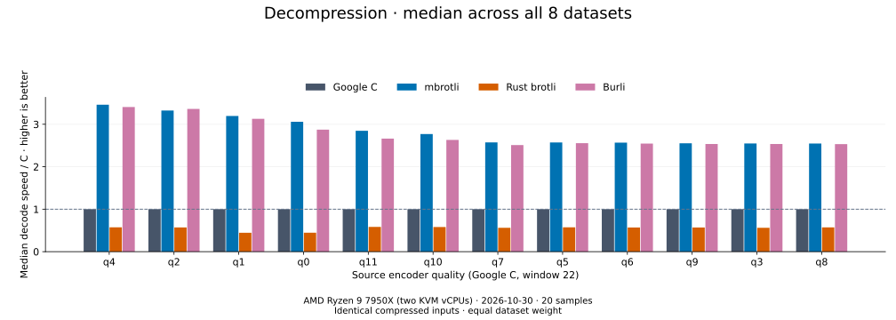

# Benchmark results

## Current library comparison — 2026-10-30

Full serial sweeps on the AMD Ryzen 9 7950X Linux VDS compare five encoders
(432 cases) and four decoders (384 cases). Both use ordinary release builds,
20 samples, 1 s warmup and 3 s requested measurement per case, one process at a
time on logical CPU 1. The reports identify the measured checkout and binaries.

| Compare | Results | Data |
| --- | --- | --- |
| Compression speed and size | [Qualities 0–11](encoders/README.md) | [CSV](encoder-comparison.csv), [conditions](encoder-comparison.md), [sizes](encoder-comparison-2026-10-30/sizes.csv) |
| Decompression of identical C streams | [Source qualities 0–11](decoders/README.md) | [CSV](decoder-comparison.csv), [conditions](decoder-comparison.md), [sizes](decoder-comparison-2026-10-30/sizes.csv) |

### Compression

Across all 96 corpus/quality pairs, mbrotli's median speed / C is **1.099×**;
its mean latency is lower in **67/96** cases. Burli supports q0–q5 and
the other encoders q0–q11. Each plotted value is a median of eight per-dataset
ratios to C. Higher speed and lower output size are better. Equal numeric
quality does not imply equal compressed size.

### Decompression

Across all 96 corpus/quality pairs, mbrotli's median speed is **2.588× C**
and **1.006× Burli**. Its mean latency is lower in **80/96** C
comparisons and **53/96** Burli comparisons. All decoders restore the
same C-produced bytes; quality belongs to their source encoder. SIMD Brotli
shares the Rust Brotli decoder project and is omitted. Throughput counts restored bytes.

### How to interpret the results

Generic mode, window 22, cold native APIs: construction, allocation, transformation
and disposal are timed. Inputs and complete matrices are validated before timing.
Empty and tiny inputs carry the same weight as large inputs. Medians describe
this corpus, not a production workload distribution; point counts do not imply
statistical significance. Confidence bounds and every workload remain in the
quality pages. Fixed implementation order and an uncontrolled virtual host can
affect timings beyond sampling uncertainty. No build, test, fuzzing or other
benchmark ran concurrently with either sweep.

| Dataset | Input bytes | Content |
| --- | ---: | --- |
| empty | 0 | API overhead without input |
| tiny-text | 44 | Quick-brown-fox sentence |
| alice29 | 152,089 | Vendored Alice in Wonderland text |
| text-1m | 1,048,576 | Alice repeated cyclically |
| binary-64k | 65,536 | Structured binary bytes |
| random-64k | 65,536 | Prefix of the pseudorandom corpus |
| random-1m | 1,048,576 | Deterministic xorshift64 bytes |
| repeated-1m | 1,048,576 | Repeated `a` bytes |

Use [benchmarking and profiling](../benchmarking.md) for reproduction and page/chart
generation. Root API suites separately measure reuse, streaming, slices, parallel
tasks and dictionaries; their results are not mixed into these native-API medians.
Superseded local reports and intermediate snapshots have been removed from the
published result set.

## lzbench (independent)

[lzbench](https://github.com/inikep/lzbench) is a long-running open-source
in-memory benchmark: every codec is built from source into one binary with the
same compiler and flags and runs on the same data and machine. Its maintainer ran
these results, not us: lzbench 2.4 (gcc 15.2), the 211 MB
[Silesia corpus](http://sun.aei.polsl.pl/~sdeor/index.php?page=silesia), one
thread of an AMD EPYC 9555P with turbo disabled. [Full table][lzbench-results].

mbrotli 0.5.2 against Google Brotli 1.2.0; bold marks the faster result. Ratio is
the compressed size as a percentage of the input and matches for both.

| Level | Compress mbrotli | Compress brotli | Decompress mbrotli | Decompress brotli | Ratio, % |
| ----: | ---------------: | --------------: | -----------------: | ----------------: | -------: |
| -11   |   **0.67 MB/s**  |       0.56 MB/s |           371 MB/s |      **383 MB/s** | 23.78 |
| -8    |   **14.4 MB/s**  |       12.6 MB/s |           419 MB/s |      **443 MB/s** | 26.96 |
| -5    |       50.0 MB/s  |   **53.3 MB/s** |           388 MB/s |      **419 MB/s** | 28.10 |
| -2    |        127 MB/s  |    **139 MB/s** |           349 MB/s |      **378 MB/s** | 32.12 |
| -0    |        341 MB/s  |        341 MB/s |           291 MB/s |      **322 MB/s** | 37.01 |

**Summary:** the same compressed size as Google Brotli (+0.005% at -11),
**14–20% faster** compression at -8 and -11, within 9% at lower levels, and
decompression 3–10% behind C.

This external historical result covers mbrotli 0.5.2 on its maintainer's host;
it is separate from the current local library comparison above.

[lzbench-results]: https://github.com/inikep/lzbench/blob/2706ba16721e947a9240c70d080b8efa3f752da0/doc/lzbench24_sorted.md
