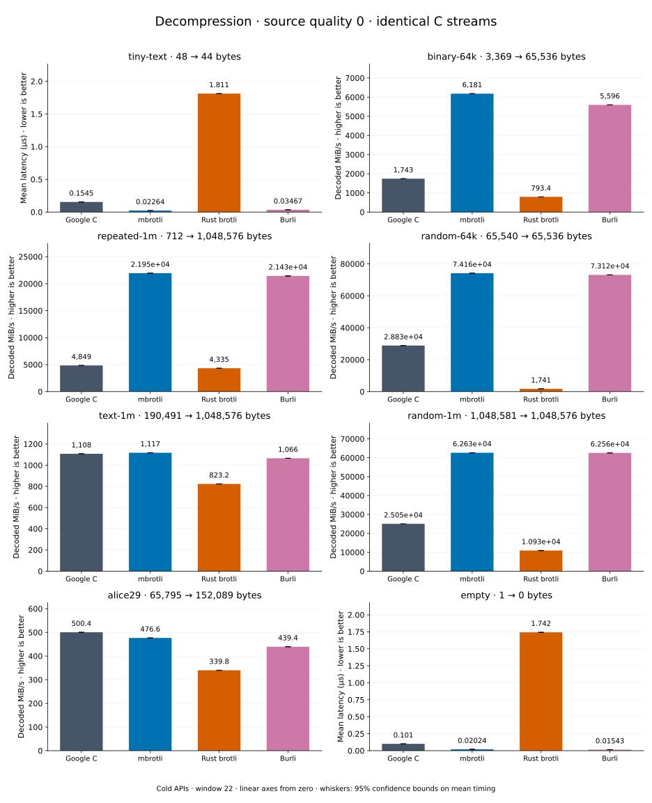

# Decompression of quality 0 streams

[Decoder overview](README.md) · [Benchmark index](../README.md)

Recorded run: **dec-2026-10-09** (2026-10-09).
[CSV](../decoder-comparison.csv) · [Environment](../decoder-comparison-environment.json) · [Methodology and limits](../decoder-comparison.md).

Quality belongs to the C encoder that prepared the input; decoders have no quality setting.
All four decode the same bytes. Burli is included at every source quality; SIMD Brotli
re-exports Rust brotli's decoder and is omitted.

## Median speed across 8 datasets

Median of per-dataset C mean time / decoder mean time ratios, with equal weight.
Higher is faster; 1× matches C. No confidence interval
is inferred for this across-dataset median.

| Decoder | Median speed / C |
| --- | ---: |
| Google C | 1.000× |
| mbrotli | 3.674× |
| Rust brotli | 0.359× |
| Burli | 3.174× |

mbrotli median speed / Burli: **0.989×** (direct per-dataset ratios).

Datasets are ranked by mbrotli speed relative to the fastest peer, highest first.
Throughput counts restored bytes; empty input has latency only. Whiskers and intervals
describe sampling uncertainty, not all host variation. Cold APIs include allocation
and disposal. C knows the output capacity; Rust brotli includes its 4 KiB I/O adapter.

## tiny-text

44-byte quick-brown-fox sentence.

**48 compressed → 44 restored bytes; compressed / original: 109.091%.**

| Decoder | Mean µs | 95% mean interval µs | Decoded MiB/s | Speed / C |
| --- | ---: | ---: | ---: | ---: |
| Google C | 0.2535 | 0.2364–0.2747 | 165.51 | 1.000× |
| mbrotli | 0.02088 | 0.02007–0.02187 | 2,009.28 | 12.140× |
| Rust brotli | 2.302 | 2.137–2.49 | 18.23 | 0.110× |
| Burli | 0.0351 | 0.03213–0.03882 | 1,195.52 | 7.223× |

## binary-64k

64 KiB of structured binary bytes: ((i / 16) XOR i) modulo 256.

**3,369 compressed → 65,536 restored bytes; compressed / original: 5.141%.**

| Decoder | Mean µs | 95% mean interval µs | Decoded MiB/s | Speed / C |
| --- | ---: | ---: | ---: | ---: |
| Google C | 41.77 | 38.07–46.54 | 1,496.14 | 1.000× |
| mbrotli | 10.65 | 10.51–10.84 | 5,870.45 | 3.924× |
| Rust brotli | 143.1 | 136.4–150.3 | 436.70 | 0.292× |
| Burli | 14.04 | 13.09–15.07 | 4,451.30 | 2.975× |

## repeated-1m

1 MiB of repeated a bytes.

**712 compressed → 1,048,576 restored bytes; compressed / original: 0.068%.**

| Decoder | Mean µs | 95% mean interval µs | Decoded MiB/s | Speed / C |
| --- | ---: | ---: | ---: | ---: |
| Google C | 223.3 | 215.9–231.4 | 4,478.93 | 1.000× |
| mbrotli | 58.04 | 55.19–61.59 | 17,228.85 | 3.847× |
| Rust brotli | 293.4 | 286.5–301.2 | 3,407.77 | 0.761× |
| Burli | 66.2 | 64.25–68.72 | 15,105.41 | 3.373× |

## random-64k

64 KiB prefix of the deterministic pseudorandom corpus.

**65,540 compressed → 65,536 restored bytes; compressed / original: 100.006%.**

| Decoder | Mean µs | 95% mean interval µs | Decoded MiB/s | Speed / C |
| --- | ---: | ---: | ---: | ---: |
| Google C | 2.921 | 2.91–2.933 | 21,398.92 | 1.000× |
| mbrotli | 1.007 | 1.001–1.015 | 62,037.33 | 2.899× |
| Rust brotli | 86.84 | 86.34–87.62 | 719.67 | 0.034× |
| Burli | 0.9975 | 0.9918–1.004 | 62,654.20 | 2.928× |

## alice29

Vendored Alice in Wonderland text.

**65,795 compressed → 152,089 restored bytes; compressed / original: 43.261%.**

| Decoder | Mean µs | 95% mean interval µs | Decoded MiB/s | Speed / C |
| --- | ---: | ---: | ---: | ---: |
| Google C | 496.4 | 419.1–588.1 | 292.17 | 1.000× |
| mbrotli | 371.3 | 356.4–389.7 | 390.66 | 1.337× |
| Rust brotli | 551.7 | 525.9–580.9 | 262.89 | 0.900× |
| Burli | 366.6 | 352.2–388.6 | 395.62 | 1.354× |

## random-1m

1 MiB of deterministic xorshift64 pseudorandom bytes.

**1,048,581 compressed → 1,048,576 restored bytes; compressed / original: 100.000%.**

| Decoder | Mean µs | 95% mean interval µs | Decoded MiB/s | Speed / C |
| --- | ---: | ---: | ---: | ---: |
| Google C | 71.67 | 70.82–72.57 | 13,953.62 | 1.000× |
| mbrotli | 20.47 | 20.12–21.02 | 48,845.76 | 3.501× |
| Rust brotli | 167.9 | 163.4–173.9 | 5,955.55 | 0.427× |
| Burli | 20.02 | 19.92–20.13 | 49,949.10 | 3.580× |

## text-1m

Alice text repeated cyclically to 1 MiB.

**190,491 compressed → 1,048,576 restored bytes; compressed / original: 18.167%.**

| Decoder | Mean µs | 95% mean interval µs | Decoded MiB/s | Speed / C |
| --- | ---: | ---: | ---: | ---: |
| Google C | 1,438 | 1,219–1,693 | 695.63 | 1.000× |
| mbrotli | 1,133 | 1,060–1,229 | 882.46 | 1.269× |
| Rust brotli | 1,761 | 1,598–1,930 | 568.01 | 0.817× |
| Burli | 1,033 | 997.6–1,080 | 968.02 | 1.392× |

## empty

Empty input; measures API overhead.

**1 compressed → 0 restored bytes; compressed / original: undefined.**

| Decoder | Mean µs | 95% mean interval µs | Decoded MiB/s | Speed / C |
| --- | ---: | ---: | ---: | ---: |
| Google C | 0.1719 | 0.1569–0.1884 | — | 1.000× |
| mbrotli | 0.01898 | 0.01725–0.02158 | — | 9.056× |
| Rust brotli | 1.997 | 1.93–2.081 | — | 0.086× |
| Burli | 0.01518 | 0.01382–0.01659 | — | 11.320× |
