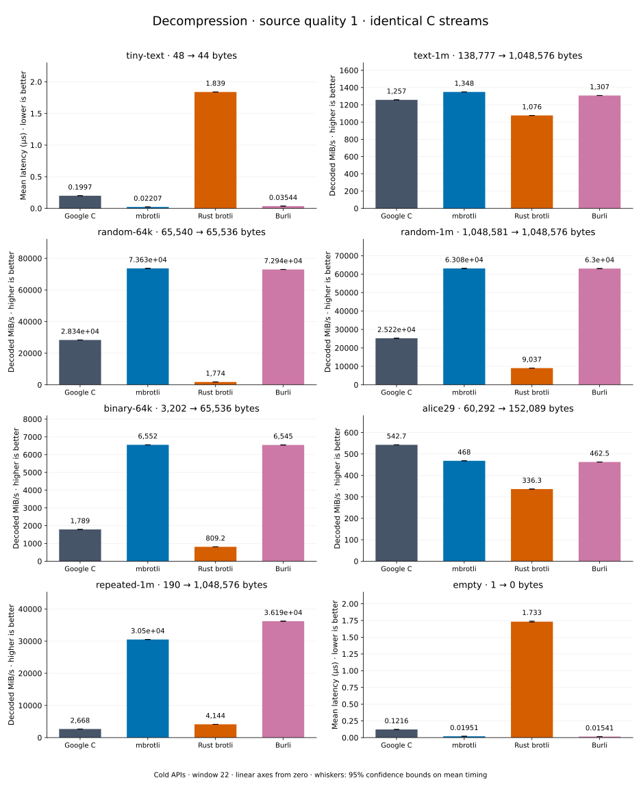

# Decompression of quality 1 streams

[Decoder overview](README.md) · [Benchmark index](../README.md)

Recorded run: **dec-2026-10-09** (2026-10-09).
[CSV](../decoder-comparison.csv) · [Environment](../decoder-comparison-environment.json) · [Methodology and limits](../decoder-comparison.md).

Quality belongs to the C encoder that prepared the input; decoders have no quality setting.
All four decode the same bytes. Burli is included at every source quality; SIMD Brotli
re-exports Rust brotli's decoder and is omitted.

## Median speed across 8 datasets

Median of per-dataset C mean time / decoder mean time ratios, with equal weight.
Higher is faster; 1× matches C. No confidence interval
is inferred for this across-dataset median.

| Decoder | Median speed / C |
| --- | ---: |
| Google C | 1.000× |
| mbrotli | 3.782× |
| Rust brotli | 0.369× |
| Burli | 3.793× |

mbrotli median speed / Burli: **1.003×** (direct per-dataset ratios).

Datasets are ranked by mbrotli speed relative to the fastest peer, highest first.
Throughput counts restored bytes; empty input has latency only. Whiskers and intervals
describe sampling uncertainty, not all host variation. Cold APIs include allocation
and disposal. C knows the output capacity; Rust brotli includes its 4 KiB I/O adapter.

## tiny-text

44-byte quick-brown-fox sentence.

**48 compressed → 44 restored bytes; compressed / original: 109.091%.**

| Decoder | Mean µs | 95% mean interval µs | Decoded MiB/s | Speed / C |
| --- | ---: | ---: | ---: | ---: |
| Google C | 0.2562 | 0.2444–0.2693 | 163.75 | 1.000× |
| mbrotli | 0.02252 | 0.02102–0.0245 | 1,863.43 | 11.379× |
| Rust brotli | 2.368 | 2.187–2.591 | 17.72 | 0.108× |
| Burli | 0.03048 | 0.02979–0.03157 | 1,376.68 | 8.407× |

## text-1m

Alice text repeated cyclically to 1 MiB.

**138,777 compressed → 1,048,576 restored bytes; compressed / original: 13.235%.**

| Decoder | Mean µs | 95% mean interval µs | Decoded MiB/s | Speed / C |
| --- | ---: | ---: | ---: | ---: |
| Google C | 1,194 | 993.7–1,408 | 837.40 | 1.000× |
| mbrotli | 870.2 | 825.6–922.1 | 1,149.19 | 1.372× |
| Rust brotli | 1,189 | 1,118–1,274 | 840.95 | 1.004× |
| Burli | 922.3 | 851.5–1,003 | 1,084.30 | 1.295× |

## alice29

Vendored Alice in Wonderland text.

**60,292 compressed → 152,089 restored bytes; compressed / original: 39.643%.**

| Decoder | Mean µs | 95% mean interval µs | Decoded MiB/s | Speed / C |
| --- | ---: | ---: | ---: | ---: |
| Google C | 435.6 | 357.1–520.2 | 332.99 | 1.000× |
| mbrotli | 364.9 | 344.6–387 | 397.45 | 1.194× |
| Rust brotli | 497.5 | 486.6–513.7 | 291.54 | 0.876× |
| Burli | 368.3 | 346.8–394.6 | 393.79 | 1.183× |

## random-64k

64 KiB prefix of the deterministic pseudorandom corpus.

**65,540 compressed → 65,536 restored bytes; compressed / original: 100.006%.**

| Decoder | Mean µs | 95% mean interval µs | Decoded MiB/s | Speed / C |
| --- | ---: | ---: | ---: | ---: |
| Google C | 2.972 | 2.935–3.016 | 21,028.97 | 1.000× |
| mbrotli | 1 | 0.9874–1.02 | 62,499.31 | 2.972× |
| Rust brotli | 90.74 | 87.38–95.29 | 688.74 | 0.033× |
| Burli | 1.007 | 0.9945–1.022 | 62,076.41 | 2.952× |

## random-1m

1 MiB of deterministic xorshift64 pseudorandom bytes.

**1,048,581 compressed → 1,048,576 restored bytes; compressed / original: 100.000%.**

| Decoder | Mean µs | 95% mean interval µs | Decoded MiB/s | Speed / C |
| --- | ---: | ---: | ---: | ---: |
| Google C | 68.09 | 67.52–68.81 | 14,685.70 | 1.000× |
| mbrotli | 19.46 | 19.37–19.56 | 51,392.18 | 3.499× |
| Rust brotli | 164.8 | 162–168 | 6,068.94 | 0.413× |
| Burli | 19.43 | 19.37–19.51 | 51,459.83 | 3.504× |

## binary-64k

64 KiB of structured binary bytes: ((i / 16) XOR i) modulo 256.

**3,202 compressed → 65,536 restored bytes; compressed / original: 4.886%.**

| Decoder | Mean µs | 95% mean interval µs | Decoded MiB/s | Speed / C |
| --- | ---: | ---: | ---: | ---: |
| Google C | 42.24 | 38.53–46.81 | 1,479.77 | 1.000× |
| mbrotli | 10.39 | 9.975–10.87 | 6,014.82 | 4.065× |
| Rust brotli | 130.3 | 127–134.7 | 479.59 | 0.324× |
| Burli | 10.35 | 10.24–10.47 | 6,039.18 | 4.081× |

## repeated-1m

1 MiB of repeated a bytes.

**190 compressed → 1,048,576 restored bytes; compressed / original: 0.018%.**

| Decoder | Mean µs | 95% mean interval µs | Decoded MiB/s | Speed / C |
| --- | ---: | ---: | ---: | ---: |
| Google C | 384.3 | 361.6–411.9 | 2,601.94 | 1.000× |
| mbrotli | 42.61 | 40.09–45.95 | 23,468.81 | 9.020× |
| Rust brotli | 294.5 | 292.2–297 | 3,396.01 | 1.305× |
| Burli | 30.55 | 29.63–31.57 | 32,730.30 | 12.579× |

## empty

Empty input; measures API overhead.

**1 compressed → 0 restored bytes; compressed / original: undefined.**

| Decoder | Mean µs | 95% mean interval µs | Decoded MiB/s | Speed / C |
| --- | ---: | ---: | ---: | ---: |
| Google C | 0.1924 | 0.1794–0.2055 | — | 1.000× |
| mbrotli | 0.01826 | 0.01718–0.01948 | — | 10.534× |
| Rust brotli | 1.927 | 1.891–1.979 | — | 0.100× |
| Burli | 0.01209 | 0.01155–0.01287 | — | 15.907× |
