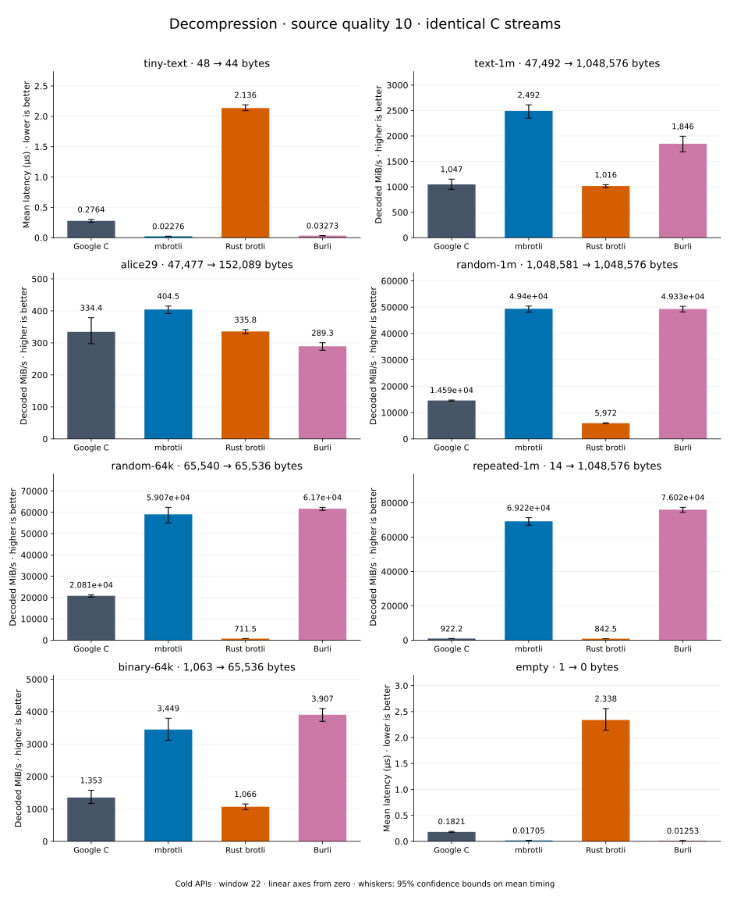

# Decompression of quality 10 streams

[Decoder overview](README.md) · [Benchmark index](../README.md)

Recorded run: **dec-2026-10-30-amd** (2026-10-30).
[CSV](../decoder-comparison.csv) · [Environment](../decoder-comparison-environment.json) · [Methodology and limits](../decoder-comparison.md).

Quality belongs to the C encoder that prepared the input; decoders have no quality setting.
All four decode the same bytes. Burli is included at every source quality; SIMD Brotli
re-exports Rust brotli's decoder and is omitted.

## Median speed across 8 datasets

Median of per-dataset C mean time / decoder mean time ratios, with equal weight.
Higher is faster; 1× matches C. No confidence interval
is inferred for this across-dataset median.

| Decoder | Median speed / C |
| --- | ---: |
| Google C | 1.000× |
| mbrotli | 2.770× |
| Rust brotli | 0.581× |
| Burli | 2.632× |

mbrotli median speed / Burli: **1.051×** (direct per-dataset ratios).

Datasets are ranked by mbrotli speed relative to the fastest peer, highest first.
Throughput counts restored bytes; empty input has latency only. Whiskers and intervals
describe sampling uncertainty, not all host variation. Cold APIs include allocation
and disposal. C knows the output capacity; Rust brotli includes its 4 KiB I/O adapter.

## tiny-text

44-byte quick-brown-fox sentence.

**48 compressed → 44 restored bytes; compressed / original: 109.091%.**

| Decoder | Mean µs | 95% mean interval µs | Decoded MiB/s | Speed / C |
| --- | ---: | ---: | ---: | ---: |
| Google C | 0.1908 | 0.1901–0.1916 | 219.93 | 1.000× |
| mbrotli | 0.02248 | 0.02164–0.02334 | 1,866.71 | 8.488× |
| Rust brotli | 1.842 | 1.84–1.844 | 22.78 | 0.104× |
| Burli | 0.03516 | 0.03497–0.03538 | 1,193.44 | 5.426× |

## text-1m

Alice text repeated cyclically to 1 MiB.

**47,492 compressed → 1,048,576 restored bytes; compressed / original: 4.529%.**

| Decoder | Mean µs | 95% mean interval µs | Decoded MiB/s | Speed / C |
| --- | ---: | ---: | ---: | ---: |
| Google C | 707.4 | 706.4–708.6 | 1,413.56 | 1.000× |
| mbrotli | 315.1 | 314.8–315.3 | 3,173.84 | 2.245× |
| Rust brotli | 909.5 | 908.9–910.1 | 1,099.52 | 0.778× |
| Burli | 442 | 441.5–442.6 | 2,262.29 | 1.600× |

## binary-64k

64 KiB of structured binary bytes: ((i / 16) XOR i) modulo 256.

**1,063 compressed → 65,536 restored bytes; compressed / original: 1.622%.**

| Decoder | Mean µs | 95% mean interval µs | Decoded MiB/s | Speed / C |
| --- | ---: | ---: | ---: | ---: |
| Google C | 37.85 | 37.81–37.88 | 1,651.39 | 1.000× |
| mbrotli | 12.66 | 12.65–12.66 | 4,937.50 | 2.990× |
| Rust brotli | 51.7 | 51.61–51.84 | 1,208.95 | 0.732× |
| Burli | 13.84 | 13.83–13.86 | 4,514.47 | 2.734× |

## random-64k

64 KiB prefix of the deterministic pseudorandom corpus.

**65,540 compressed → 65,536 restored bytes; compressed / original: 100.006%.**

| Decoder | Mean µs | 95% mean interval µs | Decoded MiB/s | Speed / C |
| --- | ---: | ---: | ---: | ---: |
| Google C | 2.21 | 2.208–2.212 | 28,278.34 | 1.000× |
| mbrotli | 0.8666 | 0.866–0.8673 | 72,121.07 | 2.550× |
| Rust brotli | 35.45 | 35.42–35.49 | 1,763.08 | 0.062× |
| Burli | 0.8738 | 0.8733–0.8743 | 71,527.36 | 2.529× |

## alice29

Vendored Alice in Wonderland text.

**47,477 compressed → 152,089 restored bytes; compressed / original: 31.217%.**

| Decoder | Mean µs | 95% mean interval µs | Decoded MiB/s | Speed / C |
| --- | ---: | ---: | ---: | ---: |
| Google C | 283.2 | 282.6–283.7 | 512.23 | 1.000× |
| mbrotli | 281 | 280.7–281.2 | 516.17 | 1.008× |
| Rust brotli | 378.1 | 377.8–378.5 | 383.57 | 0.749× |
| Burli | 423 | 422.5–423.6 | 342.90 | 0.669× |

## random-1m

1 MiB of deterministic xorshift64 pseudorandom bytes.

**1,048,581 compressed → 1,048,576 restored bytes; compressed / original: 100.000%.**

| Decoder | Mean µs | 95% mean interval µs | Decoded MiB/s | Speed / C |
| --- | ---: | ---: | ---: | ---: |
| Google C | 40.11 | 40.08–40.15 | 24,929.99 | 1.000× |
| mbrotli | 15.92 | 15.9–15.96 | 62,805.31 | 2.519× |
| Rust brotli | 93.45 | 93.33–93.59 | 10,701.03 | 0.429× |
| Burli | 15.89 | 15.88–15.91 | 62,921.46 | 2.524× |

## repeated-1m

1 MiB of repeated a bytes.

**14 compressed → 1,048,576 restored bytes; compressed / original: 0.001%.**

| Decoder | Mean µs | 95% mean interval µs | Decoded MiB/s | Speed / C |
| --- | ---: | ---: | ---: | ---: |
| Google C | 1,227 | 1,226–1,228 | 815.00 | 1.000× |
| mbrotli | 8.955 | 8.948–8.963 | 111,664.27 | 137.011× |
| Rust brotli | 1,264 | 1,262–1,267 | 791.11 | 0.971× |
| Burli | 8.062 | 8.052–8.074 | 124,040.42 | 152.197× |

## empty

Empty input; measures API overhead.

**1 compressed → 0 restored bytes; compressed / original: undefined.**

| Decoder | Mean µs | 95% mean interval µs | Decoded MiB/s | Speed / C |
| --- | ---: | ---: | ---: | ---: |
| Google C | 0.1131 | 0.113–0.1133 | — | 1.000× |
| mbrotli | 0.02025 | 0.01956–0.02096 | — | 5.588× |
| Rust brotli | 1.711 | 1.709–1.712 | — | 0.066× |
| Burli | 0.01543 | 0.01538–0.01551 | — | 7.333× |
