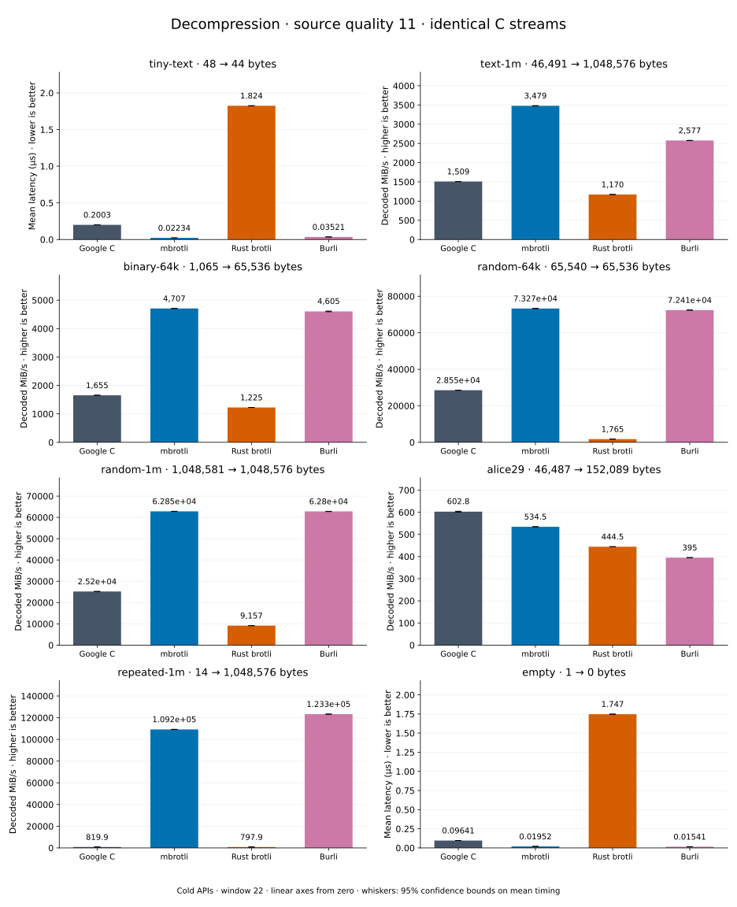

# Decompression of quality 11 streams

[Decoder overview](README.md) · [Benchmark index](../README.md)

Recorded run: **dec-2026-10-30-amd** (2026-10-30).
[CSV](../decoder-comparison.csv) · [Environment](../decoder-comparison-environment.json) · [Methodology and limits](../decoder-comparison.md).

Quality belongs to the C encoder that prepared the input; decoders have no quality setting.
All four decode the same bytes. Burli is included at every source quality; SIMD Brotli
re-exports Rust brotli's decoder and is omitted.

## Median speed across 8 datasets

Median of per-dataset C mean time / decoder mean time ratios, with equal weight.
Higher is faster; 1× matches C. No confidence interval
is inferred for this across-dataset median.

| Decoder | Median speed / C |
| --- | ---: |
| Google C | 1.000× |
| mbrotli | 2.847× |
| Rust brotli | 0.584× |
| Burli | 2.662× |

mbrotli median speed / Burli: **1.067×** (direct per-dataset ratios).

Datasets are ranked by mbrotli speed relative to the fastest peer, highest first.
Throughput counts restored bytes; empty input has latency only. Whiskers and intervals
describe sampling uncertainty, not all host variation. Cold APIs include allocation
and disposal. C knows the output capacity; Rust brotli includes its 4 KiB I/O adapter.

## tiny-text

44-byte quick-brown-fox sentence.

**48 compressed → 44 restored bytes; compressed / original: 109.091%.**

| Decoder | Mean µs | 95% mean interval µs | Decoded MiB/s | Speed / C |
| --- | ---: | ---: | ---: | ---: |
| Google C | 0.1959 | 0.1952–0.1968 | 214.18 | 1.000× |
| mbrotli | 0.02331 | 0.02255–0.0241 | 1,800.10 | 8.405× |
| Rust brotli | 1.853 | 1.852–1.855 | 22.64 | 0.106× |
| Burli | 0.03506 | 0.03493–0.03521 | 1,196.79 | 5.588× |

## text-1m

Alice text repeated cyclically to 1 MiB.

**46,491 compressed → 1,048,576 restored bytes; compressed / original: 4.434%.**

| Decoder | Mean µs | 95% mean interval µs | Decoded MiB/s | Speed / C |
| --- | ---: | ---: | ---: | ---: |
| Google C | 665.7 | 662.9–669 | 1,502.22 | 1.000× |
| mbrotli | 273 | 272.6–273.6 | 3,663.14 | 2.438× |
| Rust brotli | 850.5 | 849.8–851.1 | 1,175.84 | 0.783× |
| Burli | 385.3 | 384.9–385.6 | 2,595.33 | 1.728× |

## binary-64k

64 KiB of structured binary bytes: ((i / 16) XOR i) modulo 256.

**1,065 compressed → 65,536 restored bytes; compressed / original: 1.625%.**

| Decoder | Mean µs | 95% mean interval µs | Decoded MiB/s | Speed / C |
| --- | ---: | ---: | ---: | ---: |
| Google C | 37.84 | 37.81–37.87 | 1,651.78 | 1.000× |
| mbrotli | 12.18 | 12.18–12.19 | 5,129.38 | 3.105× |
| Rust brotli | 51.38 | 51.34–51.42 | 1,216.37 | 0.736× |
| Burli | 13.7 | 13.69–13.71 | 4,562.06 | 2.762× |

## random-64k

64 KiB prefix of the deterministic pseudorandom corpus.

**65,540 compressed → 65,536 restored bytes; compressed / original: 100.006%.**

| Decoder | Mean µs | 95% mean interval µs | Decoded MiB/s | Speed / C |
| --- | ---: | ---: | ---: | ---: |
| Google C | 2.207 | 2.206–2.208 | 28,319.23 | 1.000× |
| mbrotli | 0.8525 | 0.8521–0.8529 | 73,314.54 | 2.589× |
| Rust brotli | 35.64 | 35.48–35.89 | 1,753.46 | 0.062× |
| Burli | 0.8611 | 0.8607–0.8614 | 72,584.43 | 2.563× |

## random-1m

1 MiB of deterministic xorshift64 pseudorandom bytes.

**1,048,581 compressed → 1,048,576 restored bytes; compressed / original: 100.000%.**

| Decoder | Mean µs | 95% mean interval µs | Decoded MiB/s | Speed / C |
| --- | ---: | ---: | ---: | ---: |
| Google C | 40.17 | 40.14–40.22 | 24,895.16 | 1.000× |
| mbrotli | 16.03 | 16–16.06 | 62,396.03 | 2.506× |
| Rust brotli | 92.35 | 92.2–92.52 | 10,828.28 | 0.435× |
| Burli | 16 | 15.99–16.01 | 62,489.75 | 2.510× |

## alice29

Vendored Alice in Wonderland text.

**46,487 compressed → 152,089 restored bytes; compressed / original: 30.566%.**

| Decoder | Mean µs | 95% mean interval µs | Decoded MiB/s | Speed / C |
| --- | ---: | ---: | ---: | ---: |
| Google C | 239.2 | 238.5–239.9 | 606.35 | 1.000× |
| mbrotli | 248.2 | 247.8–248.5 | 584.49 | 0.964× |
| Rust brotli | 326.5 | 326.3–326.9 | 444.17 | 0.733× |
| Burli | 367.9 | 367.5–368.3 | 394.25 | 0.650× |

## repeated-1m

1 MiB of repeated a bytes.

**14 compressed → 1,048,576 restored bytes; compressed / original: 0.001%.**

| Decoder | Mean µs | 95% mean interval µs | Decoded MiB/s | Speed / C |
| --- | ---: | ---: | ---: | ---: |
| Google C | 1,226 | 1,225–1,227 | 815.69 | 1.000× |
| mbrotli | 8.947 | 8.936–8.958 | 111,771.06 | 137.027× |
| Rust brotli | 1,263 | 1,262–1,265 | 791.61 | 0.970× |
| Burli | 8.043 | 8.035–8.053 | 124,330.40 | 152.424× |

## empty

Empty input; measures API overhead.

**1 compressed → 0 restored bytes; compressed / original: undefined.**

| Decoder | Mean µs | 95% mean interval µs | Decoded MiB/s | Speed / C |
| --- | ---: | ---: | ---: | ---: |
| Google C | 0.1133 | 0.1131–0.1135 | — | 1.000× |
| mbrotli | 0.02026 | 0.01958–0.02098 | — | 5.589× |
| Rust brotli | 1.712 | 1.71–1.715 | — | 0.066× |
| Burli | 0.01544 | 0.01539–0.01551 | — | 7.337× |
