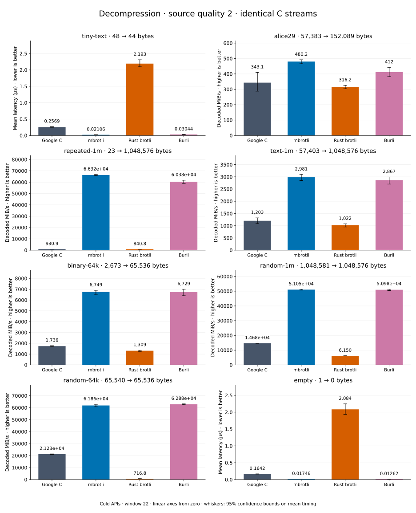

# Decompression of quality 2 streams

[Decoder overview](README.md) · [Benchmark index](../README.md)

Recorded run: **dec-2026-10-29-amd** (2026-10-29).
[CSV](../decoder-comparison.csv) · [Environment](../decoder-comparison-environment.json) · [Methodology and limits](../decoder-comparison.md).

Quality belongs to the C encoder that prepared the input; decoders have no quality setting.
All four decode the same bytes. Burli is included at every source quality; SIMD Brotli
re-exports Rust brotli's decoder and is omitted.

## Median speed across 8 datasets

Median of per-dataset C mean time / decoder mean time ratios, with equal weight.
Higher is faster; 1× matches C. No confidence interval
is inferred for this across-dataset median.

| Decoder | Median speed / C |
| --- | ---: |
| Google C | 1.000× |
| mbrotli | 3.211× |
| Rust brotli | 0.496× |
| Burli | 3.328× |

mbrotli median speed / Burli: **1.024×** (direct per-dataset ratios).

Datasets are ranked by mbrotli speed relative to the fastest peer, highest first.
Throughput counts restored bytes; empty input has latency only. Whiskers and intervals
describe sampling uncertainty, not all host variation. Cold APIs include allocation
and disposal. C knows the output capacity; Rust brotli includes its 4 KiB I/O adapter.

## tiny-text

44-byte quick-brown-fox sentence.

**48 compressed → 44 restored bytes; compressed / original: 109.091%.**

| Decoder | Mean µs | 95% mean interval µs | Decoded MiB/s | Speed / C |
| --- | ---: | ---: | ---: | ---: |
| Google C | 0.1796 | 0.1792–0.18 | 233.58 | 1.000× |
| mbrotli | 0.02229 | 0.02225–0.02233 | 1,882.28 | 8.058× |
| Rust brotli | 1.824 | 1.823–1.825 | 23.01 | 0.098× |
| Burli | 0.03557 | 0.03546–0.03569 | 1,179.75 | 5.051× |

## repeated-1m

1 MiB of repeated a bytes.

**23 compressed → 1,048,576 restored bytes; compressed / original: 0.002%.**

| Decoder | Mean µs | 95% mean interval µs | Decoded MiB/s | Speed / C |
| --- | ---: | ---: | ---: | ---: |
| Google C | 1,224 | 1,222–1,225 | 817.31 | 1.000× |
| mbrotli | 10.54 | 10.53–10.55 | 94,875.03 | 116.083× |
| Rust brotli | 1,261 | 1,260–1,262 | 792.95 | 0.970× |
| Burli | 11.64 | 11.63–11.66 | 85,881.08 | 105.078× |

## text-1m

Alice text repeated cyclically to 1 MiB.

**57,403 compressed → 1,048,576 restored bytes; compressed / original: 5.474%.**

| Decoder | Mean µs | 95% mean interval µs | Decoded MiB/s | Speed / C |
| --- | ---: | ---: | ---: | ---: |
| Google C | 657.8 | 657.3–658.2 | 1,520.33 | 1.000× |
| mbrotli | 296.1 | 295.7–296.5 | 3,377.42 | 2.222× |
| Rust brotli | 874.1 | 872.8–875.4 | 1,144.09 | 0.753× |
| Burli | 310.3 | 309.5–311 | 3,222.53 | 2.120× |

## random-64k

64 KiB prefix of the deterministic pseudorandom corpus.

**65,540 compressed → 65,536 restored bytes; compressed / original: 100.006%.**

| Decoder | Mean µs | 95% mean interval µs | Decoded MiB/s | Speed / C |
| --- | ---: | ---: | ---: | ---: |
| Google C | 2.207 | 2.205–2.208 | 28,324.36 | 1.000× |
| mbrotli | 0.8458 | 0.8451–0.8467 | 73,893.20 | 2.609× |
| Rust brotli | 35.3 | 35.22–35.4 | 1,770.32 | 0.063× |
| Burli | 0.8537 | 0.8534–0.854 | 73,211.34 | 2.585× |

## random-1m

1 MiB of deterministic xorshift64 pseudorandom bytes.

**1,048,581 compressed → 1,048,576 restored bytes; compressed / original: 100.000%.**

| Decoder | Mean µs | 95% mean interval µs | Decoded MiB/s | Speed / C |
| --- | ---: | ---: | ---: | ---: |
| Google C | 39.62 | 39.58–39.66 | 25,242.79 | 1.000× |
| mbrotli | 15.87 | 15.87–15.88 | 63,007.77 | 2.496× |
| Rust brotli | 108.4 | 108.3–108.6 | 9,222.25 | 0.365× |
| Burli | 15.89 | 15.88–15.9 | 62,941.53 | 2.493× |

## binary-64k

64 KiB of structured binary bytes: ((i / 16) XOR i) modulo 256.

**2,673 compressed → 65,536 restored bytes; compressed / original: 4.079%.**

| Decoder | Mean µs | 95% mean interval µs | Decoded MiB/s | Speed / C |
| --- | ---: | ---: | ---: | ---: |
| Google C | 34.47 | 34.45–34.48 | 1,813.38 | 1.000× |
| mbrotli | 9.037 | 9.027–9.052 | 6,916.36 | 3.814× |
| Rust brotli | 46.54 | 46.48–46.61 | 1,342.86 | 0.741× |
| Burli | 8.468 | 8.459–8.476 | 7,381.16 | 4.070× |

## alice29

Vendored Alice in Wonderland text.

**57,383 compressed → 152,089 restored bytes; compressed / original: 37.730%.**

| Decoder | Mean µs | 95% mean interval µs | Decoded MiB/s | Speed / C |
| --- | ---: | ---: | ---: | ---: |
| Google C | 245.8 | 245.4–246.3 | 590.15 | 1.000× |
| mbrotli | 276.5 | 276–276.9 | 524.63 | 0.889× |
| Rust brotli | 392.7 | 392.2–393.1 | 369.36 | 0.626× |
| Burli | 287.4 | 287–288 | 504.64 | 0.855× |

## empty

Empty input; measures API overhead.

**1 compressed → 0 restored bytes; compressed / original: undefined.**

| Decoder | Mean µs | 95% mean interval µs | Decoded MiB/s | Speed / C |
| --- | ---: | ---: | ---: | ---: |
| Google C | 0.0963 | 0.09619–0.09644 | — | 1.000× |
| mbrotli | 0.01955 | 0.0195–0.01959 | — | 4.927× |
| Rust brotli | 1.743 | 1.741–1.744 | — | 0.055× |
| Burli | 0.01542 | 0.01538–0.01547 | — | 6.246× |
