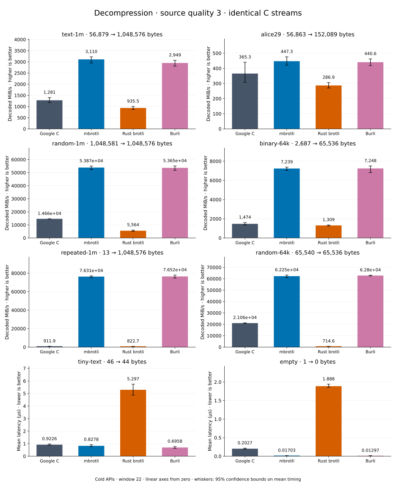

# Decompression of quality 3 streams

[Decoder overview](README.md) · [Benchmark index](../README.md)

Recorded run: **dec-2026-10-30-amd** (2026-10-30).
[CSV](../decoder-comparison.csv) · [Environment](../decoder-comparison-environment.json) · [Methodology and limits](../decoder-comparison.md).

Quality belongs to the C encoder that prepared the input; decoders have no quality setting.
All four decode the same bytes. Burli is included at every source quality; SIMD Brotli
re-exports Rust brotli's decoder and is omitted.

## Median speed across 8 datasets

Median of per-dataset C mean time / decoder mean time ratios, with equal weight.
Higher is faster; 1× matches C. No confidence interval
is inferred for this across-dataset median.

| Decoder | Median speed / C |
| --- | ---: |
| Google C | 1.000× |
| mbrotli | 2.548× |
| Rust brotli | 0.563× |
| Burli | 2.536× |

mbrotli median speed / Burli: **0.986×** (direct per-dataset ratios).

Datasets are ranked by mbrotli speed relative to the fastest peer, highest first.
Throughput counts restored bytes; empty input has latency only. Whiskers and intervals
describe sampling uncertainty, not all host variation. Cold APIs include allocation
and disposal. C knows the output capacity; Rust brotli includes its 4 KiB I/O adapter.

## text-1m

Alice text repeated cyclically to 1 MiB.

**56,879 compressed → 1,048,576 restored bytes; compressed / original: 5.424%.**

| Decoder | Mean µs | 95% mean interval µs | Decoded MiB/s | Speed / C |
| --- | ---: | ---: | ---: | ---: |
| Google C | 647.6 | 646.9–648.3 | 1,544.18 | 1.000× |
| mbrotli | 262.3 | 262.1–262.5 | 3,812.97 | 2.469× |
| Rust brotli | 863.3 | 862.5–864.1 | 1,158.39 | 0.750× |
| Burli | 299.7 | 299.5–299.9 | 3,337.01 | 2.161× |

## random-64k

64 KiB prefix of the deterministic pseudorandom corpus.

**65,540 compressed → 65,536 restored bytes; compressed / original: 100.006%.**

| Decoder | Mean µs | 95% mean interval µs | Decoded MiB/s | Speed / C |
| --- | ---: | ---: | ---: | ---: |
| Google C | 2.21 | 2.209–2.211 | 28,277.40 | 1.000× |
| mbrotli | 0.8434 | 0.8426–0.8443 | 74,108.59 | 2.621× |
| Rust brotli | 35.9 | 35.87–35.93 | 1,740.85 | 0.062× |
| Burli | 0.8529 | 0.8524–0.8535 | 73,276.48 | 2.591× |

## random-1m

1 MiB of deterministic xorshift64 pseudorandom bytes.

**1,048,581 compressed → 1,048,576 restored bytes; compressed / original: 100.000%.**

| Decoder | Mean µs | 95% mean interval µs | Decoded MiB/s | Speed / C |
| --- | ---: | ---: | ---: | ---: |
| Google C | 39.6 | 39.56–39.64 | 25,253.03 | 1.000× |
| mbrotli | 15.99 | 15.98–16.01 | 62,531.82 | 2.476× |
| Rust brotli | 84.31 | 84.1–84.55 | 11,861.19 | 0.470× |
| Burli | 15.97 | 15.96–15.98 | 62,627.60 | 2.480× |

## binary-64k

64 KiB of structured binary bytes: ((i / 16) XOR i) modulo 256.

**2,687 compressed → 65,536 restored bytes; compressed / original: 4.100%.**

| Decoder | Mean µs | 95% mean interval µs | Decoded MiB/s | Speed / C |
| --- | ---: | ---: | ---: | ---: |
| Google C | 34.52 | 34.5–34.55 | 1,810.61 | 1.000× |
| mbrotli | 8.315 | 8.308–8.324 | 7,516.37 | 4.151× |
| Rust brotli | 46.2 | 46.14–46.28 | 1,352.70 | 0.747× |
| Burli | 8.102 | 8.098–8.107 | 7,713.85 | 4.260× |

## repeated-1m

1 MiB of repeated a bytes.

**13 compressed → 1,048,576 restored bytes; compressed / original: 0.001%.**

| Decoder | Mean µs | 95% mean interval µs | Decoded MiB/s | Speed / C |
| --- | ---: | ---: | ---: | ---: |
| Google C | 1,225 | 1,225–1,226 | 816.09 | 1.000× |
| mbrotli | 8.547 | 8.538–8.556 | 117,004.43 | 143.372× |
| Rust brotli | 1,258 | 1,256–1,259 | 795.08 | 0.974× |
| Burli | 8.199 | 8.189–8.209 | 121,971.40 | 149.459× |

## alice29

Vendored Alice in Wonderland text.

**56,863 compressed → 152,089 restored bytes; compressed / original: 37.388%.**

| Decoder | Mean µs | 95% mean interval µs | Decoded MiB/s | Speed / C |
| --- | ---: | ---: | ---: | ---: |
| Google C | 233.2 | 233–233.5 | 621.85 | 1.000× |
| mbrotli | 243.9 | 243.8–244.1 | 594.63 | 0.956× |
| Rust brotli | 355.8 | 355.6–356.1 | 407.66 | 0.656× |
| Burli | 278.5 | 278.3–278.6 | 520.85 | 0.838× |

## empty

Empty input; measures API overhead.

**1 compressed → 0 restored bytes; compressed / original: undefined.**

| Decoder | Mean µs | 95% mean interval µs | Decoded MiB/s | Speed / C |
| --- | ---: | ---: | ---: | ---: |
| Google C | 0.1098 | 0.1096–0.11 | — | 1.000× |
| mbrotli | 0.02032 | 0.01965–0.02106 | — | 5.402× |
| Rust brotli | 1.73 | 1.726–1.735 | — | 0.063× |
| Burli | 0.01543 | 0.01538–0.0155 | — | 7.116× |

## tiny-text

44-byte quick-brown-fox sentence.

**46 compressed → 44 restored bytes; compressed / original: 104.545%.**

| Decoder | Mean µs | 95% mean interval µs | Decoded MiB/s | Speed / C |
| --- | ---: | ---: | ---: | ---: |
| Google C | 0.7607 | 0.7597–0.7621 | 55.16 | 1.000× |
| mbrotli | 0.7369 | 0.7351–0.7383 | 56.95 | 1.032× |
| Rust brotli | 3.463 | 3.46–3.466 | 12.12 | 0.220× |
| Burli | 0.5204 | 0.5172–0.523 | 80.64 | 1.462× |
