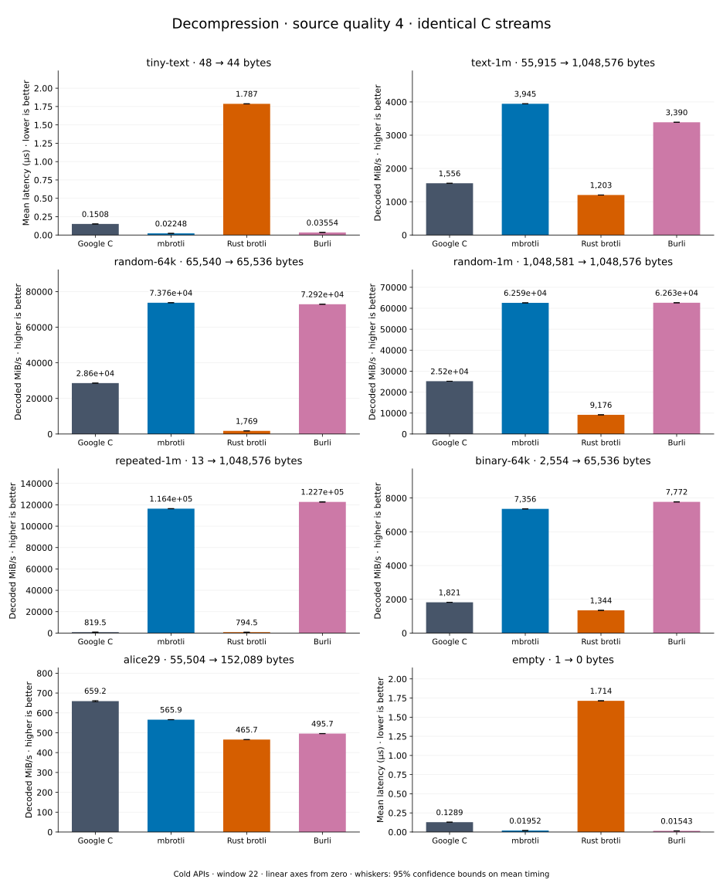

# Decompression of quality 4 streams

[Decoder overview](README.md) · [Benchmark index](../README.md)

Recorded run: **dec-2026-10-30-amd** (2026-10-30).
[CSV](../decoder-comparison.csv) · [Environment](../decoder-comparison-environment.json) · [Methodology and limits](../decoder-comparison.md).

Quality belongs to the C encoder that prepared the input; decoders have no quality setting.
All four decode the same bytes. Burli is included at every source quality; SIMD Brotli
re-exports Rust brotli's decoder and is omitted.

## Median speed across 8 datasets

Median of per-dataset C mean time / decoder mean time ratios, with equal weight.
Higher is faster; 1× matches C. No confidence interval
is inferred for this across-dataset median.

| Decoder | Median speed / C |
| --- | ---: |
| Google C | 1.000× |
| mbrotli | 3.461× |
| Rust brotli | 0.574× |
| Burli | 3.407× |

mbrotli median speed / Burli: **1.003×** (direct per-dataset ratios).

Datasets are ranked by mbrotli speed relative to the fastest peer, highest first.
Throughput counts restored bytes; empty input has latency only. Whiskers and intervals
describe sampling uncertainty, not all host variation. Cold APIs include allocation
and disposal. C knows the output capacity; Rust brotli includes its 4 KiB I/O adapter.

## tiny-text

44-byte quick-brown-fox sentence.

**48 compressed → 44 restored bytes; compressed / original: 109.091%.**

| Decoder | Mean µs | 95% mean interval µs | Decoded MiB/s | Speed / C |
| --- | ---: | ---: | ---: | ---: |
| Google C | 0.1689 | 0.1684–0.1695 | 248.43 | 1.000× |
| mbrotli | 0.02235 | 0.02146–0.0233 | 1,877.77 | 7.558× |
| Rust brotli | 1.813 | 1.812–1.815 | 23.14 | 0.093× |
| Burli | 0.03519 | 0.03507–0.03533 | 1,192.56 | 4.800× |

## text-1m

Alice text repeated cyclically to 1 MiB.

**55,915 compressed → 1,048,576 restored bytes; compressed / original: 5.332%.**

| Decoder | Mean µs | 95% mean interval µs | Decoded MiB/s | Speed / C |
| --- | ---: | ---: | ---: | ---: |
| Google C | 655.2 | 640.5–670.3 | 1,526.33 | 1.000× |
| mbrotli | 239.6 | 239.4–239.8 | 4,173.38 | 2.734× |
| Rust brotli | 827.7 | 827.3–828.1 | 1,208.19 | 0.792× |
| Burli | 291.7 | 291.4–292 | 3,428.35 | 2.246× |

## random-64k

64 KiB prefix of the deterministic pseudorandom corpus.

**65,540 compressed → 65,536 restored bytes; compressed / original: 100.006%.**

| Decoder | Mean µs | 95% mean interval µs | Decoded MiB/s | Speed / C |
| --- | ---: | ---: | ---: | ---: |
| Google C | 2.186 | 2.185–2.187 | 28,590.91 | 1.000× |
| mbrotli | 0.8425 | 0.8419–0.8432 | 74,185.89 | 2.595× |
| Rust brotli | 35.78 | 35.76–35.8 | 1,746.73 | 0.061× |
| Burli | 0.8537 | 0.8533–0.8541 | 73,211.67 | 2.561× |

## random-1m

1 MiB of deterministic xorshift64 pseudorandom bytes.

**1,048,581 compressed → 1,048,576 restored bytes; compressed / original: 100.000%.**

| Decoder | Mean µs | 95% mean interval µs | Decoded MiB/s | Speed / C |
| --- | ---: | ---: | ---: | ---: |
| Google C | 40.18 | 40.12–40.23 | 24,890.59 | 1.000× |
| mbrotli | 15.88 | 15.85–15.9 | 62,986.65 | 2.531× |
| Rust brotli | 90.98 | 90.92–91.05 | 10,991.00 | 0.442× |
| Burli | 15.75 | 15.73–15.77 | 63,501.84 | 2.551× |

## binary-64k

64 KiB of structured binary bytes: ((i / 16) XOR i) modulo 256.

**2,554 compressed → 65,536 restored bytes; compressed / original: 3.897%.**

| Decoder | Mean µs | 95% mean interval µs | Decoded MiB/s | Speed / C |
| --- | ---: | ---: | ---: | ---: |
| Google C | 34.66 | 34.64–34.68 | 1,803.36 | 1.000× |
| mbrotli | 8.274 | 8.265–8.284 | 7,553.65 | 4.189× |
| Rust brotli | 46.7 | 46.66–46.74 | 1,338.46 | 0.742× |
| Burli | 8.15 | 8.145–8.154 | 7,669.11 | 4.253× |

## repeated-1m

1 MiB of repeated a bytes.

**13 compressed → 1,048,576 restored bytes; compressed / original: 0.001%.**

| Decoder | Mean µs | 95% mean interval µs | Decoded MiB/s | Speed / C |
| --- | ---: | ---: | ---: | ---: |
| Google C | 1,226 | 1,225–1,228 | 815.47 | 1.000× |
| mbrotli | 8.507 | 8.504–8.51 | 117,554.83 | 144.156× |
| Rust brotli | 1,253 | 1,253–1,254 | 797.77 | 0.978× |
| Burli | 8.189 | 8.178–8.201 | 122,112.05 | 149.744× |

## alice29

Vendored Alice in Wonderland text.

**55,504 compressed → 152,089 restored bytes; compressed / original: 36.494%.**

| Decoder | Mean µs | 95% mean interval µs | Decoded MiB/s | Speed / C |
| --- | ---: | ---: | ---: | ---: |
| Google C | 220.1 | 219.6–220.7 | 658.93 | 1.000× |
| mbrotli | 234.5 | 234.3–234.7 | 618.51 | 0.939× |
| Rust brotli | 312 | 311.8–312.2 | 464.88 | 0.706× |
| Burli | 291.8 | 291.4–292.2 | 497.14 | 0.754× |

## empty

Empty input; measures API overhead.

**1 compressed → 0 restored bytes; compressed / original: undefined.**

| Decoder | Mean µs | 95% mean interval µs | Decoded MiB/s | Speed / C |
| --- | ---: | ---: | ---: | ---: |
| Google C | 0.1098 | 0.1097–0.1099 | — | 1.000× |
| mbrotli | 0.02026 | 0.01958–0.02096 | — | 5.419× |
| Rust brotli | 1.728 | 1.727–1.73 | — | 0.064× |
| Burli | 0.01545 | 0.0154–0.01555 | — | 7.105× |
