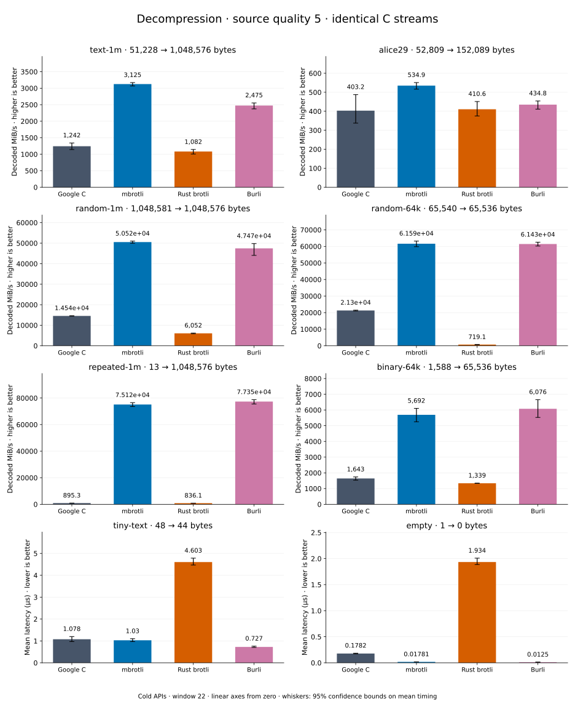

# Decompression of quality 5 streams

[Decoder overview](README.md) · [Benchmark index](../README.md)

Recorded run: **dec-2026-10-30-amd** (2026-10-30).
[CSV](../decoder-comparison.csv) · [Environment](../decoder-comparison-environment.json) · [Methodology and limits](../decoder-comparison.md).

Quality belongs to the C encoder that prepared the input; decoders have no quality setting.
All four decode the same bytes. Burli is included at every source quality; SIMD Brotli
re-exports Rust brotli's decoder and is omitted.

## Median speed across 8 datasets

Median of per-dataset C mean time / decoder mean time ratios, with equal weight.
Higher is faster; 1× matches C. No confidence interval
is inferred for this across-dataset median.

| Decoder | Median speed / C |
| --- | ---: |
| Google C | 1.000× |
| mbrotli | 2.572× |
| Rust brotli | 0.574× |
| Burli | 2.555× |

mbrotli median speed / Burli: **0.982×** (direct per-dataset ratios).

Datasets are ranked by mbrotli speed relative to the fastest peer, highest first.
Throughput counts restored bytes; empty input has latency only. Whiskers and intervals
describe sampling uncertainty, not all host variation. Cold APIs include allocation
and disposal. C knows the output capacity; Rust brotli includes its 4 KiB I/O adapter.

## text-1m

Alice text repeated cyclically to 1 MiB.

**51,228 compressed → 1,048,576 restored bytes; compressed / original: 4.885%.**

| Decoder | Mean µs | 95% mean interval µs | Decoded MiB/s | Speed / C |
| --- | ---: | ---: | ---: | ---: |
| Google C | 668.6 | 662.3–675.6 | 1,495.77 | 1.000× |
| mbrotli | 272.5 | 272.2–272.8 | 3,669.63 | 2.453× |
| Rust brotli | 841.7 | 840.9–842.8 | 1,188.01 | 0.794× |
| Burli | 358.6 | 358.4–359 | 2,788.30 | 1.864× |

## random-64k

64 KiB prefix of the deterministic pseudorandom corpus.

**65,540 compressed → 65,536 restored bytes; compressed / original: 100.006%.**

| Decoder | Mean µs | 95% mean interval µs | Decoded MiB/s | Speed / C |
| --- | ---: | ---: | ---: | ---: |
| Google C | 2.176 | 2.175–2.177 | 28,723.63 | 1.000× |
| mbrotli | 0.836 | 0.8352–0.8368 | 74,764.92 | 2.603× |
| Rust brotli | 35.81 | 35.79–35.83 | 1,745.40 | 0.061× |
| Burli | 0.8477 | 0.8471–0.8484 | 73,728.71 | 2.567× |

## random-1m

1 MiB of deterministic xorshift64 pseudorandom bytes.

**1,048,581 compressed → 1,048,576 restored bytes; compressed / original: 100.000%.**

| Decoder | Mean µs | 95% mean interval µs | Decoded MiB/s | Speed / C |
| --- | ---: | ---: | ---: | ---: |
| Google C | 40.04 | 40.01–40.06 | 24,977.09 | 1.000× |
| mbrotli | 15.76 | 15.74–15.78 | 63,450.30 | 2.540× |
| Rust brotli | 91.21 | 91.15–91.29 | 10,963.55 | 0.439× |
| Burli | 15.74 | 15.72–15.75 | 63,542.42 | 2.544× |

## binary-64k

64 KiB of structured binary bytes: ((i / 16) XOR i) modulo 256.

**1,588 compressed → 65,536 restored bytes; compressed / original: 2.423%.**

| Decoder | Mean µs | 95% mean interval µs | Decoded MiB/s | Speed / C |
| --- | ---: | ---: | ---: | ---: |
| Google C | 34.79 | 34.75–34.84 | 1,796.64 | 1.000× |
| mbrotli | 8.717 | 8.708–8.728 | 7,170.03 | 3.991× |
| Rust brotli | 47.94 | 47.87–48.03 | 1,303.80 | 0.726× |
| Burli | 8.408 | 8.401–8.417 | 7,433.37 | 4.137× |

## repeated-1m

1 MiB of repeated a bytes.

**13 compressed → 1,048,576 restored bytes; compressed / original: 0.001%.**

| Decoder | Mean µs | 95% mean interval µs | Decoded MiB/s | Speed / C |
| --- | ---: | ---: | ---: | ---: |
| Google C | 1,225 | 1,224–1,225 | 816.53 | 1.000× |
| mbrotli | 8.556 | 8.542–8.573 | 116,872.96 | 143.133× |
| Rust brotli | 1,257 | 1,256–1,258 | 795.38 | 0.974× |
| Burli | 8.209 | 8.205–8.212 | 121,824.59 | 149.197× |

## alice29

Vendored Alice in Wonderland text.

**52,809 compressed → 152,089 restored bytes; compressed / original: 34.722%.**

| Decoder | Mean µs | 95% mean interval µs | Decoded MiB/s | Speed / C |
| --- | ---: | ---: | ---: | ---: |
| Google C | 207.7 | 207.4–208 | 698.21 | 1.000× |
| mbrotli | 225.6 | 225.3–225.8 | 643.06 | 0.921× |
| Rust brotli | 293 | 292.8–293.2 | 495.00 | 0.709× |
| Burli | 284.2 | 283.9–284.6 | 510.30 | 0.731× |

## empty

Empty input; measures API overhead.

**1 compressed → 0 restored bytes; compressed / original: undefined.**

| Decoder | Mean µs | 95% mean interval µs | Decoded MiB/s | Speed / C |
| --- | ---: | ---: | ---: | ---: |
| Google C | 0.104 | 0.1038–0.1042 | — | 1.000× |
| mbrotli | 0.02027 | 0.01958–0.02102 | — | 5.129× |
| Rust brotli | 1.727 | 1.725–1.729 | — | 0.060× |
| Burli | 0.01542 | 0.01538–0.0155 | — | 6.744× |

## tiny-text

44-byte quick-brown-fox sentence.

**48 compressed → 44 restored bytes; compressed / original: 109.091%.**

| Decoder | Mean µs | 95% mean interval µs | Decoded MiB/s | Speed / C |
| --- | ---: | ---: | ---: | ---: |
| Google C | 0.7005 | 0.7–0.7011 | 59.90 | 1.000× |
| mbrotli | 0.8751 | 0.8744–0.8758 | 47.95 | 0.801× |
| Rust brotli | 3.432 | 3.429–3.435 | 12.23 | 0.204× |
| Burli | 0.5891 | 0.5875–0.5907 | 71.23 | 1.189× |
