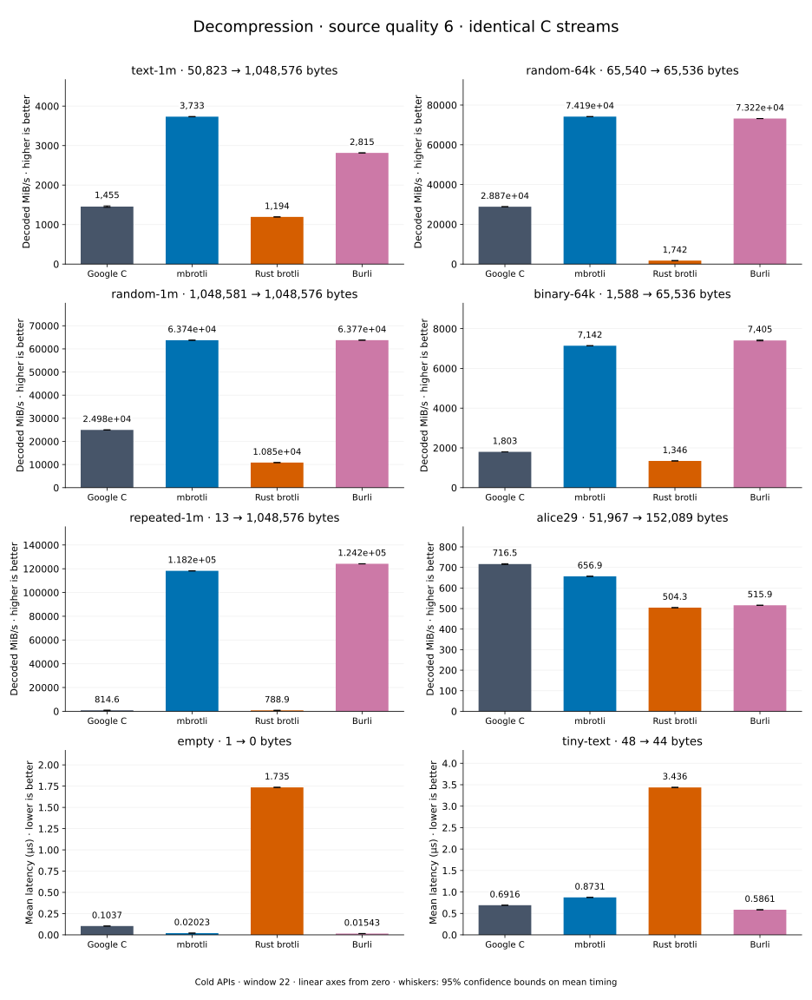

# Decompression of quality 6 streams

[Decoder overview](README.md) · [Benchmark index](../README.md)

Recorded run: **dec-2026-10-30-amd** (2026-10-30).
[CSV](../decoder-comparison.csv) · [Environment](../decoder-comparison-environment.json) · [Methodology and limits](../decoder-comparison.md).

Quality belongs to the C encoder that prepared the input; decoders have no quality setting.
All four decode the same bytes. Burli is included at every source quality; SIMD Brotli
re-exports Rust brotli's decoder and is omitted.

## Median speed across 8 datasets

Median of per-dataset C mean time / decoder mean time ratios, with equal weight.
Higher is faster; 1× matches C. No confidence interval
is inferred for this across-dataset median.

| Decoder | Median speed / C |
| --- | ---: |
| Google C | 1.000× |
| mbrotli | 2.568× |
| Rust brotli | 0.569× |
| Burli | 2.545× |

mbrotli median speed / Burli: **0.982×** (direct per-dataset ratios).

Datasets are ranked by mbrotli speed relative to the fastest peer, highest first.
Throughput counts restored bytes; empty input has latency only. Whiskers and intervals
describe sampling uncertainty, not all host variation. Cold APIs include allocation
and disposal. C knows the output capacity; Rust brotli includes its 4 KiB I/O adapter.

## text-1m

Alice text repeated cyclically to 1 MiB.

**50,823 compressed → 1,048,576 restored bytes; compressed / original: 4.847%.**

| Decoder | Mean µs | 95% mean interval µs | Decoded MiB/s | Speed / C |
| --- | ---: | ---: | ---: | ---: |
| Google C | 687.5 | 678.8–695.7 | 1,454.59 | 1.000× |
| mbrotli | 267.9 | 267.6–268.2 | 3,732.56 | 2.566× |
| Rust brotli | 837.5 | 836.7–838.5 | 1,194.01 | 0.821× |
| Burli | 355.3 | 354.9–355.6 | 2,814.86 | 1.935× |

## random-64k

64 KiB prefix of the deterministic pseudorandom corpus.

**65,540 compressed → 65,536 restored bytes; compressed / original: 100.006%.**

| Decoder | Mean µs | 95% mean interval µs | Decoded MiB/s | Speed / C |
| --- | ---: | ---: | ---: | ---: |
| Google C | 2.165 | 2.164–2.166 | 28,866.35 | 1.000× |
| mbrotli | 0.8424 | 0.8417–0.8431 | 74,194.16 | 2.570× |
| Rust brotli | 35.88 | 35.83–35.93 | 1,741.82 | 0.060× |
| Burli | 0.8536 | 0.8532–0.854 | 73,220.64 | 2.537× |

## random-1m

1 MiB of deterministic xorshift64 pseudorandom bytes.

**1,048,581 compressed → 1,048,576 restored bytes; compressed / original: 100.000%.**

| Decoder | Mean µs | 95% mean interval µs | Decoded MiB/s | Speed / C |
| --- | ---: | ---: | ---: | ---: |
| Google C | 40.04 | 39.99–40.09 | 24,976.27 | 1.000× |
| mbrotli | 15.69 | 15.67–15.7 | 63,744.07 | 2.552× |
| Rust brotli | 92.17 | 92.08–92.26 | 10,849.92 | 0.434× |
| Burli | 15.68 | 15.67–15.69 | 63,767.51 | 2.553× |

## binary-64k

64 KiB of structured binary bytes: ((i / 16) XOR i) modulo 256.

**1,588 compressed → 65,536 restored bytes; compressed / original: 2.423%.**

| Decoder | Mean µs | 95% mean interval µs | Decoded MiB/s | Speed / C |
| --- | ---: | ---: | ---: | ---: |
| Google C | 34.67 | 34.65–34.69 | 1,802.66 | 1.000× |
| mbrotli | 8.751 | 8.748–8.756 | 7,141.74 | 3.962× |
| Rust brotli | 46.42 | 46.36–46.49 | 1,346.29 | 0.747× |
| Burli | 8.44 | 8.417–8.462 | 7,405.27 | 4.108× |

## repeated-1m

1 MiB of repeated a bytes.

**13 compressed → 1,048,576 restored bytes; compressed / original: 0.001%.**

| Decoder | Mean µs | 95% mean interval µs | Decoded MiB/s | Speed / C |
| --- | ---: | ---: | ---: | ---: |
| Google C | 1,228 | 1,226–1,229 | 814.58 | 1.000× |
| mbrotli | 8.458 | 8.45–8.469 | 118,232.82 | 145.146× |
| Rust brotli | 1,268 | 1,266–1,269 | 788.88 | 0.968× |
| Burli | 8.054 | 8.047–8.061 | 124,165.77 | 152.430× |

## alice29

Vendored Alice in Wonderland text.

**51,967 compressed → 152,089 restored bytes; compressed / original: 34.169%.**

| Decoder | Mean µs | 95% mean interval µs | Decoded MiB/s | Speed / C |
| --- | ---: | ---: | ---: | ---: |
| Google C | 202.4 | 201.9–203 | 716.48 | 1.000× |
| mbrotli | 220.8 | 220.6–221 | 656.86 | 0.917× |
| Rust brotli | 287.6 | 287.3–287.9 | 504.35 | 0.704× |
| Burli | 281.1 | 280.9–281.3 | 515.95 | 0.720× |

## empty

Empty input; measures API overhead.

**1 compressed → 0 restored bytes; compressed / original: undefined.**

| Decoder | Mean µs | 95% mean interval µs | Decoded MiB/s | Speed / C |
| --- | ---: | ---: | ---: | ---: |
| Google C | 0.1037 | 0.1036–0.1038 | — | 1.000× |
| mbrotli | 0.02023 | 0.01954–0.02095 | — | 5.126× |
| Rust brotli | 1.735 | 1.734–1.737 | — | 0.060× |
| Burli | 0.01543 | 0.01539–0.01551 | — | 6.720× |

## tiny-text

44-byte quick-brown-fox sentence.

**48 compressed → 44 restored bytes; compressed / original: 109.091%.**

| Decoder | Mean µs | 95% mean interval µs | Decoded MiB/s | Speed / C |
| --- | ---: | ---: | ---: | ---: |
| Google C | 0.6916 | 0.6911–0.6923 | 60.67 | 1.000× |
| mbrotli | 0.8731 | 0.8722–0.8741 | 48.06 | 0.792× |
| Rust brotli | 3.436 | 3.433–3.441 | 12.21 | 0.201× |
| Burli | 0.5861 | 0.5846–0.5873 | 71.60 | 1.180× |
