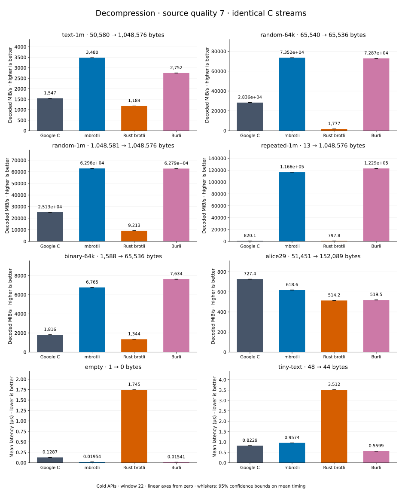

# Decompression of quality 7 streams

[Decoder overview](README.md) · [Benchmark index](../README.md)

Recorded run: **dec-2026-10-29-amd** (2026-10-29).
[CSV](../decoder-comparison.csv) · [Environment](../decoder-comparison-environment.json) · [Methodology and limits](../decoder-comparison.md).

Quality belongs to the C encoder that prepared the input; decoders have no quality setting.
All four decode the same bytes. Burli is included at every source quality; SIMD Brotli
re-exports Rust brotli's decoder and is omitted.

## Median speed across 8 datasets

Median of per-dataset C mean time / decoder mean time ratios, with equal weight.
Higher is faster; 1× matches C. No confidence interval
is inferred for this across-dataset median.

| Decoder | Median speed / C |
| --- | ---: |
| Google C | 1.000× |
| mbrotli | 2.549× |
| Rust brotli | 0.537× |
| Burli | 2.534× |

mbrotli median speed / Burli: **0.976×** (direct per-dataset ratios).

Datasets are ranked by mbrotli speed relative to the fastest peer, highest first.
Throughput counts restored bytes; empty input has latency only. Whiskers and intervals
describe sampling uncertainty, not all host variation. Cold APIs include allocation
and disposal. C knows the output capacity; Rust brotli includes its 4 KiB I/O adapter.

## text-1m

Alice text repeated cyclically to 1 MiB.

**50,580 compressed → 1,048,576 restored bytes; compressed / original: 4.824%.**

| Decoder | Mean µs | 95% mean interval µs | Decoded MiB/s | Speed / C |
| --- | ---: | ---: | ---: | ---: |
| Google C | 646.6 | 646.1–647.1 | 1,546.53 | 1.000× |
| mbrotli | 287.4 | 287–287.7 | 3,479.90 | 2.250× |
| Rust brotli | 844.7 | 843.7–845.7 | 1,183.89 | 0.766× |
| Burli | 363.4 | 363.2–363.6 | 2,751.81 | 1.779× |

## random-64k

64 KiB prefix of the deterministic pseudorandom corpus.

**65,540 compressed → 65,536 restored bytes; compressed / original: 100.006%.**

| Decoder | Mean µs | 95% mean interval µs | Decoded MiB/s | Speed / C |
| --- | ---: | ---: | ---: | ---: |
| Google C | 2.204 | 2.201–2.207 | 28,357.21 | 1.000× |
| mbrotli | 0.8501 | 0.8491–0.8514 | 73,518.50 | 2.593× |
| Rust brotli | 35.18 | 35.16–35.2 | 1,776.68 | 0.063× |
| Burli | 0.8577 | 0.857–0.8584 | 72,872.68 | 2.570× |

## random-1m

1 MiB of deterministic xorshift64 pseudorandom bytes.

**1,048,581 compressed → 1,048,576 restored bytes; compressed / original: 100.000%.**

| Decoder | Mean µs | 95% mean interval µs | Decoded MiB/s | Speed / C |
| --- | ---: | ---: | ---: | ---: |
| Google C | 39.79 | 39.72–39.87 | 25,133.63 | 1.000× |
| mbrotli | 15.88 | 15.87–15.9 | 62,955.27 | 2.505× |
| Rust brotli | 108.5 | 108.4–108.7 | 9,213.49 | 0.367× |
| Burli | 15.93 | 15.91–15.94 | 62,794.08 | 2.498× |

## repeated-1m

1 MiB of repeated a bytes.

**13 compressed → 1,048,576 restored bytes; compressed / original: 0.001%.**

| Decoder | Mean µs | 95% mean interval µs | Decoded MiB/s | Speed / C |
| --- | ---: | ---: | ---: | ---: |
| Google C | 1,219 | 1,219–1,220 | 820.14 | 1.000× |
| mbrotli | 8.577 | 8.564–8.592 | 116,585.68 | 142.154× |
| Rust brotli | 1,253 | 1,253–1,254 | 797.80 | 0.973× |
| Burli | 8.138 | 8.126–8.151 | 122,885.89 | 149.836× |

## binary-64k

64 KiB of structured binary bytes: ((i / 16) XOR i) modulo 256.

**1,588 compressed → 65,536 restored bytes; compressed / original: 2.423%.**

| Decoder | Mean µs | 95% mean interval µs | Decoded MiB/s | Speed / C |
| --- | ---: | ---: | ---: | ---: |
| Google C | 34.41 | 34.39–34.43 | 1,816.39 | 1.000× |
| mbrotli | 9.239 | 9.235–9.245 | 6,764.69 | 3.724× |
| Rust brotli | 46.49 | 46.4–46.6 | 1,344.37 | 0.740× |
| Burli | 8.187 | 8.172–8.206 | 7,633.69 | 4.203× |

## alice29

Vendored Alice in Wonderland text.

**51,451 compressed → 152,089 restored bytes; compressed / original: 33.830%.**

| Decoder | Mean µs | 95% mean interval µs | Decoded MiB/s | Speed / C |
| --- | ---: | ---: | ---: | ---: |
| Google C | 199.4 | 199.1–199.7 | 727.42 | 1.000× |
| mbrotli | 234.5 | 234.3–234.6 | 618.61 | 0.850× |
| Rust brotli | 282.1 | 281.7–282.4 | 514.20 | 0.707× |
| Burli | 279.2 | 278.2–280.2 | 519.52 | 0.714× |

## empty

Empty input; measures API overhead.

**1 compressed → 0 restored bytes; compressed / original: undefined.**

| Decoder | Mean µs | 95% mean interval µs | Decoded MiB/s | Speed / C |
| --- | ---: | ---: | ---: | ---: |
| Google C | 0.1287 | 0.1286–0.1288 | — | 1.000× |
| mbrotli | 0.01954 | 0.0195–0.01959 | — | 6.586× |
| Rust brotli | 1.745 | 1.743–1.748 | — | 0.074× |
| Burli | 0.01541 | 0.01536–0.01546 | — | 8.355× |

## tiny-text

44-byte quick-brown-fox sentence.

**48 compressed → 44 restored bytes; compressed / original: 109.091%.**

| Decoder | Mean µs | 95% mean interval µs | Decoded MiB/s | Speed / C |
| --- | ---: | ---: | ---: | ---: |
| Google C | 0.8229 | 0.8217–0.8246 | 50.99 | 1.000× |
| mbrotli | 0.9574 | 0.9568–0.958 | 43.83 | 0.860× |
| Rust brotli | 3.512 | 3.509–3.517 | 11.95 | 0.234× |
| Burli | 0.5599 | 0.5589–0.5609 | 74.95 | 1.470× |
