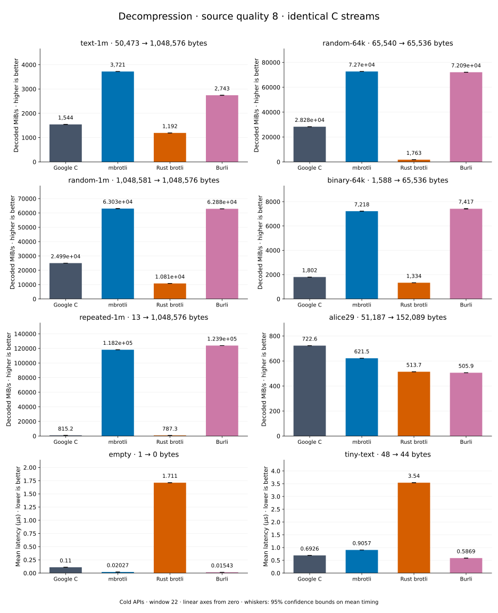

# Decompression of quality 8 streams

[Decoder overview](README.md) · [Benchmark index](../README.md)

Recorded run: **dec-2026-10-30-amd** (2026-10-30).
[CSV](../decoder-comparison.csv) · [Environment](../decoder-comparison-environment.json) · [Methodology and limits](../decoder-comparison.md).

Quality belongs to the C encoder that prepared the input; decoders have no quality setting.
All four decode the same bytes. Burli is included at every source quality; SIMD Brotli
re-exports Rust brotli's decoder and is omitted.

## Median speed across 8 datasets

Median of per-dataset C mean time / decoder mean time ratios, with equal weight.
Higher is faster; 1× matches C. No confidence interval
is inferred for this across-dataset median.

| Decoder | Median speed / C |
| --- | ---: |
| Google C | 1.000× |
| mbrotli | 2.547× |
| Rust brotli | 0.572× |
| Burli | 2.533× |

mbrotli median speed / Burli: **0.988×** (direct per-dataset ratios).

Datasets are ranked by mbrotli speed relative to the fastest peer, highest first.
Throughput counts restored bytes; empty input has latency only. Whiskers and intervals
describe sampling uncertainty, not all host variation. Cold APIs include allocation
and disposal. C knows the output capacity; Rust brotli includes its 4 KiB I/O adapter.

## text-1m

Alice text repeated cyclically to 1 MiB.

**50,473 compressed → 1,048,576 restored bytes; compressed / original: 4.813%.**

| Decoder | Mean µs | 95% mean interval µs | Decoded MiB/s | Speed / C |
| --- | ---: | ---: | ---: | ---: |
| Google C | 647.9 | 646.8–649.5 | 1,543.52 | 1.000× |
| mbrotli | 268.7 | 268.4–269 | 3,721.35 | 2.411× |
| Rust brotli | 838.8 | 838–840 | 1,192.11 | 0.772× |
| Burli | 364.5 | 364.2–364.9 | 2,743.19 | 1.777× |

## random-64k

64 KiB prefix of the deterministic pseudorandom corpus.

**65,540 compressed → 65,536 restored bytes; compressed / original: 100.006%.**

| Decoder | Mean µs | 95% mean interval µs | Decoded MiB/s | Speed / C |
| --- | ---: | ---: | ---: | ---: |
| Google C | 2.21 | 2.208–2.212 | 28,276.44 | 1.000× |
| mbrotli | 0.8597 | 0.8591–0.8603 | 72,700.10 | 2.571× |
| Rust brotli | 35.45 | 35.43–35.48 | 1,762.84 | 0.062× |
| Burli | 0.867 | 0.8666–0.8676 | 72,085.13 | 2.549× |

## random-1m

1 MiB of deterministic xorshift64 pseudorandom bytes.

**1,048,581 compressed → 1,048,576 restored bytes; compressed / original: 100.000%.**

| Decoder | Mean µs | 95% mean interval µs | Decoded MiB/s | Speed / C |
| --- | ---: | ---: | ---: | ---: |
| Google C | 40.01 | 39.98–40.06 | 24,991.58 | 1.000× |
| mbrotli | 15.87 | 15.84–15.89 | 63,031.53 | 2.522× |
| Rust brotli | 92.48 | 92.24–92.72 | 10,813.62 | 0.433× |
| Burli | 15.9 | 15.89–15.92 | 62,876.70 | 2.516× |

## binary-64k

64 KiB of structured binary bytes: ((i / 16) XOR i) modulo 256.

**1,588 compressed → 65,536 restored bytes; compressed / original: 2.423%.**

| Decoder | Mean µs | 95% mean interval µs | Decoded MiB/s | Speed / C |
| --- | ---: | ---: | ---: | ---: |
| Google C | 34.68 | 34.62–34.79 | 1,802.12 | 1.000× |
| mbrotli | 8.659 | 8.655–8.662 | 7,218.30 | 4.005× |
| Rust brotli | 46.86 | 46.83–46.89 | 1,333.68 | 0.740× |
| Burli | 8.427 | 8.4–8.455 | 7,416.64 | 4.116× |

## repeated-1m

1 MiB of repeated a bytes.

**13 compressed → 1,048,576 restored bytes; compressed / original: 0.001%.**

| Decoder | Mean µs | 95% mean interval µs | Decoded MiB/s | Speed / C |
| --- | ---: | ---: | ---: | ---: |
| Google C | 1,227 | 1,225–1,229 | 815.20 | 1.000× |
| mbrotli | 8.461 | 8.453–8.47 | 118,187.86 | 144.980× |
| Rust brotli | 1,270 | 1,268–1,273 | 787.34 | 0.966× |
| Burli | 8.071 | 8.067–8.075 | 123,898.16 | 151.984× |

## alice29

Vendored Alice in Wonderland text.

**51,187 compressed → 152,089 restored bytes; compressed / original: 33.656%.**

| Decoder | Mean µs | 95% mean interval µs | Decoded MiB/s | Speed / C |
| --- | ---: | ---: | ---: | ---: |
| Google C | 200.7 | 200.5–200.9 | 722.57 | 1.000× |
| mbrotli | 233.4 | 233.2–233.6 | 621.53 | 0.860× |
| Rust brotli | 282.4 | 281.9–282.8 | 513.70 | 0.711× |
| Burli | 286.7 | 286.4–287.1 | 505.88 | 0.700× |

## empty

Empty input; measures API overhead.

**1 compressed → 0 restored bytes; compressed / original: undefined.**

| Decoder | Mean µs | 95% mean interval µs | Decoded MiB/s | Speed / C |
| --- | ---: | ---: | ---: | ---: |
| Google C | 0.11 | 0.1098–0.1102 | — | 1.000× |
| mbrotli | 0.02027 | 0.0196–0.02098 | — | 5.426× |
| Rust brotli | 1.711 | 1.709–1.713 | — | 0.064× |
| Burli | 0.01543 | 0.01538–0.01551 | — | 7.130× |

## tiny-text

44-byte quick-brown-fox sentence.

**48 compressed → 44 restored bytes; compressed / original: 109.091%.**

| Decoder | Mean µs | 95% mean interval µs | Decoded MiB/s | Speed / C |
| --- | ---: | ---: | ---: | ---: |
| Google C | 0.6926 | 0.6921–0.6931 | 60.59 | 1.000× |
| mbrotli | 0.9057 | 0.9049–0.9066 | 46.33 | 0.765× |
| Rust brotli | 3.54 | 3.536–3.543 | 11.85 | 0.196× |
| Burli | 0.5869 | 0.5854–0.5883 | 71.49 | 1.180× |
