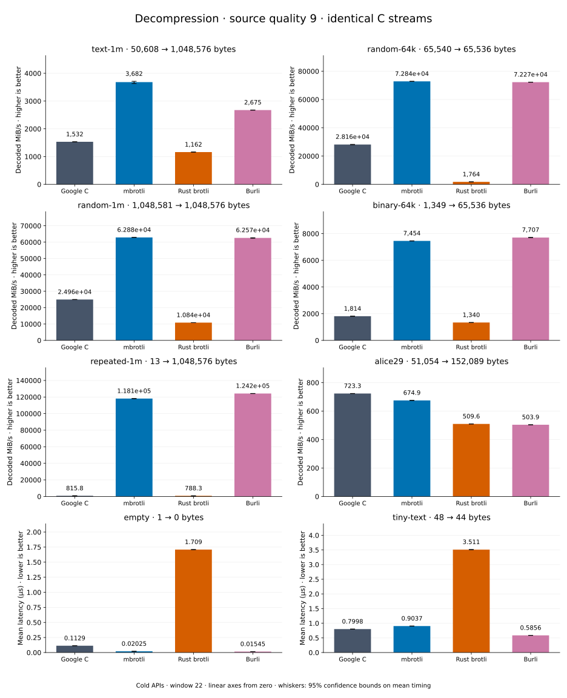

# Decompression of quality 9 streams

[Decoder overview](README.md) · [Benchmark index](../README.md)

Recorded run: **dec-2026-10-29-amd** (2026-10-29).
[CSV](../decoder-comparison.csv) · [Environment](../decoder-comparison-environment.json) · [Methodology and limits](../decoder-comparison.md).

Quality belongs to the C encoder that prepared the input; decoders have no quality setting.
All four decode the same bytes. Burli is included at every source quality; SIMD Brotli
re-exports Rust brotli's decoder and is omitted.

## Median speed across 8 datasets

Median of per-dataset C mean time / decoder mean time ratios, with equal weight.
Higher is faster; 1× matches C. No confidence interval
is inferred for this across-dataset median.

| Decoder | Median speed / C |
| --- | ---: |
| Google C | 1.000× |
| mbrotli | 2.488× |
| Rust brotli | 0.535× |
| Burli | 2.487× |

mbrotli median speed / Burli: **0.974×** (direct per-dataset ratios).

Datasets are ranked by mbrotli speed relative to the fastest peer, highest first.
Throughput counts restored bytes; empty input has latency only. Whiskers and intervals
describe sampling uncertainty, not all host variation. Cold APIs include allocation
and disposal. C knows the output capacity; Rust brotli includes its 4 KiB I/O adapter.

## text-1m

Alice text repeated cyclically to 1 MiB.

**50,608 compressed → 1,048,576 restored bytes; compressed / original: 4.826%.**

| Decoder | Mean µs | 95% mean interval µs | Decoded MiB/s | Speed / C |
| --- | ---: | ---: | ---: | ---: |
| Google C | 652.4 | 651.6–653.2 | 1,532.86 | 1.000× |
| mbrotli | 292.7 | 292.2–293.3 | 3,416.03 | 2.229× |
| Rust brotli | 844.4 | 843.5–845.4 | 1,184.23 | 0.773× |
| Burli | 376.8 | 376.5–377.2 | 2,653.74 | 1.731× |

## random-64k

64 KiB prefix of the deterministic pseudorandom corpus.

**65,540 compressed → 65,536 restored bytes; compressed / original: 100.006%.**

| Decoder | Mean µs | 95% mean interval µs | Decoded MiB/s | Speed / C |
| --- | ---: | ---: | ---: | ---: |
| Google C | 2.218 | 2.216–2.22 | 28,184.73 | 1.000× |
| mbrotli | 0.8655 | 0.8635–0.8685 | 72,215.07 | 2.562× |
| Rust brotli | 35.37 | 35.34–35.4 | 1,767.22 | 0.063× |
| Burli | 0.8659 | 0.865–0.8669 | 72,179.77 | 2.561× |

## random-1m

1 MiB of deterministic xorshift64 pseudorandom bytes.

**1,048,581 compressed → 1,048,576 restored bytes; compressed / original: 100.000%.**

| Decoder | Mean µs | 95% mean interval µs | Decoded MiB/s | Speed / C |
| --- | ---: | ---: | ---: | ---: |
| Google C | 39.8 | 39.76–39.84 | 25,127.25 | 1.000× |
| mbrotli | 16.49 | 16.47–16.51 | 60,656.67 | 2.414× |
| Rust brotli | 108.8 | 108.7–109 | 9,189.46 | 0.366× |
| Burli | 16.49 | 16.48–16.5 | 60,648.21 | 2.414× |

## repeated-1m

1 MiB of repeated a bytes.

**13 compressed → 1,048,576 restored bytes; compressed / original: 0.001%.**

| Decoder | Mean µs | 95% mean interval µs | Decoded MiB/s | Speed / C |
| --- | ---: | ---: | ---: | ---: |
| Google C | 1,220 | 1,219–1,221 | 819.86 | 1.000× |
| mbrotli | 8.583 | 8.574–8.594 | 116,506.45 | 142.105× |
| Rust brotli | 1,254 | 1,253–1,254 | 797.69 | 0.973× |
| Burli | 8.134 | 8.126–8.142 | 122,941.94 | 149.955× |

## binary-64k

64 KiB of structured binary bytes: ((i / 16) XOR i) modulo 256.

**1,349 compressed → 65,536 restored bytes; compressed / original: 2.058%.**

| Decoder | Mean µs | 95% mean interval µs | Decoded MiB/s | Speed / C |
| --- | ---: | ---: | ---: | ---: |
| Google C | 34.22 | 34.15–34.35 | 1,826.30 | 1.000× |
| mbrotli | 9.094 | 9.082–9.106 | 6,872.88 | 3.763× |
| Rust brotli | 46.1 | 46.07–46.13 | 1,355.69 | 0.742× |
| Burli | 7.914 | 7.894–7.938 | 7,897.53 | 4.324× |

## alice29

Vendored Alice in Wonderland text.

**51,054 compressed → 152,089 restored bytes; compressed / original: 33.569%.**

| Decoder | Mean µs | 95% mean interval µs | Decoded MiB/s | Speed / C |
| --- | ---: | ---: | ---: | ---: |
| Google C | 199.9 | 199.5–200.3 | 725.52 | 1.000× |
| mbrotli | 232.7 | 232.5–232.9 | 623.29 | 0.859× |
| Rust brotli | 284.1 | 283.9–284.4 | 510.51 | 0.704× |
| Burli | 287.6 | 287.3–288 | 504.27 | 0.695× |

## empty

Empty input; measures API overhead.

**1 compressed → 0 restored bytes; compressed / original: undefined.**

| Decoder | Mean µs | 95% mean interval µs | Decoded MiB/s | Speed / C |
| --- | ---: | ---: | ---: | ---: |
| Google C | 0.09638 | 0.09626–0.0965 | — | 1.000× |
| mbrotli | 0.01949 | 0.01944–0.01954 | — | 4.945× |
| Rust brotli | 1.727 | 1.725–1.728 | — | 0.056× |
| Burli | 0.01541 | 0.01537–0.01545 | — | 6.255× |

## tiny-text

44-byte quick-brown-fox sentence.

**48 compressed → 44 restored bytes; compressed / original: 109.091%.**

| Decoder | Mean µs | 95% mean interval µs | Decoded MiB/s | Speed / C |
| --- | ---: | ---: | ---: | ---: |
| Google C | 0.8268 | 0.8262–0.8274 | 50.75 | 1.000× |
| mbrotli | 0.9599 | 0.9588–0.9611 | 43.72 | 0.861× |
| Rust brotli | 3.53 | 3.528–3.533 | 11.89 | 0.234× |
| Burli | 0.5606 | 0.5595–0.5619 | 74.85 | 1.475× |
