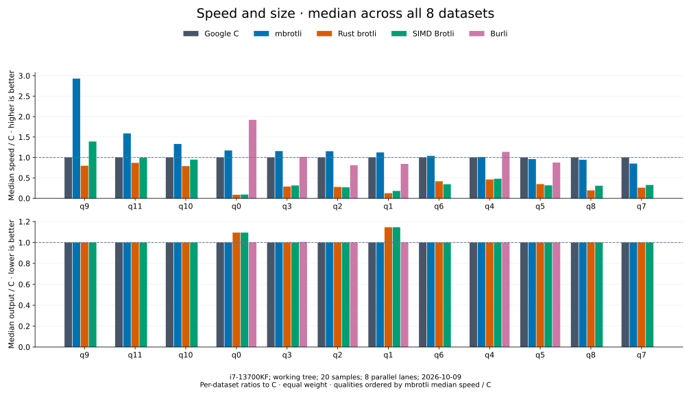

# Compression comparison — 2026-10-09 (38a3c10)

[Benchmark index](README.md) · [Results by quality](encoders/README.md)

The [432-case CSV](encoder-comparison.csv) and
[environment record](encoder-comparison-environment.json) describe a clean
checkout of `38a3c10` (unreleased, after v0.5.6), recorded as `enc-2026-10-09c`,
against Google C Brotli 1.2.0, Rust brotli 9.0.0, simd-brotli 10.0.1 and Burli
0.3.3. The run's [size manifest](encoder-comparison-2026-10-09c/sizes.csv) is
archived with it; the environment record holds the source and executable hashes.

The whole matrix ran serially in one process pinned to one core, with nothing
else running on the host. See
[interpretation limits](#interpretation-limits) before reading absolute timings.

## Final measurements



Each quality summarizes eight equally weighted datasets. Speed / C is C mean
latency divided by the encoder's mean latency for the same input; output / C is
encoder bytes divided by C bytes. The summary takes the median of those eight
ratios, including empty and tiny input. These are not median Criterion sample
times. Higher speed and lower output are better.

| Quality | mbrotli median speed / C ↑ | mbrotli median output / C ↓ |
| --- | ---: | ---: |
| 0 | 1.154× | 1.000× |
| 1 | 1.196× | 1.000× |
| 2 | 1.145× | 1.000× |
| 3 | 1.121× | 1.000× |
| 4 | 1.017× | 1.000× |
| 5 | 1.002× | 1.000× |
| 6 | 0.982× | 1.000× |
| 7 | 1.039× | 1.000× |
| 8 | 0.909× | 1.000× |
| 9 | 2.884× | 1.000× |
| 10 | 1.236× | 1.000× |
| 11 | 1.503× | 1.000× |

mbrotli has a lower mean latency than C in 67 of 96 shared cases and the lowest
mean among supported implementations in 57 of 96 cases. These counts compare
point estimates, not statistical significance. In 51 cases, mbrotli's 95% mean
timing interval is wholly below every competitor's interval. The medians also
retain qualities where mbrotli is slower than C.

For Alice at q4, mbrotli measures 90.36 MiB/s against C's 92.51 MiB/s, both
producing 55,504 bytes; Burli measures 94.19 MiB/s with 57,813 bytes. At q5,
mbrotli measures 60.45 MiB/s against C's 63.81 MiB/s, both producing 52,809
bytes. At q11, mbrotli measures 1.76 MiB/s against C's 1.09 MiB/s, both
producing 46,487 bytes; SIMD Brotli measures 1.36 MiB/s with 46,493 bytes.

Against the previous run (`enc-2026-10-09`, the working tree that became
`270e6f2`) this run adds `38a3c10`: the greedy loops (q2-q9) run at the detected
SIMD level instead of SSE2, and the encoders dispatch their backend per block
instead of holding boxed kernels. The previous run also had eight benchmark
processes on the host at once; this one ran alone on one core. The q7 median
rose from 0.850× to 1.039× of C, q5 from 0.960× to 1.002× and q1 from 1.123× to
1.196×; q0, q2-q4, q8 and q9 moved by -3.7..+0.6%. The q6, q10 and q11 medians
fell by 5-7% because C gained more than mbrotli from the idle host: Alice at
q10 takes C 45.0 ms here against 51.6 ms before, mbrotli 35.4 against 37.7 ms.
Output sizes are unchanged in all 432 cases and the size manifests are
identical.

The [quality pages](encoders/README.md) retain all datasets, all implementations,
and exact timings with 95% mean confidence bounds. Burli supports q0–q5 only.
Equal quality numbers describe each encoder's effort policy and do not imply
equal output size.

mbrotli and Google C produce equal output lengths in all 96 shared cases in
this run. Equal lengths alone do not establish compressed byte identity; the
greedy differential tests check byte identity with Google C separately.

## Measurement contract

| Setting | Recorded value |
| --- | --- |
| Host | Intel Core i7-13700KF, x86_64, WSL2 |
| Affinity | One process pinned to logical CPU 2; the matrix ran serially and nothing else ran concurrently |
| Rust | rustc 1.98.1; release defaults; runtime SIMD dispatch |
| C compiler | GCC 11.4.0; vendored release defaults |
| C Brotli | 1.2.0; commit `4508218e7fef90fa4273286f7a415065946f2c43` |
| Rust brotli / simd-brotli / burli | 9.0.0 / 10.0.1 / 0.3.3 |
| Compression | Generic mode, window 22, complete known input, no dictionary or explicit flush |
| API | Cold native serial helpers; construction, allocation, compression, and disposal timed |
| Sampling | 20 samples; 1 s warmup; 3 s requested measurement per case |
| Validation | All 432 outputs decoded to the original input through Google C Brotli before timing |

Inputs are empty, 44-byte text, vendored `alice29.txt` (152,089 bytes), cyclic
Alice text at 1 MiB, structured binary at 64 KiB, deterministic pseudorandom
bytes at 64 KiB and 1 MiB, and 1 MiB of repeated `a` bytes. Corpus construction
and validation occur outside timing. The environment record hashes the corpus
generator, Alice source, lockfiles, and benchmark executable.

No encoder retains workspace between iterations. Rust Brotli and SIMD Brotli
include their native 4 KiB I/O adapters. The C encoder uses its native one-shot
API, including its output rewrites. Round-trip equality is required; compressed
byte identity across implementations is not. Empty input has latency and output
size but no meaningful throughput or compressed/input fraction.

## Reproduction

Run from the repository root; use a fresh baseline name when repeating timings.
The [benchmark guide](../benchmarking.md#sharded-runs) describes the sharded
run; a single-core sweep is one command:

```sh
cargo bench --manifest-path benchmarks/comparison/Cargo.toml --bench implementations --locked -- --test
taskset -c 2 cargo bench --manifest-path benchmarks/comparison/Cargo.toml --bench implementations --locked -- --save-baseline enc-2026-10-09c
python3 benchmarks/comparison/report.py --baseline enc-2026-10-09c --csv docs/benchmarks/encoder-comparison.csv
python3 benchmarks/comparison/quality_docs.py --csv docs/benchmarks/encoder-comparison.csv --environment docs/benchmarks/encoder-comparison-environment.json --report docs/benchmarks/encoder-comparison.md --output docs/benchmarks/encoders
python3 benchmarks/comparison/plot.py --csv docs/benchmarks/encoder-comparison.csv --output docs/benchmarks/encoders/charts --subtitle 'i7-13700KF; 38a3c10; 20 samples; 1 core; 2026-10-09'
```

Plotting uses Matplotlib 3.10.8. Criterion extends slow cases to collect the
requested samples. The exporter rejects incomplete matrices and mismatched
input lengths. Export immediately after timing and archive `sizes.csv` with
the named baseline: a later preflight replaces that shared manifest. This
run's [size manifest](encoder-comparison-2026-10-09c/sizes.csv) is checked in.
Raw samples remain local under `benchmarks/comparison/target/criterion/`.
Chart regeneration reuses the CSV; it does not rerun timings.

## Interpretation limits

This is a single sweep on one WSL2 host, one benchmark process pinned to one
core. Every implementation of a case ran in the same process, one after another,
so ratios to C are the comparable quantity. Affinity restricts CPU migration
but does not control frequency, thermal state, or host scheduling.
Implementation order is fixed. The lowest mean does not necessarily imply a
statistically significant lead; confidence bounds do not capture every source
of host or allocator variation. No build, test, fuzzing or other benchmark
process ran during the sweep.

Ratios to C are not stable to a few percent between sweeps on this host, and
less so between a single-core and a parallel sweep: C's own mean latency moved
by up to ±22% per case against the previous run. Before this sweep, 36 cases
whose ratio fell more than 3% in an exploratory four-lane sweep of the same
binary were timed against the previous commit `270e6f2` with a one-shot
harness alternating the two builds on one otherwise idle core, eight rounds of
two seconds: the mean is -0.19%, 33 cases are within ±2%, and tiny text at q10
and q11 is 10% and 9% faster. The three slower cases were counted with
callgrind against `270e6f2`: random 1 MiB at q8 (+6.3% time, round-to-round
spread 8.7%) executes 4.3% fewer instructions, random 64 KiB at q9 (+2.2%)
4.1% fewer, and repeated 1 MiB at q11 (+2.7%) +0.02%. No case does more work
than before.

Cold 1 MiB inputs at q7 and q8, and Alice at q7-q9, are bimodal on this host:
when the allocator trims a freed peak, the next iteration faults its pages back
in, and a sweep can catch either mode for a whole case. In this sweep Alice at
q8 takes 4.22 ms against C's 3.39 ms and Alice at q7 3.49 ms against 3.04 ms;
random 1 MiB is faster than C at q7 (2.38 against 2.74 ms) and slower at q8
(3.27 against 2.97 ms). That is why the q8 median stays below C.

The suite measures cold serial compression. Streaming, retained workspace,
parallel tasks, dictionaries, and experimental formats have separate root API
benchmarks and are not represented by these results. See the
[benchmark guide](../benchmarking.md) and [harness specification](../../architecture/benchmark-comparison.md).
