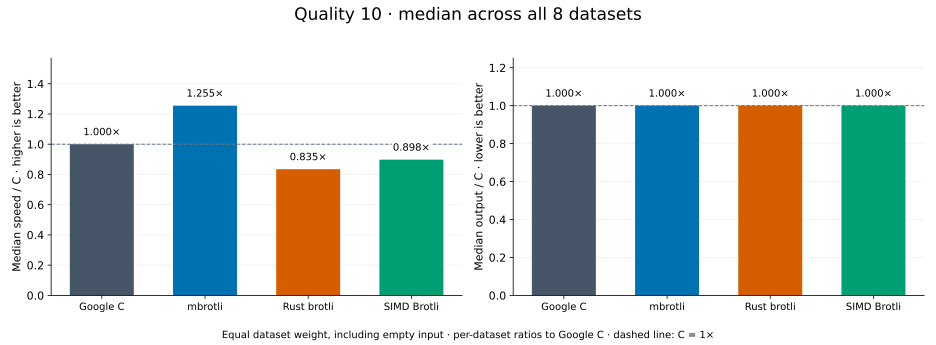
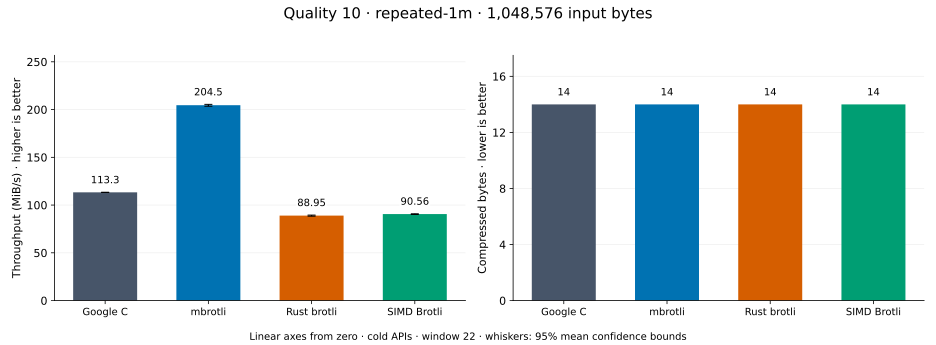
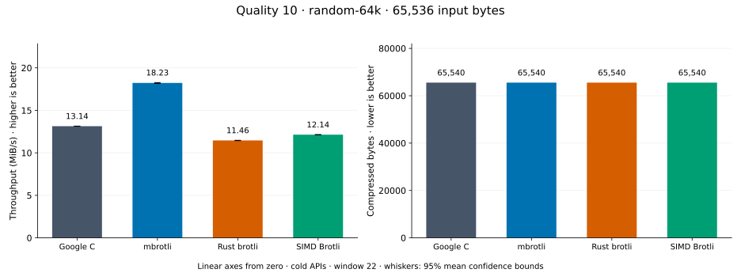
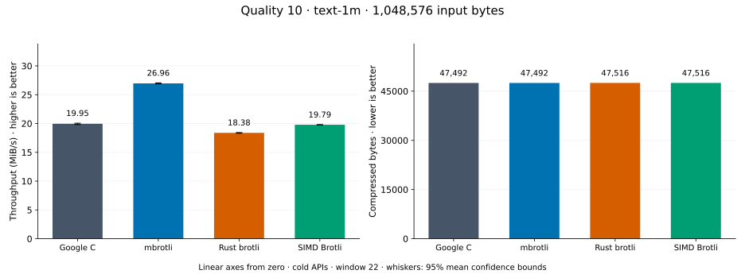
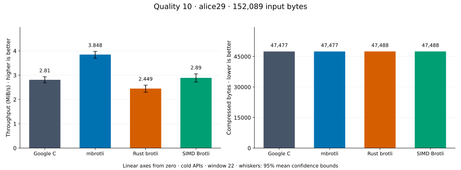
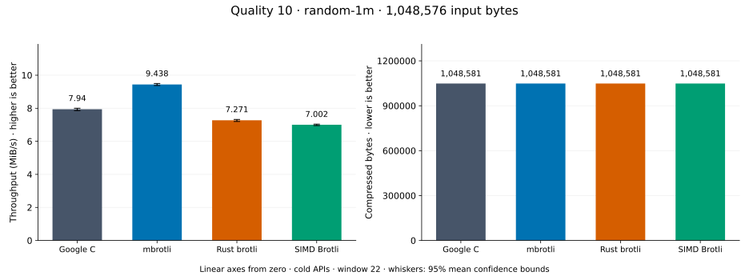
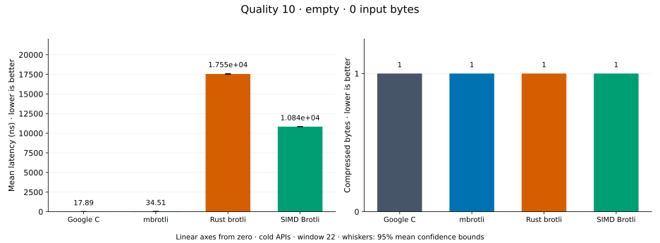
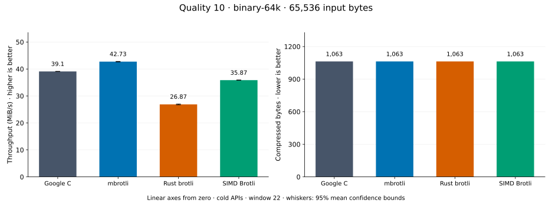
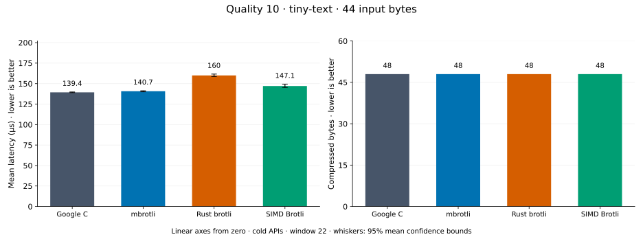

# Compression quality 10

[Benchmark index](../README.md) · [Median overview](README.md) · [← Quality 9](q9.md) · [Quality 11 →](q11.md)

Recorded run: **enc-2026-10-09c** (2026-10-09).
[Raw results](../encoder-comparison.csv) · [Environment](../encoder-comparison-environment.json) · [Run analysis](../encoder-comparison.md).

## Median across all datasets

Each of the eight datasets has equal weight, including empty and tiny input.
Speed / C = C mean latency / implementation mean latency; output / C = implementation bytes / C bytes.
We take the median of these eight per-dataset ratios separately for speed and size.
1× matches C; higher speed and lower output are better. These are medians across datasets,
not median sample latencies, and do not imply equal compressed size or statistical significance.

| Implementation | Median speed / C ↑ | Median output / C ↓ | Datasets |
| --- | ---: | ---: | ---: |
| Google C | 1.000× | 1.000× | 8 |
| mbrotli | 1.236× | 1.000× | 8 |
| Rust brotli | 0.805× | 1.000× | 8 |
| SIMD Brotli | 0.936× | 1.000× | 8 |

Measurement setup and interpretation

Google C Brotli 1.2.0, mbrotli at the recorded optimized checkout, Rust brotli 9.0.0,
and SIMD Brotli 10.0.1 are compared at this quality.
**Burli supports only qualities 0–5; it has no results at this quality.**

These are cold native API measurements: construction, allocation, compression, and disposal.
Generic mode, window 22, known input size; 20 samples, 1 s warmup, at least 3 s measurement.
Host: 13th Gen Intel(R) Core(TM) i7-13700KF, One single-threaded Criterion process pinned to logical CPU 2; the whole matrix ran serially and nothing else ran on the host during the sweep.; unset; Cargo release defaults, runtime SIMD dispatch.
Rust brotli and SIMD Brotli include their native 4 KiB I/O adapters.

Chart whiskers and table intervals describe 95% confidence bounds on mean timing.
They do not capture all host or allocator variation. Throughput bounds are transformed latency bounds.
Output / input is compressed bytes divided by input bytes; smaller is better, and values above 100% mean expansion.
For empty input, throughput and output / input are undefined (—).
See the [run analysis](../encoder-comparison.md#final-measurements) for measurement limitations.

## Dataset details

Ordered by mbrotli speed / fastest competing implementation, highest first; all eight datasets are shown.
This order uses recorded mean latency, not statistical significance. Bars start at zero.

[repeated-1m](#repeated-1m) · [random-64k](#random-64k) · [text-1m](#text-1m) · [alice29](#alice29) · [random-1m](#random-1m) · [empty](#empty) · [binary-64k](#binary-64k) · [tiny-text](#tiny-text)

### repeated-1m

1 MiB of repeated a bytes. **Input: 1,048,576 bytes.**

mbrotli speed / fastest peer (Google C): **1.786×**; output: 14 / 14 bytes.

Exact measurements and confidence bounds

| Implementation | Mean, µs | 95% mean interval, µs | MiB/s | Output bytes | Output / input | Speed / C |
| --- | ---: | ---: | ---: | ---: | ---: | ---: |
| Google C | 8,592 | 8,556–8,629 | 116.39 | 14 | 0.001% | 1.000× |
| mbrotli | 4,810 | 4,779–4,840 | 207.90 | 14 | 0.001% | 1.786× |
| Rust brotli | 1.191e+04 | 1.186e+04–1.197e+04 | 83.96 | 14 | 0.001% | 0.721× |
| SIMD Brotli | 1.023e+04 | 1.013e+04–1.035e+04 | 97.77 | 14 | 0.001% | 0.840× |

### random-64k

64 KiB prefix of the deterministic pseudorandom corpus. **Input: 65,536 bytes.**

mbrotli speed / fastest peer (Google C): **1.354×**; output: 65,540 / 65,540 bytes.

Exact measurements and confidence bounds

| Implementation | Mean, µs | 95% mean interval, µs | MiB/s | Output bytes | Output / input | Speed / C |
| --- | ---: | ---: | ---: | ---: | ---: | ---: |
| Google C | 4,454 | 4,439–4,468 | 14.03 | 65,540 | 100.006% | 1.000× |
| mbrotli | 3,290 | 3,274–3,307 | 19.00 | 65,540 | 100.006% | 1.354× |
| Rust brotli | 5,831 | 5,815–5,847 | 10.72 | 65,540 | 100.006% | 0.764× |
| SIMD Brotli | 4,755 | 4,733–4,779 | 13.14 | 65,540 | 100.006% | 0.937× |

### text-1m

Alice text repeated cyclically to 1 MiB. **Input: 1,048,576 bytes.**

mbrotli speed / fastest peer (Google C): **1.321×**; output: 47,492 / 47,492 bytes.

Exact measurements and confidence bounds

| Implementation | Mean, µs | 95% mean interval, µs | MiB/s | Output bytes | Output / input | Speed / C |
| --- | ---: | ---: | ---: | ---: | ---: | ---: |
| Google C | 5.124e+04 | 5.102e+04–5.145e+04 | 19.52 | 47,492 | 4.529% | 1.000× |
| mbrotli | 3.878e+04 | 3.865e+04–3.891e+04 | 25.79 | 47,492 | 4.529% | 1.321× |
| Rust brotli | 6.001e+04 | 5.987e+04–6.016e+04 | 16.66 | 47,516 | 4.531% | 0.854× |
| SIMD Brotli | 5.144e+04 | 5.123e+04–5.165e+04 | 19.44 | 47,516 | 4.531% | 0.996× |

### alice29

Vendored Alice in Wonderland text. **Input: 152,089 bytes.**

mbrotli speed / fastest peer (SIMD Brotli): **1.266×**; output: 47,477 / 47,488 bytes.

Exact measurements and confidence bounds

| Implementation | Mean, µs | 95% mean interval, µs | MiB/s | Output bytes | Output / input | Speed / C |
| --- | ---: | ---: | ---: | ---: | ---: | ---: |
| Google C | 4.505e+04 | 4.492e+04–4.519e+04 | 3.22 | 47,477 | 31.217% | 1.000× |
| mbrotli | 3.543e+04 | 3.53e+04–3.556e+04 | 4.09 | 47,477 | 31.217% | 1.271× |
| Rust brotli | 5.318e+04 | 5.301e+04–5.335e+04 | 2.73 | 47,488 | 31.224% | 0.847× |
| SIMD Brotli | 4.486e+04 | 4.464e+04–4.51e+04 | 3.23 | 47,488 | 31.224% | 1.004× |

### random-1m

1 MiB of deterministic xorshift64 pseudorandom bytes. **Input: 1,048,576 bytes.**

mbrotli speed / fastest peer (Google C): **1.200×**; output: 1,048,581 / 1,048,581 bytes.

Exact measurements and confidence bounds

| Implementation | Mean, µs | 95% mean interval, µs | MiB/s | Output bytes | Output / input | Speed / C |
| --- | ---: | ---: | ---: | ---: | ---: | ---: |
| Google C | 1.278e+05 | 1.261e+05–1.298e+05 | 7.83 | 1,048,581 | 100.000% | 1.000× |
| mbrotli | 1.065e+05 | 1.058e+05–1.071e+05 | 9.39 | 1,048,581 | 100.000% | 1.200× |
| Rust brotli | 1.489e+05 | 1.481e+05–1.497e+05 | 6.72 | 1,048,581 | 100.000% | 0.858× |
| SIMD Brotli | 1.405e+05 | 1.4e+05–1.41e+05 | 7.12 | 1,048,581 | 100.000% | 0.910× |

### empty

Empty input; measures API overhead. **Input: 0 bytes.**

mbrotli speed / fastest peer (Google C): **1.186×**; output: 1 / 1 bytes.

Exact measurements and confidence bounds

| Implementation | Mean, ns | 95% mean interval, ns | MiB/s | Output bytes | Output / input | Speed / C |
| --- | ---: | ---: | ---: | ---: | ---: | ---: |
| Google C | 31.08 | 30.97–31.21 | — | 1 | — | 1.000× |
| mbrotli | 26.21 | 26.09–26.34 | — | 1 | — | 1.186× |
| Rust brotli | 1.762e+04 | 1.751e+04–1.774e+04 | — | 1 | — | 0.002× |
| SIMD Brotli | 1.43e+04 | 1.42e+04–1.439e+04 | — | 1 | — | 0.002× |

### binary-64k

64 KiB of structured binary bytes: ((i / 16) XOR i) modulo 256. **Input: 65,536 bytes.**

mbrotli speed / fastest peer (Google C): **1.167×**; output: 1,063 / 1,063 bytes.

Exact measurements and confidence bounds

| Implementation | Mean, µs | 95% mean interval, µs | MiB/s | Output bytes | Output / input | Speed / C |
| --- | ---: | ---: | ---: | ---: | ---: | ---: |
| Google C | 1,641 | 1,636–1,646 | 38.09 | 1,063 | 1.622% | 1.000× |
| mbrotli | 1,405 | 1,399–1,413 | 44.47 | 1,063 | 1.622% | 1.167× |
| Rust brotli | 2,461 | 2,454–2,468 | 25.40 | 1,063 | 1.622% | 0.667× |
| SIMD Brotli | 1,753 | 1,745–1,762 | 35.66 | 1,063 | 1.622% | 0.936× |

### tiny-text

44-byte quick-brown-fox sentence. **Input: 44 bytes.**

mbrotli speed / fastest peer (Google C): **0.917×**; output: 48 / 48 bytes.

Exact measurements and confidence bounds

| Implementation | Mean, µs | 95% mean interval, µs | MiB/s | Output bytes | Output / input | Speed / C |
| --- | ---: | ---: | ---: | ---: | ---: | ---: |
| Google C | 137.9 | 137.1–138.7 | 0.30 | 48 | 109.091% | 1.000× |
| mbrotli | 150.3 | 149.7–151.1 | 0.28 | 48 | 109.091% | 0.917× |
| Rust brotli | 151.9 | 151.1–152.6 | 0.28 | 48 | 109.091% | 0.908× |
| SIMD Brotli | 143.9 | 143.2–144.6 | 0.29 | 48 | 109.091% | 0.958× |

