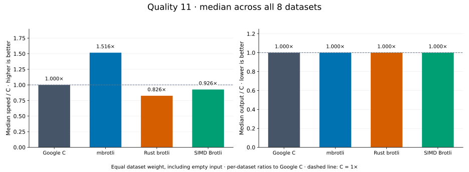
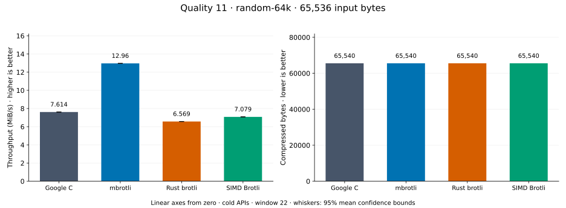
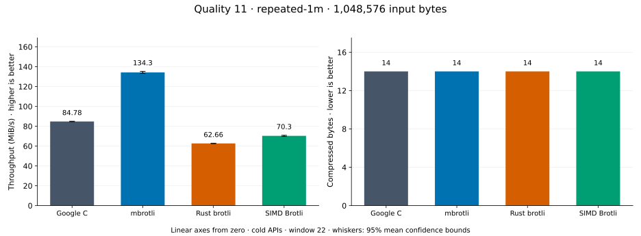
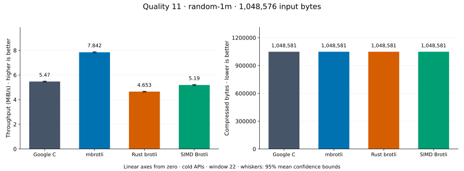
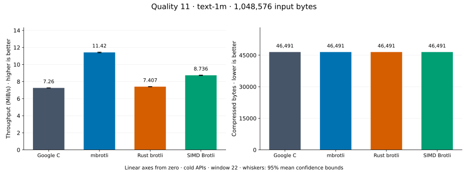
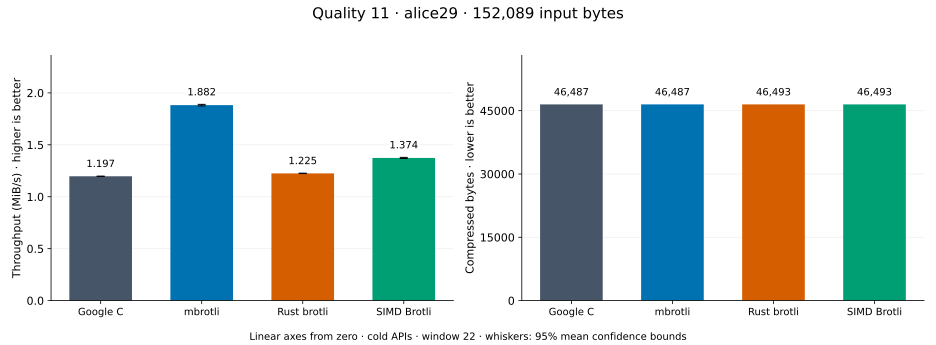
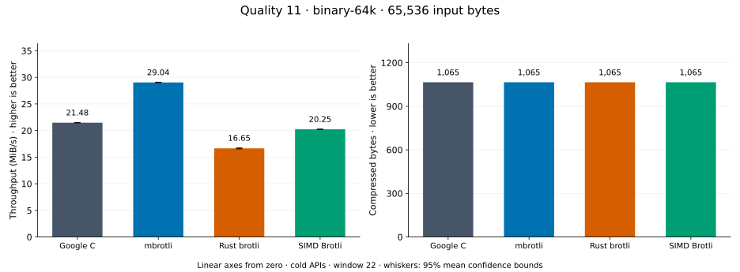
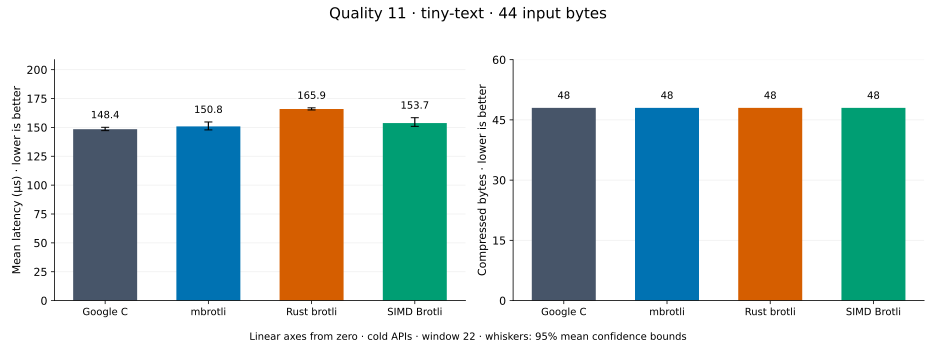
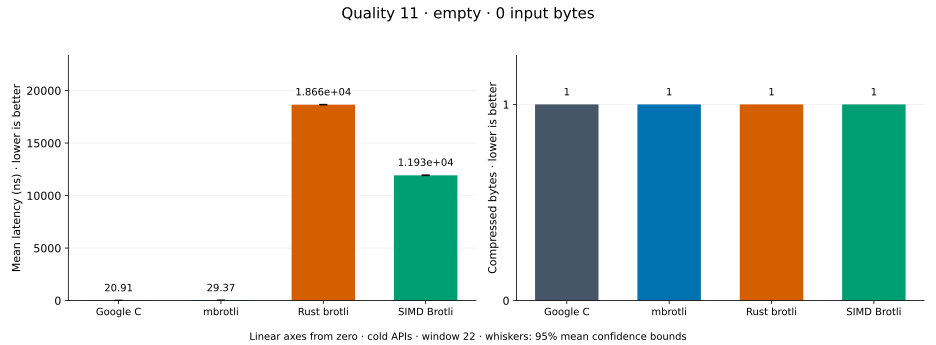

# Compression quality 11

[Benchmark index](../README.md) · [Median overview](README.md) · [← Quality 10](q10.md)

Recorded run: **enc-2026-10-30-amd** (2026-10-30).
[Raw results](../encoder-comparison.csv) · [Environment](../encoder-comparison-environment.json) · [Run analysis](../encoder-comparison.md).

## Median across all datasets

Each of the eight datasets has equal weight, including empty and tiny input.
Speed / C = C mean latency / implementation mean latency; output / C = implementation bytes / C bytes.
We take the median of these eight per-dataset ratios separately for speed and size.
1× matches C; higher speed and lower output are better. These are medians across datasets,
not median sample latencies, and do not imply equal compressed size or statistical significance.

| Implementation | Median speed / C ↑ | Median output / C ↓ | Datasets |
| --- | ---: | ---: | ---: |
| Google C | 1.000× | 1.000× | 8 |
| mbrotli | 1.493× | 1.000× | 8 |
| Rust brotli | 0.834× | 1.000× | 8 |
| SIMD Brotli | 0.906× | 1.000× | 8 |

Measurement setup and interpretation

Google C Brotli 1.2.0, mbrotli at the recorded optimized checkout, Rust brotli 9.0.0,
and SIMD Brotli 10.0.1 are compared at this quality.
**Burli supports only qualities 0–5; it has no results at this quality.**

These are cold native API measurements: construction, allocation, compression, and disposal.
Generic mode, window 22, known input size; 20 samples, 1 s warmup, at least 3 s measurement.
Host: AMD Ryzen 9 7950X (two KVM vCPUs), one benchmark process at a time pinned to logical CPU 1; codec calls and encoder/decoder sweeps ran serially; no concurrent builds, tests, fuzzers or profilers; unset; ordinary Cargo release defaults; runtime SIMD dispatch.
Rust brotli and SIMD Brotli include their native 4 KiB I/O adapters.

Chart whiskers and table intervals describe 95% confidence bounds on mean timing.
They do not capture all host or allocator variation. Throughput bounds are transformed latency bounds.
Output / input is compressed bytes divided by input bytes; smaller is better, and values above 100% mean expansion.
For empty input, throughput and output / input are undefined (—).
See the [run analysis](../encoder-comparison.md#final-measurements) for measurement limitations.

## Dataset details

Ordered by mbrotli speed / fastest competing implementation, highest first; all eight datasets are shown.
This order uses recorded mean latency, not statistical significance. Bars start at zero.

[random-64k](#random-64k) · [repeated-1m](#repeated-1m) · [random-1m](#random-1m) · [text-1m](#text-1m) · [alice29](#alice29) · [binary-64k](#binary-64k) · [tiny-text](#tiny-text) · [empty](#empty)

### random-64k

64 KiB prefix of the deterministic pseudorandom corpus. **Input: 65,536 bytes.**

mbrotli speed / fastest peer (Google C): **1.702×**; output: 65,540 / 65,540 bytes.

Exact measurements and confidence bounds

| Implementation | Mean, µs | 95% mean interval, µs | MiB/s | Output bytes | Output / input | Speed / C |
| --- | ---: | ---: | ---: | ---: | ---: | ---: |
| Google C | 8,208 | 8,200–8,217 | 7.61 | 65,540 | 100.006% | 1.000× |
| mbrotli | 4,822 | 4,818–4,825 | 12.96 | 65,540 | 100.006% | 1.702× |
| Rust brotli | 9,515 | 9,503–9,532 | 6.57 | 65,540 | 100.006% | 0.863× |
| SIMD Brotli | 8,829 | 8,814–8,845 | 7.08 | 65,540 | 100.006% | 0.930× |

### repeated-1m

1 MiB of repeated a bytes. **Input: 1,048,576 bytes.**

mbrotli speed / fastest peer (Google C): **1.643×**; output: 14 / 14 bytes.

Exact measurements and confidence bounds

| Implementation | Mean, µs | 95% mean interval, µs | MiB/s | Output bytes | Output / input | Speed / C |
| --- | ---: | ---: | ---: | ---: | ---: | ---: |
| Google C | 1.278e+04 | 1.276e+04–1.28e+04 | 78.26 | 14 | 0.001% | 1.000× |
| mbrotli | 7,777 | 7,755–7,802 | 128.58 | 14 | 0.001% | 1.643× |
| Rust brotli | 1.595e+04 | 1.583e+04–1.607e+04 | 62.68 | 14 | 0.001% | 0.801× |
| SIMD Brotli | 1.549e+04 | 1.541e+04–1.559e+04 | 64.55 | 14 | 0.001% | 0.825× |

### random-1m

1 MiB of deterministic xorshift64 pseudorandom bytes. **Input: 1,048,576 bytes.**

mbrotli speed / fastest peer (Google C): **1.429×**; output: 1,048,581 / 1,048,581 bytes.

Exact measurements and confidence bounds

| Implementation | Mean, µs | 95% mean interval, µs | MiB/s | Output bytes | Output / input | Speed / C |
| --- | ---: | ---: | ---: | ---: | ---: | ---: |
| Google C | 1.843e+05 | 1.832e+05–1.855e+05 | 5.43 | 1,048,581 | 100.000% | 1.000× |
| mbrotli | 1.29e+05 | 1.284e+05–1.296e+05 | 7.75 | 1,048,581 | 100.000% | 1.429× |
| Rust brotli | 2.083e+05 | 2.059e+05–2.112e+05 | 4.80 | 1,048,581 | 100.000% | 0.885× |
| SIMD Brotli | 2.086e+05 | 2.056e+05–2.123e+05 | 4.79 | 1,048,581 | 100.000% | 0.883× |

### text-1m

Alice text repeated cyclically to 1 MiB. **Input: 1,048,576 bytes.**

mbrotli speed / fastest peer (SIMD Brotli): **1.409×**; output: 46,491 / 46,491 bytes.

Exact measurements and confidence bounds

| Implementation | Mean, µs | 95% mean interval, µs | MiB/s | Output bytes | Output / input | Speed / C |
| --- | ---: | ---: | ---: | ---: | ---: | ---: |
| Google C | 1.268e+05 | 1.264e+05–1.272e+05 | 7.89 | 46,491 | 4.434% | 1.000× |
| mbrotli | 8.139e+04 | 8.094e+04–8.19e+04 | 12.29 | 46,491 | 4.434% | 1.558× |
| Rust brotli | 1.267e+05 | 1.265e+05–1.27e+05 | 7.89 | 46,491 | 4.434% | 1.001× |
| SIMD Brotli | 1.147e+05 | 1.14e+05–1.154e+05 | 8.72 | 46,491 | 4.434% | 1.106× |

### alice29

Vendored Alice in Wonderland text. **Input: 152,089 bytes.**

mbrotli speed / fastest peer (SIMD Brotli): **1.367×**; output: 46,487 / 46,493 bytes.

Exact measurements and confidence bounds

| Implementation | Mean, µs | 95% mean interval, µs | MiB/s | Output bytes | Output / input | Speed / C |
| --- | ---: | ---: | ---: | ---: | ---: | ---: |
| Google C | 1.219e+05 | 1.217e+05–1.22e+05 | 1.19 | 46,487 | 30.566% | 1.000× |
| mbrotli | 7.724e+04 | 7.713e+04–7.741e+04 | 1.88 | 46,487 | 30.566% | 1.578× |
| Rust brotli | 1.189e+05 | 1.188e+05–1.19e+05 | 1.22 | 46,493 | 30.570% | 1.025× |
| SIMD Brotli | 1.056e+05 | 1.053e+05–1.06e+05 | 1.37 | 46,493 | 30.570% | 1.154× |

### binary-64k

64 KiB of structured binary bytes: ((i / 16) XOR i) modulo 256. **Input: 65,536 bytes.**

mbrotli speed / fastest peer (Google C): **1.352×**; output: 1,065 / 1,065 bytes.

Exact measurements and confidence bounds

| Implementation | Mean, µs | 95% mean interval, µs | MiB/s | Output bytes | Output / input | Speed / C |
| --- | ---: | ---: | ---: | ---: | ---: | ---: |
| Google C | 2,910 | 2,907–2,913 | 21.48 | 1,065 | 1.625% | 1.000× |
| mbrotli | 2,152 | 2,150–2,154 | 29.04 | 1,065 | 1.625% | 1.352× |
| Rust brotli | 3,753 | 3,734–3,773 | 16.65 | 1,065 | 1.625% | 0.775× |
| SIMD Brotli | 3,087 | 3,083–3,091 | 20.25 | 1,065 | 1.625% | 0.943× |

### tiny-text

44-byte quick-brown-fox sentence. **Input: 44 bytes.**

mbrotli speed / fastest peer (Google C): **1.004×**; output: 48 / 48 bytes.

Exact measurements and confidence bounds

| Implementation | Mean, µs | 95% mean interval, µs | MiB/s | Output bytes | Output / input | Speed / C |
| --- | ---: | ---: | ---: | ---: | ---: | ---: |
| Google C | 132.9 | 132.7–133.1 | 0.32 | 48 | 109.091% | 1.000× |
| mbrotli | 132.3 | 132.2–132.4 | 0.32 | 48 | 109.091% | 1.004× |
| Rust brotli | 165 | 164.7–165.6 | 0.25 | 48 | 109.091% | 0.805× |
| SIMD Brotli | 163.7 | 162.9–164.4 | 0.26 | 48 | 109.091% | 0.812× |

### empty

Empty input; measures API overhead. **Input: 0 bytes.**

mbrotli speed / fastest peer (Google C): **0.513×**; output: 1 / 1 bytes.

Exact measurements and confidence bounds

| Implementation | Mean, ns | 95% mean interval, ns | MiB/s | Output bytes | Output / input | Speed / C |
| --- | ---: | ---: | ---: | ---: | ---: | ---: |
| Google C | 17.71 | 17.68–17.74 | — | 1 | — | 1.000× |
| mbrotli | 34.54 | 34.32–34.94 | — | 1 | — | 0.513× |
| Rust brotli | 1.831e+04 | 1.829e+04–1.834e+04 | — | 1 | — | 0.001× |
| SIMD Brotli | 1.156e+04 | 1.154e+04–1.157e+04 | — | 1 | — | 0.002× |

