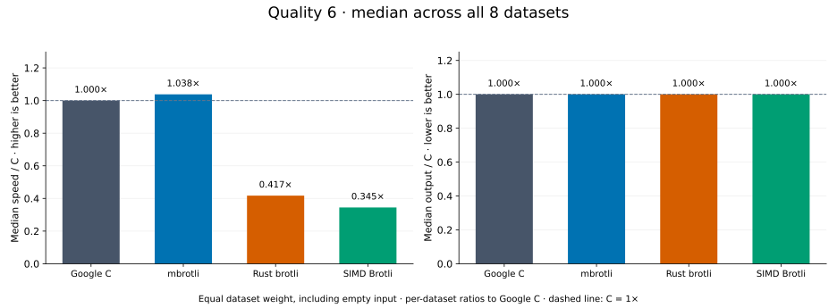
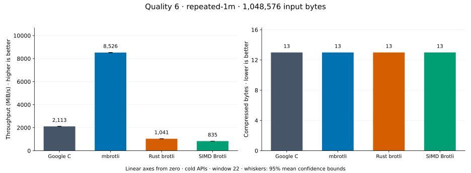
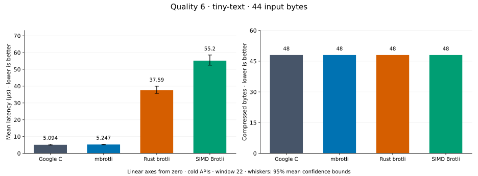
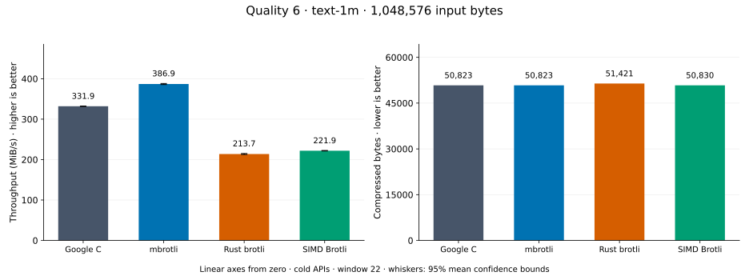
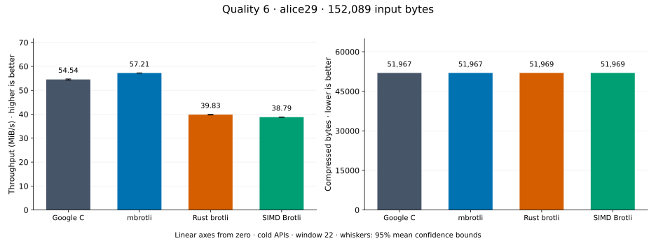
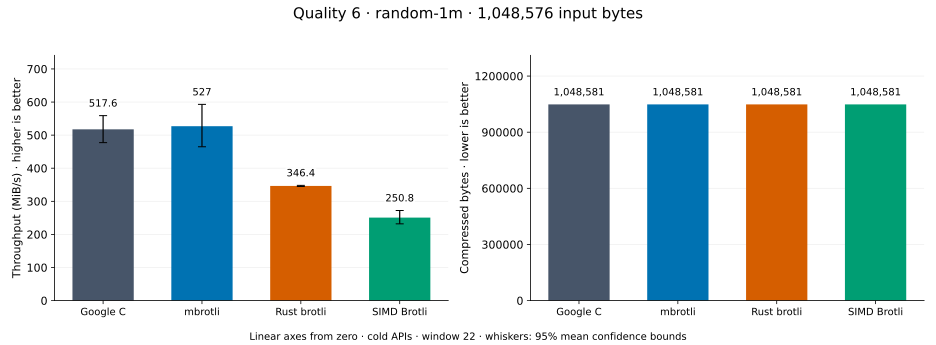
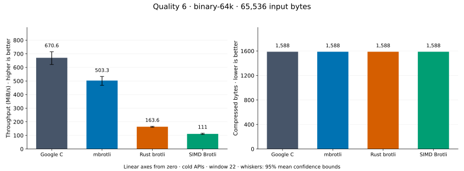
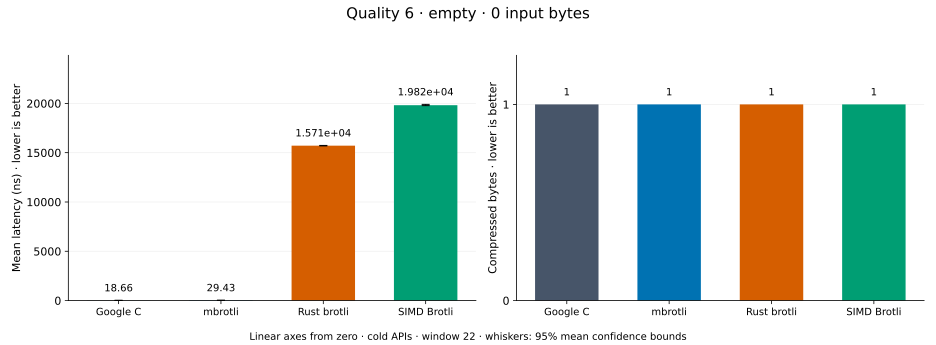
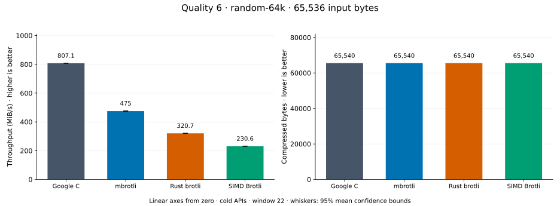

# Compression quality 6

[Benchmark index](../README.md) · [Median overview](README.md) · [← Quality 5](q5.md) · [Quality 7 →](q7.md)

Recorded run: **enc-2026-10-30-amd** (2026-10-30).
[Raw results](../encoder-comparison.csv) · [Environment](../encoder-comparison-environment.json) · [Run analysis](../encoder-comparison.md).

## Median across all datasets

Each of the eight datasets has equal weight, including empty and tiny input.
Speed / C = C mean latency / implementation mean latency; output / C = implementation bytes / C bytes.
We take the median of these eight per-dataset ratios separately for speed and size.
1× matches C; higher speed and lower output are better. These are medians across datasets,
not median sample latencies, and do not imply equal compressed size or statistical significance.

| Implementation | Median speed / C ↑ | Median output / C ↓ | Datasets |
| --- | ---: | ---: | ---: |
| Google C | 1.000× | 1.000× | 8 |
| mbrotli | 1.008× | 1.000× | 8 |
| Rust brotli | 0.404× | 1.000× | 8 |
| SIMD Brotli | 0.344× | 1.000× | 8 |

Measurement setup and interpretation

Google C Brotli 1.2.0, mbrotli at the recorded optimized checkout, Rust brotli 9.0.0,
and SIMD Brotli 10.0.1 are compared at this quality.
**Burli supports only qualities 0–5; it has no results at this quality.**

These are cold native API measurements: construction, allocation, compression, and disposal.
Generic mode, window 22, known input size; 20 samples, 1 s warmup, at least 3 s measurement.
Host: AMD Ryzen 9 7950X (two KVM vCPUs), one benchmark process at a time pinned to logical CPU 1; codec calls and encoder/decoder sweeps ran serially; no concurrent builds, tests, fuzzers or profilers; unset; ordinary Cargo release defaults; runtime SIMD dispatch.
Rust brotli and SIMD Brotli include their native 4 KiB I/O adapters.

Chart whiskers and table intervals describe 95% confidence bounds on mean timing.
They do not capture all host or allocator variation. Throughput bounds are transformed latency bounds.
Output / input is compressed bytes divided by input bytes; smaller is better, and values above 100% mean expansion.
For empty input, throughput and output / input are undefined (—).
See the [run analysis](../encoder-comparison.md#final-measurements) for measurement limitations.

## Dataset details

Ordered by mbrotli speed / fastest competing implementation, highest first; all eight datasets are shown.
This order uses recorded mean latency, not statistical significance. Bars start at zero.

[repeated-1m](#repeated-1m) · [tiny-text](#tiny-text) · [text-1m](#text-1m) · [alice29](#alice29) · [random-1m](#random-1m) · [binary-64k](#binary-64k) · [empty](#empty) · [random-64k](#random-64k)

### repeated-1m

1 MiB of repeated a bytes. **Input: 1,048,576 bytes.**

mbrotli speed / fastest peer (Google C): **4.036×**; output: 13 / 13 bytes.

Exact measurements and confidence bounds

| Implementation | Mean, µs | 95% mean interval, µs | MiB/s | Output bytes | Output / input | Speed / C |
| --- | ---: | ---: | ---: | ---: | ---: | ---: |
| Google C | 473.4 | 473–474 | 2,112.56 | 13 | 0.001% | 1.000× |
| mbrotli | 117.3 | 117.1–117.4 | 8,526.35 | 13 | 0.001% | 4.036× |
| Rust brotli | 961 | 957.3–965.1 | 1,040.61 | 13 | 0.001% | 0.493× |
| SIMD Brotli | 1,198 | 1,194–1,202 | 834.99 | 13 | 0.001% | 0.395× |

### tiny-text

44-byte quick-brown-fox sentence. **Input: 44 bytes.**

mbrotli speed / fastest peer (Google C): **1.410×**; output: 48 / 48 bytes.

Exact measurements and confidence bounds

| Implementation | Mean, µs | 95% mean interval, µs | MiB/s | Output bytes | Output / input | Speed / C |
| --- | ---: | ---: | ---: | ---: | ---: | ---: |
| Google C | 4.641 | 4.637–4.647 | 9.04 | 48 | 109.091% | 1.000× |
| mbrotli | 3.291 | 3.288–3.294 | 12.75 | 48 | 109.091% | 1.410× |
| Rust brotli | 21.48 | 21.46–21.5 | 1.95 | 48 | 109.091% | 0.216× |
| SIMD Brotli | 26.1 | 26.07–26.12 | 1.61 | 48 | 109.091% | 0.178× |

### text-1m

Alice text repeated cyclically to 1 MiB. **Input: 1,048,576 bytes.**

mbrotli speed / fastest peer (Google C): **1.166×**; output: 50,823 / 50,823 bytes.

Exact measurements and confidence bounds

| Implementation | Mean, µs | 95% mean interval, µs | MiB/s | Output bytes | Output / input | Speed / C |
| --- | ---: | ---: | ---: | ---: | ---: | ---: |
| Google C | 3,013 | 3,009–3,017 | 331.90 | 50,823 | 4.847% | 1.000× |
| mbrotli | 2,584 | 2,577–2,594 | 386.93 | 50,823 | 4.847% | 1.166× |
| Rust brotli | 4,679 | 4,652–4,705 | 213.74 | 51,421 | 4.904% | 0.644× |
| SIMD Brotli | 4,506 | 4,495–4,518 | 221.95 | 50,830 | 4.848% | 0.669× |

### alice29

Vendored Alice in Wonderland text. **Input: 152,089 bytes.**

mbrotli speed / fastest peer (Google C): **1.043×**; output: 51,967 / 51,967 bytes.

Exact measurements and confidence bounds

| Implementation | Mean, µs | 95% mean interval, µs | MiB/s | Output bytes | Output / input | Speed / C |
| --- | ---: | ---: | ---: | ---: | ---: | ---: |
| Google C | 2,633 | 2,631–2,635 | 55.08 | 51,967 | 34.169% | 1.000× |
| mbrotli | 2,523 | 2,522–2,525 | 57.48 | 51,967 | 34.169% | 1.043× |
| Rust brotli | 3,728 | 3,718–3,736 | 38.91 | 51,969 | 34.170% | 0.706× |
| SIMD Brotli | 3,702 | 3,694–3,712 | 39.18 | 51,969 | 34.170% | 0.711× |

### random-1m

1 MiB of deterministic xorshift64 pseudorandom bytes. **Input: 1,048,576 bytes.**

mbrotli speed / fastest peer (Google C): **0.972×**; output: 1,048,581 / 1,048,581 bytes.

Exact measurements and confidence bounds

| Implementation | Mean, µs | 95% mean interval, µs | MiB/s | Output bytes | Output / input | Speed / C |
| --- | ---: | ---: | ---: | ---: | ---: | ---: |
| Google C | 1,251 | 1,249–1,254 | 799.08 | 1,048,581 | 100.000% | 1.000× |
| mbrotli | 1,288 | 1,287–1,289 | 776.50 | 1,048,581 | 100.000% | 0.972× |
| Rust brotli | 2,924 | 2,915–2,934 | 341.98 | 1,048,581 | 100.000% | 0.428× |
| SIMD Brotli | 2,773 | 2,750–2,800 | 360.59 | 1,048,581 | 100.000% | 0.451× |

### binary-64k

64 KiB of structured binary bytes: ((i / 16) XOR i) modulo 256. **Input: 65,536 bytes.**

mbrotli speed / fastest peer (Google C): **0.715×**; output: 1,588 / 1,588 bytes.

Exact measurements and confidence bounds

| Implementation | Mean, µs | 95% mean interval, µs | MiB/s | Output bytes | Output / input | Speed / C |
| --- | ---: | ---: | ---: | ---: | ---: | ---: |
| Google C | 74.72 | 74.59–74.83 | 836.48 | 1,588 | 2.423% | 1.000× |
| mbrotli | 104.5 | 104.2–104.7 | 598.33 | 1,588 | 2.423% | 0.715× |
| Rust brotli | 251.5 | 250.4–252.9 | 248.50 | 1,588 | 2.423% | 0.297× |
| SIMD Brotli | 358 | 357.3–358.7 | 174.60 | 1,588 | 2.423% | 0.209× |

### empty

Empty input; measures API overhead. **Input: 0 bytes.**

mbrotli speed / fastest peer (Google C): **0.518×**; output: 1 / 1 bytes.

Exact measurements and confidence bounds

| Implementation | Mean, ns | 95% mean interval, ns | MiB/s | Output bytes | Output / input | Speed / C |
| --- | ---: | ---: | ---: | ---: | ---: | ---: |
| Google C | 17.91 | 17.86–17.97 | — | 1 | — | 1.000× |
| mbrotli | 34.57 | 34.33–34.98 | — | 1 | — | 0.518× |
| Rust brotli | 1.616e+04 | 1.615e+04–1.618e+04 | — | 1 | — | 0.001× |
| SIMD Brotli | 1.981e+04 | 1.98e+04–1.983e+04 | — | 1 | — | 0.001× |

### random-64k

64 KiB prefix of the deterministic pseudorandom corpus. **Input: 65,536 bytes.**

mbrotli speed / fastest peer (Google C): **0.485×**; output: 65,540 / 65,540 bytes.

Exact measurements and confidence bounds

| Implementation | Mean, µs | 95% mean interval, µs | MiB/s | Output bytes | Output / input | Speed / C |
| --- | ---: | ---: | ---: | ---: | ---: | ---: |
| Google C | 76.59 | 76.5–76.69 | 816.06 | 65,540 | 100.006% | 1.000× |
| mbrotli | 158 | 157.7–158.2 | 395.65 | 65,540 | 100.006% | 0.485× |
| Rust brotli | 201.8 | 200.3–203.1 | 309.75 | 65,540 | 100.006% | 0.380× |
| SIMD Brotli | 262.1 | 261.7–262.6 | 238.45 | 65,540 | 100.006% | 0.292× |

