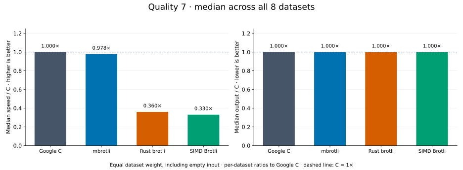
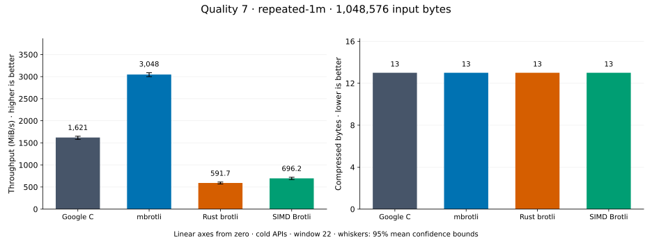
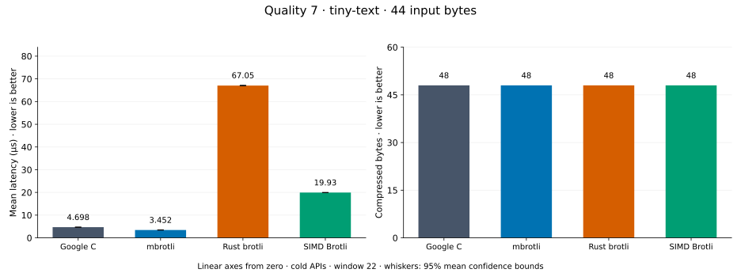
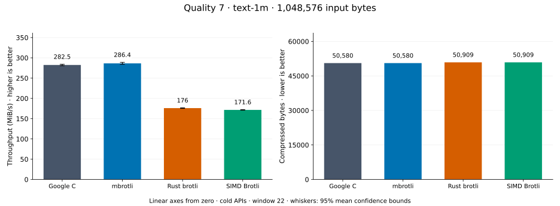
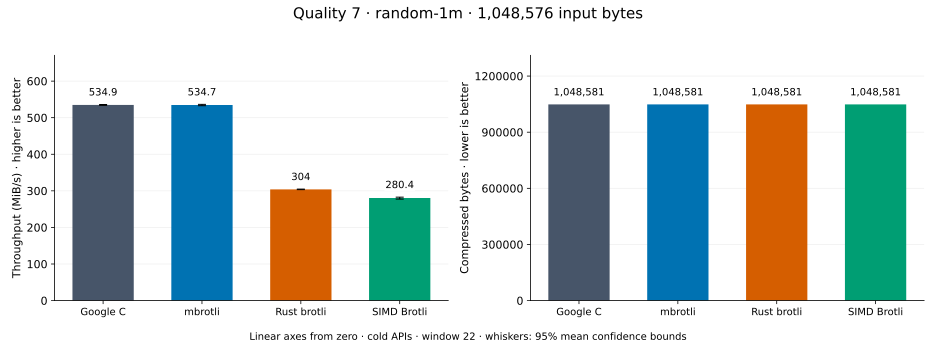
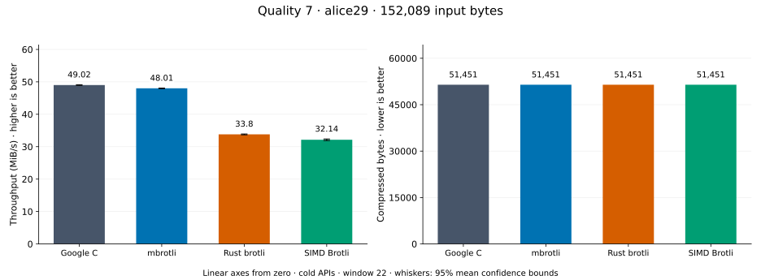
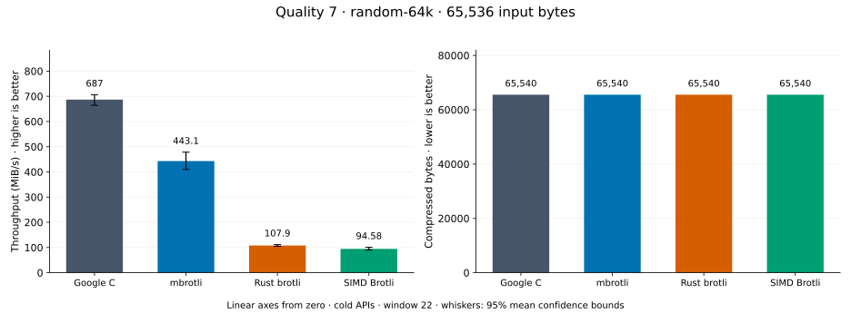
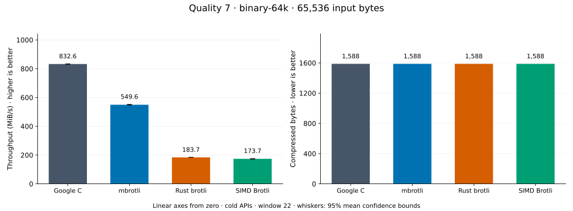
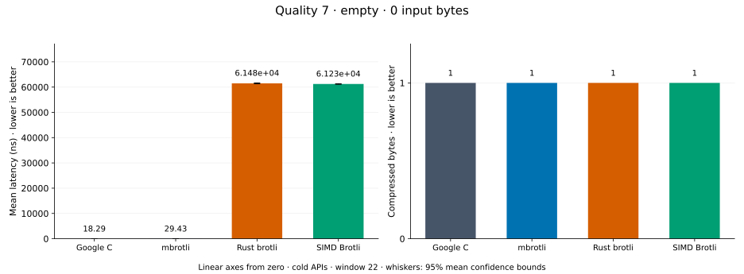

# Compression quality 7

[Benchmark index](../README.md) · [Median overview](README.md) · [← Quality 6](q6.md) · [Quality 8 →](q8.md)

Recorded run: **enc-2026-10-30-amd** (2026-10-30).
[Raw results](../encoder-comparison.csv) · [Environment](../encoder-comparison-environment.json) · [Run analysis](../encoder-comparison.md).

## Median across all datasets

Each of the eight datasets has equal weight, including empty and tiny input.
Speed / C = C mean latency / implementation mean latency; output / C = implementation bytes / C bytes.
We take the median of these eight per-dataset ratios separately for speed and size.
1× matches C; higher speed and lower output are better. These are medians across datasets,
not median sample latencies, and do not imply equal compressed size or statistical significance.

| Implementation | Median speed / C ↑ | Median output / C ↓ | Datasets |
| --- | ---: | ---: | ---: |
| Google C | 1.000× | 1.000× | 8 |
| mbrotli | 1.004× | 1.000× | 8 |
| Rust brotli | 0.360× | 1.000× | 8 |
| SIMD Brotli | 0.331× | 1.000× | 8 |

Measurement setup and interpretation

Google C Brotli 1.2.0, mbrotli at the recorded optimized checkout, Rust brotli 9.0.0,
and SIMD Brotli 10.0.1 are compared at this quality.
**Burli supports only qualities 0–5; it has no results at this quality.**

These are cold native API measurements: construction, allocation, compression, and disposal.
Generic mode, window 22, known input size; 20 samples, 1 s warmup, at least 3 s measurement.
Host: AMD Ryzen 9 7950X (two KVM vCPUs), one benchmark process at a time pinned to logical CPU 1; codec calls and encoder/decoder sweeps ran serially; no concurrent builds, tests, fuzzers or profilers; unset; ordinary Cargo release defaults; runtime SIMD dispatch.
Rust brotli and SIMD Brotli include their native 4 KiB I/O adapters.

Chart whiskers and table intervals describe 95% confidence bounds on mean timing.
They do not capture all host or allocator variation. Throughput bounds are transformed latency bounds.
Output / input is compressed bytes divided by input bytes; smaller is better, and values above 100% mean expansion.
For empty input, throughput and output / input are undefined (—).
See the [run analysis](../encoder-comparison.md#final-measurements) for measurement limitations.

## Dataset details

Ordered by mbrotli speed / fastest competing implementation, highest first; all eight datasets are shown.
This order uses recorded mean latency, not statistical significance. Bars start at zero.

[repeated-1m](#repeated-1m) · [tiny-text](#tiny-text) · [text-1m](#text-1m) · [random-1m](#random-1m) · [alice29](#alice29) · [random-64k](#random-64k) · [binary-64k](#binary-64k) · [empty](#empty)

### repeated-1m

1 MiB of repeated a bytes. **Input: 1,048,576 bytes.**

mbrotli speed / fastest peer (Google C): **2.958×**; output: 13 / 13 bytes.

Exact measurements and confidence bounds

| Implementation | Mean, µs | 95% mean interval, µs | MiB/s | Output bytes | Output / input | Speed / C |
| --- | ---: | ---: | ---: | ---: | ---: | ---: |
| Google C | 474.5 | 474–475.2 | 2,107.29 | 13 | 0.001% | 1.000× |
| mbrotli | 160.4 | 159.9–161.1 | 6,232.49 | 13 | 0.001% | 2.958× |
| Rust brotli | 1,087 | 1,081–1,095 | 919.66 | 13 | 0.001% | 0.436× |
| SIMD Brotli | 1,213 | 1,209–1,218 | 824.50 | 13 | 0.001% | 0.391× |

### tiny-text

44-byte quick-brown-fox sentence. **Input: 44 bytes.**

mbrotli speed / fastest peer (Google C): **1.361×**; output: 48 / 48 bytes.

Exact measurements and confidence bounds

| Implementation | Mean, µs | 95% mean interval, µs | MiB/s | Output bytes | Output / input | Speed / C |
| --- | ---: | ---: | ---: | ---: | ---: | ---: |
| Google C | 4.698 | 4.694–4.702 | 8.93 | 48 | 109.091% | 1.000× |
| mbrotli | 3.452 | 3.449–3.455 | 12.16 | 48 | 109.091% | 1.361× |
| Rust brotli | 67.05 | 66.95–67.14 | 0.63 | 48 | 109.091% | 0.070× |
| SIMD Brotli | 19.93 | 19.92–19.95 | 2.11 | 48 | 109.091% | 0.236× |

### text-1m

Alice text repeated cyclically to 1 MiB. **Input: 1,048,576 bytes.**

mbrotli speed / fastest peer (Google C): **1.160×**; output: 50,580 / 50,580 bytes.

Exact measurements and confidence bounds

| Implementation | Mean, µs | 95% mean interval, µs | MiB/s | Output bytes | Output / input | Speed / C |
| --- | ---: | ---: | ---: | ---: | ---: | ---: |
| Google C | 3,368 | 3,363–3,375 | 296.89 | 50,580 | 4.824% | 1.000× |
| mbrotli | 2,903 | 2,891–2,915 | 344.49 | 50,580 | 4.824% | 1.160× |
| Rust brotli | 5,188 | 5,167–5,215 | 192.75 | 50,909 | 4.855% | 0.649× |
| SIMD Brotli | 5,476 | 5,467–5,486 | 182.62 | 50,909 | 4.855% | 0.615× |

### random-1m

1 MiB of deterministic xorshift64 pseudorandom bytes. **Input: 1,048,576 bytes.**

mbrotli speed / fastest peer (Google C): **1.029×**; output: 1,048,581 / 1,048,581 bytes.

Exact measurements and confidence bounds

| Implementation | Mean, µs | 95% mean interval, µs | MiB/s | Output bytes | Output / input | Speed / C |
| --- | ---: | ---: | ---: | ---: | ---: | ---: |
| Google C | 1,879 | 1,877–1,881 | 532.18 | 1,048,581 | 100.000% | 1.000× |
| mbrotli | 1,825 | 1,821–1,830 | 547.86 | 1,048,581 | 100.000% | 1.029× |
| Rust brotli | 3,209 | 3,202–3,215 | 311.65 | 1,048,581 | 100.000% | 0.586× |
| SIMD Brotli | 3,484 | 3,453–3,523 | 287.01 | 1,048,581 | 100.000% | 0.539× |

### alice29

Vendored Alice in Wonderland text. **Input: 152,089 bytes.**

mbrotli speed / fastest peer (Google C): **0.979×**; output: 51,451 / 51,451 bytes.

Exact measurements and confidence bounds

| Implementation | Mean, µs | 95% mean interval, µs | MiB/s | Output bytes | Output / input | Speed / C |
| --- | ---: | ---: | ---: | ---: | ---: | ---: |
| Google C | 2,959 | 2,953–2,965 | 49.02 | 51,451 | 33.830% | 1.000× |
| mbrotli | 3,021 | 3,016–3,027 | 48.01 | 51,451 | 33.830% | 0.979× |
| Rust brotli | 4,291 | 4,276–4,308 | 33.80 | 51,451 | 33.830% | 0.690× |
| SIMD Brotli | 4,512 | 4,479–4,548 | 32.14 | 51,451 | 33.830% | 0.656× |

### random-64k

64 KiB prefix of the deterministic pseudorandom corpus. **Input: 65,536 bytes.**

mbrotli speed / fastest peer (Google C): **0.750×**; output: 65,540 / 65,540 bytes.

Exact measurements and confidence bounds

| Implementation | Mean, µs | 95% mean interval, µs | MiB/s | Output bytes | Output / input | Speed / C |
| --- | ---: | ---: | ---: | ---: | ---: | ---: |
| Google C | 84.99 | 84.85–85.13 | 735.40 | 65,540 | 100.006% | 1.000× |
| mbrotli | 113.3 | 112.6–114 | 551.59 | 65,540 | 100.006% | 0.750× |
| Rust brotli | 300.7 | 300.1–301.3 | 207.86 | 65,540 | 100.006% | 0.283× |
| SIMD Brotli | 313.5 | 312.5–314.6 | 199.36 | 65,540 | 100.006% | 0.271× |

### binary-64k

64 KiB of structured binary bytes: ((i / 16) XOR i) modulo 256. **Input: 65,536 bytes.**

mbrotli speed / fastest peer (Google C): **0.699×**; output: 1,588 / 1,588 bytes.

Exact measurements and confidence bounds

| Implementation | Mean, µs | 95% mean interval, µs | MiB/s | Output bytes | Output / input | Speed / C |
| --- | ---: | ---: | ---: | ---: | ---: | ---: |
| Google C | 71.97 | 71.79–72.16 | 868.36 | 1,588 | 2.423% | 1.000× |
| mbrotli | 103 | 102.7–103.3 | 606.64 | 1,588 | 2.423% | 0.699× |
| Rust brotli | 334.4 | 333.3–335.6 | 186.92 | 1,588 | 2.423% | 0.215× |
| SIMD Brotli | 365.6 | 360–371.9 | 170.97 | 1,588 | 2.423% | 0.197× |

### empty

Empty input; measures API overhead. **Input: 0 bytes.**

mbrotli speed / fastest peer (Google C): **0.508×**; output: 1 / 1 bytes.

Exact measurements and confidence bounds

| Implementation | Mean, ns | 95% mean interval, ns | MiB/s | Output bytes | Output / input | Speed / C |
| --- | ---: | ---: | ---: | ---: | ---: | ---: |
| Google C | 17.56 | 17.53–17.6 | — | 1 | — | 1.000× |
| mbrotli | 34.55 | 34.33–34.94 | — | 1 | — | 0.508× |
| Rust brotli | 6.088e+04 | 6.079e+04–6.098e+04 | — | 1 | — | 0.000× |
| SIMD Brotli | 6.035e+04 | 6.028e+04–6.043e+04 | — | 1 | — | 0.000× |

