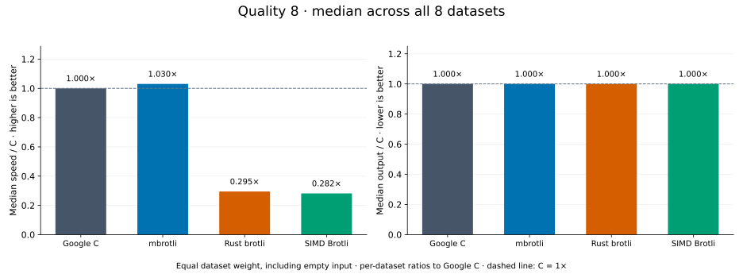
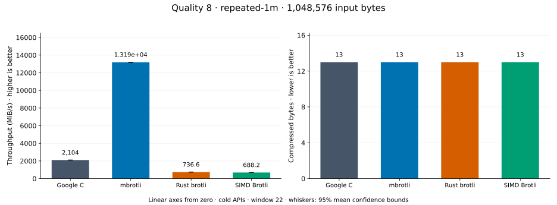
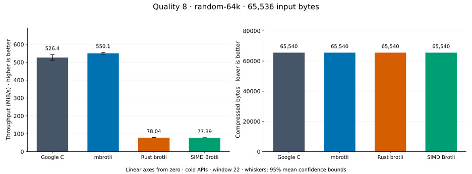
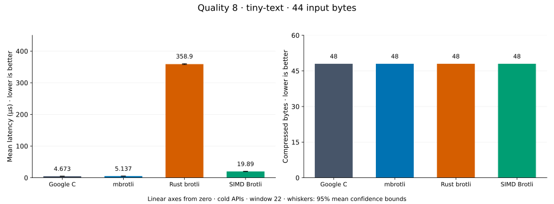
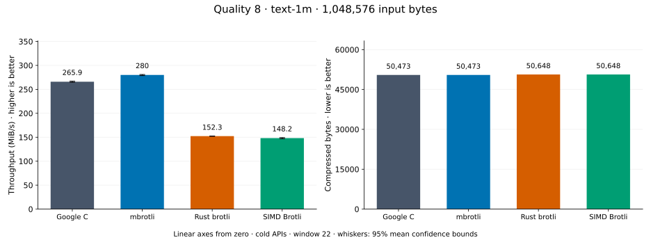
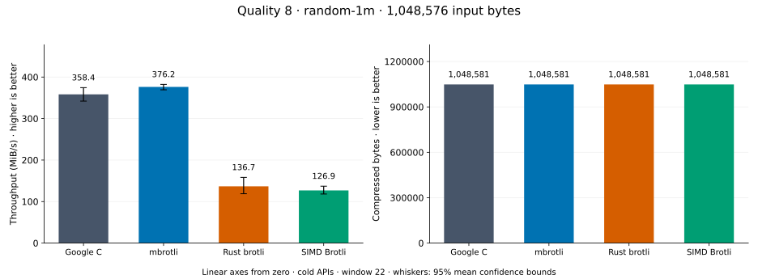
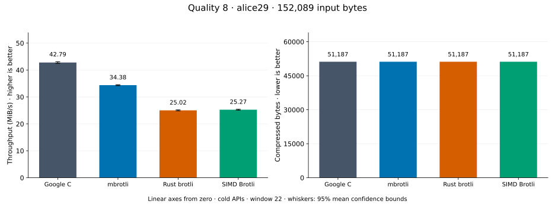
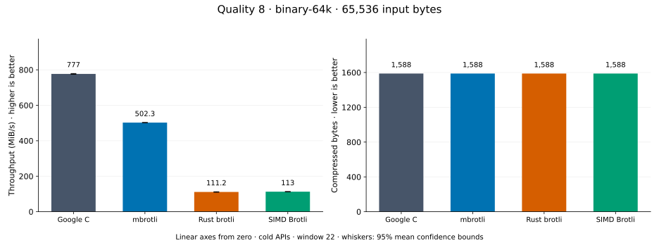
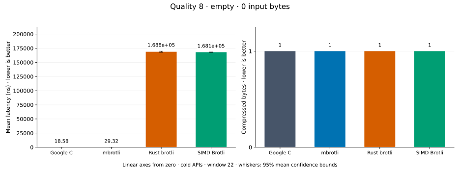

# Compression quality 8

[Benchmark index](../README.md) · [Median overview](README.md) · [← Quality 7](q7.md) · [Quality 9 →](q9.md)

Recorded run: **enc-2026-10-29-amd** (2026-10-29).
[Raw results](../encoder-comparison.csv) · [Environment](../encoder-comparison-environment.json) · [Run analysis](../encoder-comparison.md).

## Median across all datasets

Each of the eight datasets has equal weight, including empty and tiny input.
Speed / C = C mean latency / implementation mean latency; output / C = implementation bytes / C bytes.
We take the median of these eight per-dataset ratios separately for speed and size.
1× matches C; higher speed and lower output are better. These are medians across datasets,
not median sample latencies, and do not imply equal compressed size or statistical significance.

| Implementation | Median speed / C ↑ | Median output / C ↓ | Datasets |
| --- | ---: | ---: | ---: |
| Google C | 1.000× | 1.000× | 8 |
| mbrotli | 1.030× | 1.000× | 8 |
| Rust brotli | 0.295× | 1.000× | 8 |
| SIMD Brotli | 0.282× | 1.000× | 8 |

Measurement setup and interpretation

Google C Brotli 1.2.0, mbrotli at the recorded optimized checkout, Rust brotli 9.0.0,
and SIMD Brotli 10.0.1 are compared at this quality.
**Burli supports only qualities 0–5; it has no results at this quality.**

These are cold native API measurements: construction, allocation, compression, and disposal.
Generic mode, window 22, known input size; 20 samples, 1 s warmup, at least 3 s measurement.
Host: AMD Ryzen 9 7950X (two KVM vCPUs), one benchmark process at a time pinned to logical CPU 1; codec calls and encoder/decoder sweeps ran serially; no concurrent builds, tests, fuzzers or profilers; unset; ordinary Cargo release defaults; runtime SIMD dispatch.
Rust brotli and SIMD Brotli include their native 4 KiB I/O adapters.

Chart whiskers and table intervals describe 95% confidence bounds on mean timing.
They do not capture all host or allocator variation. Throughput bounds are transformed latency bounds.
Output / input is compressed bytes divided by input bytes; smaller is better, and values above 100% mean expansion.
For empty input, throughput and output / input are undefined (—).
See the [run analysis](../encoder-comparison.md#final-measurements) for measurement limitations.

## Dataset details

Ordered by mbrotli speed / fastest competing implementation, highest first; all eight datasets are shown.
This order uses recorded mean latency, not statistical significance. Bars start at zero.

[repeated-1m](#repeated-1m) · [random-64k](#random-64k) · [tiny-text](#tiny-text) · [text-1m](#text-1m) · [random-1m](#random-1m) · [alice29](#alice29) · [binary-64k](#binary-64k) · [empty](#empty)

### repeated-1m

1 MiB of repeated a bytes. **Input: 1,048,576 bytes.**

mbrotli speed / fastest peer (Google C): **6.298×**; output: 13 / 13 bytes.

Exact measurements and confidence bounds

| Implementation | Mean, µs | 95% mean interval, µs | MiB/s | Output bytes | Output / input | Speed / C |
| --- | ---: | ---: | ---: | ---: | ---: | ---: |
| Google C | 474.8 | 474.2–475.5 | 2,106.06 | 13 | 0.001% | 1.000× |
| mbrotli | 75.39 | 75.31–75.48 | 13,263.81 | 13 | 0.001% | 6.298× |
| Rust brotli | 1,310 | 1,289–1,338 | 763.24 | 13 | 0.001% | 0.362× |
| SIMD Brotli | 1,476 | 1,439–1,518 | 677.67 | 13 | 0.001% | 0.322× |

### random-64k

64 KiB prefix of the deterministic pseudorandom corpus. **Input: 65,536 bytes.**

mbrotli speed / fastest peer (Google C): **1.324×**; output: 65,540 / 65,540 bytes.

Exact measurements and confidence bounds

| Implementation | Mean, µs | 95% mean interval, µs | MiB/s | Output bytes | Output / input | Speed / C |
| --- | ---: | ---: | ---: | ---: | ---: | ---: |
| Google C | 138.2 | 138–138.4 | 452.31 | 65,540 | 100.006% | 1.000× |
| mbrotli | 104.4 | 103.4–105.3 | 598.85 | 65,540 | 100.006% | 1.324× |
| Rust brotli | 609 | 587–630.1 | 102.63 | 65,540 | 100.006% | 0.227× |
| SIMD Brotli | 572.6 | 564.8–582 | 109.15 | 65,540 | 100.006% | 0.241× |

### tiny-text

44-byte quick-brown-fox sentence. **Input: 44 bytes.**

mbrotli speed / fastest peer (Google C): **1.310×**; output: 48 / 48 bytes.

Exact measurements and confidence bounds

| Implementation | Mean, µs | 95% mean interval, µs | MiB/s | Output bytes | Output / input | Speed / C |
| --- | ---: | ---: | ---: | ---: | ---: | ---: |
| Google C | 4.804 | 4.801–4.808 | 8.73 | 48 | 109.091% | 1.000× |
| mbrotli | 3.669 | 3.663–3.675 | 11.44 | 48 | 109.091% | 1.310× |
| Rust brotli | 176 | 175.2–177.1 | 0.24 | 48 | 109.091% | 0.027× |
| SIMD Brotli | 19.92 | 19.91–19.94 | 2.11 | 48 | 109.091% | 0.241× |

### text-1m

Alice text repeated cyclically to 1 MiB. **Input: 1,048,576 bytes.**

mbrotli speed / fastest peer (Google C): **1.053×**; output: 50,473 / 50,473 bytes.

Exact measurements and confidence bounds

| Implementation | Mean, µs | 95% mean interval, µs | MiB/s | Output bytes | Output / input | Speed / C |
| --- | ---: | ---: | ---: | ---: | ---: | ---: |
| Google C | 3,760 | 3,746–3,776 | 265.94 | 50,473 | 4.813% | 1.000× |
| mbrotli | 3,571 | 3,559–3,587 | 280.02 | 50,473 | 4.813% | 1.053× |
| Rust brotli | 6,566 | 6,556–6,578 | 152.30 | 50,648 | 4.830% | 0.573× |
| SIMD Brotli | 6,746 | 6,702–6,803 | 148.23 | 50,648 | 4.830% | 0.557× |

### random-1m

1 MiB of deterministic xorshift64 pseudorandom bytes. **Input: 1,048,576 bytes.**

mbrotli speed / fastest peer (Google C): **1.008×**; output: 1,048,581 / 1,048,581 bytes.

Exact measurements and confidence bounds

| Implementation | Mean, µs | 95% mean interval, µs | MiB/s | Output bytes | Output / input | Speed / C |
| --- | ---: | ---: | ---: | ---: | ---: | ---: |
| Google C | 2,842 | 2,804–2,887 | 351.80 | 1,048,581 | 100.000% | 1.000× |
| mbrotli | 2,821 | 2,780–2,863 | 354.54 | 1,048,581 | 100.000% | 1.008× |
| Rust brotli | 4,565 | 4,548–4,589 | 219.07 | 1,048,581 | 100.000% | 0.623× |
| SIMD Brotli | 4,867 | 4,859–4,876 | 205.46 | 1,048,581 | 100.000% | 0.584× |

### alice29

Vendored Alice in Wonderland text. **Input: 152,089 bytes.**

mbrotli speed / fastest peer (Google C): **0.907×**; output: 51,187 / 51,187 bytes.

Exact measurements and confidence bounds

| Implementation | Mean, µs | 95% mean interval, µs | MiB/s | Output bytes | Output / input | Speed / C |
| --- | ---: | ---: | ---: | ---: | ---: | ---: |
| Google C | 3,447 | 3,446–3,449 | 42.07 | 51,187 | 33.656% | 1.000× |
| mbrotli | 3,801 | 3,757–3,847 | 38.16 | 51,187 | 33.656% | 0.907× |
| Rust brotli | 5,527 | 5,512–5,546 | 26.24 | 51,187 | 33.656% | 0.624× |
| SIMD Brotli | 5,617 | 5,541–5,724 | 25.82 | 51,187 | 33.656% | 0.614× |

### binary-64k

64 KiB of structured binary bytes: ((i / 16) XOR i) modulo 256. **Input: 65,536 bytes.**

mbrotli speed / fastest peer (Google C): **0.647×**; output: 1,588 / 1,588 bytes.

Exact measurements and confidence bounds

| Implementation | Mean, µs | 95% mean interval, µs | MiB/s | Output bytes | Output / input | Speed / C |
| --- | ---: | ---: | ---: | ---: | ---: | ---: |
| Google C | 80.44 | 80.22–80.66 | 777.00 | 1,588 | 2.423% | 1.000× |
| mbrotli | 124.4 | 124.3–124.6 | 502.34 | 1,588 | 2.423% | 0.647× |
| Rust brotli | 561.9 | 555–570.4 | 111.23 | 1,588 | 2.423% | 0.143× |
| SIMD Brotli | 553.2 | 550.5–556.3 | 112.98 | 1,588 | 2.423% | 0.145× |

### empty

Empty input; measures API overhead. **Input: 0 bytes.**

mbrotli speed / fastest peer (Google C): **0.634×**; output: 1 / 1 bytes.

Exact measurements and confidence bounds

| Implementation | Mean, ns | 95% mean interval, ns | MiB/s | Output bytes | Output / input | Speed / C |
| --- | ---: | ---: | ---: | ---: | ---: | ---: |
| Google C | 18.58 | 18.39–18.74 | — | 1 | — | 1.000× |
| mbrotli | 29.32 | 29.28–29.35 | — | 1 | — | 0.634× |
| Rust brotli | 1.688e+05 | 1.679e+05–1.699e+05 | — | 1 | — | 0.000× |
| SIMD Brotli | 1.681e+05 | 1.678e+05–1.684e+05 | — | 1 | — | 0.000× |

