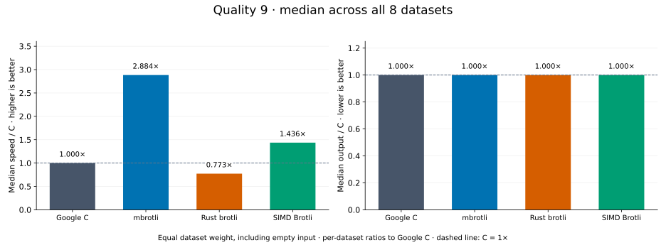
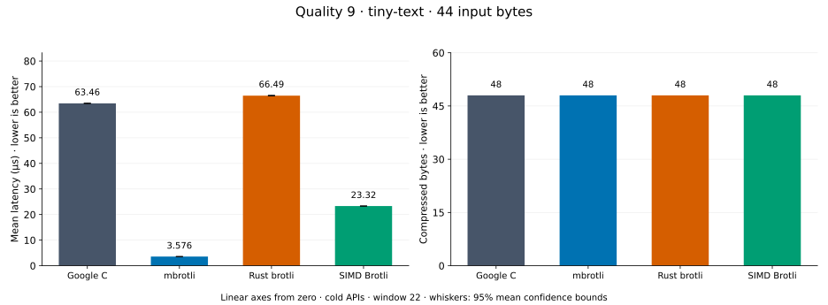
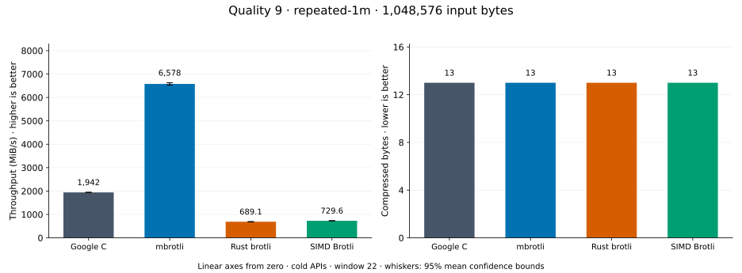
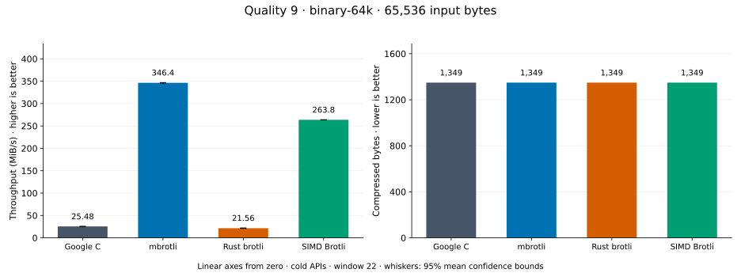
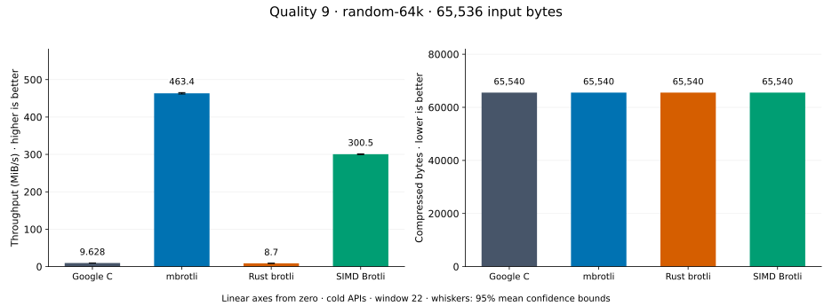
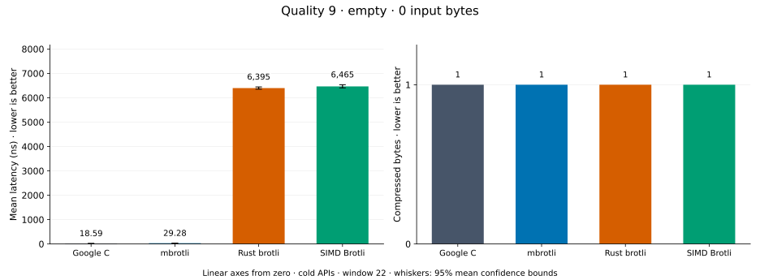
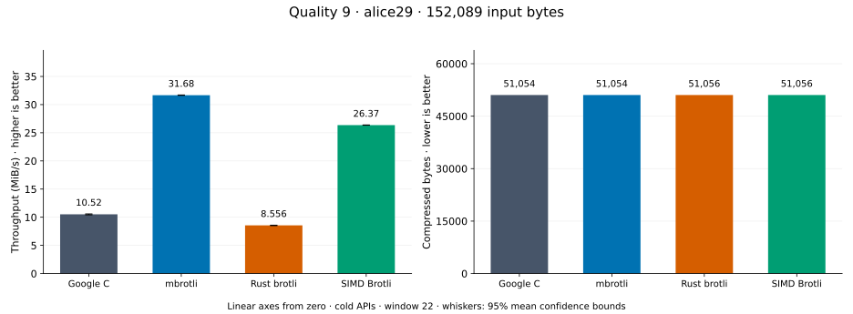
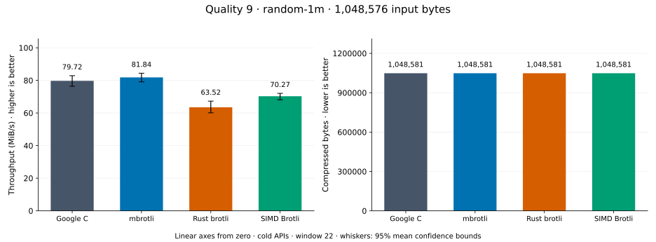
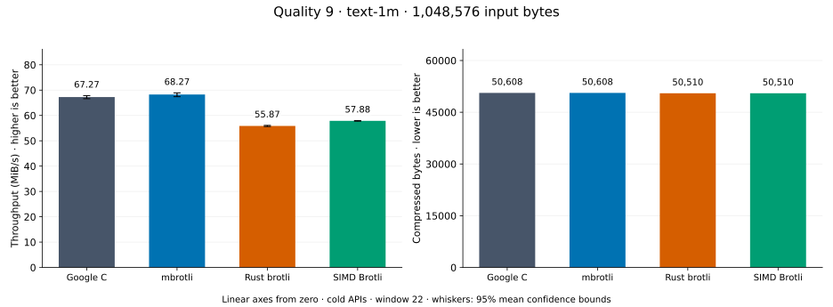

# Compression quality 9

[Benchmark index](../README.md) · [Median overview](README.md) · [← Quality 8](q8.md) · [Quality 10 →](q10.md)

Recorded run: **enc-2026-10-09c** (2026-10-09).
[Raw results](../encoder-comparison.csv) · [Environment](../encoder-comparison-environment.json) · [Run analysis](../encoder-comparison.md).

## Median across all datasets

Each of the eight datasets has equal weight, including empty and tiny input.
Speed / C = C mean latency / implementation mean latency; output / C = implementation bytes / C bytes.
We take the median of these eight per-dataset ratios separately for speed and size.
1× matches C; higher speed and lower output are better. These are medians across datasets,
not median sample latencies, and do not imply equal compressed size or statistical significance.

| Implementation | Median speed / C ↑ | Median output / C ↓ | Datasets |
| --- | ---: | ---: | ---: |
| Google C | 1.000× | 1.000× | 8 |
| mbrotli | 2.884× | 1.000× | 8 |
| Rust brotli | 0.773× | 1.000× | 8 |
| SIMD Brotli | 1.436× | 1.000× | 8 |

Measurement setup and interpretation

Google C Brotli 1.2.0, mbrotli at the recorded optimized checkout, Rust brotli 9.0.0,
and SIMD Brotli 10.0.1 are compared at this quality.
**Burli supports only qualities 0–5; it has no results at this quality.**

These are cold native API measurements: construction, allocation, compression, and disposal.
Generic mode, window 22, known input size; 20 samples, 1 s warmup, at least 3 s measurement.
Host: 13th Gen Intel(R) Core(TM) i7-13700KF, One single-threaded Criterion process pinned to logical CPU 2; the whole matrix ran serially and nothing else ran on the host during the sweep.; unset; Cargo release defaults, runtime SIMD dispatch.
Rust brotli and SIMD Brotli include their native 4 KiB I/O adapters.

Chart whiskers and table intervals describe 95% confidence bounds on mean timing.
They do not capture all host or allocator variation. Throughput bounds are transformed latency bounds.
Output / input is compressed bytes divided by input bytes; smaller is better, and values above 100% mean expansion.
For empty input, throughput and output / input are undefined (—).
See the [run analysis](../encoder-comparison.md#final-measurements) for measurement limitations.

## Dataset details

Ordered by mbrotli speed / fastest competing implementation, highest first; all eight datasets are shown.
This order uses recorded mean latency, not statistical significance. Bars start at zero.

[tiny-text](#tiny-text) · [repeated-1m](#repeated-1m) · [binary-64k](#binary-64k) · [random-64k](#random-64k) · [empty](#empty) · [alice29](#alice29) · [random-1m](#random-1m) · [text-1m](#text-1m)

### tiny-text

44-byte quick-brown-fox sentence. **Input: 44 bytes.**

mbrotli speed / fastest peer (SIMD Brotli): **3.824×**; output: 48 / 48 bytes.

Exact measurements and confidence bounds

| Implementation | Mean, µs | 95% mean interval, µs | MiB/s | Output bytes | Output / input | Speed / C |
| --- | ---: | ---: | ---: | ---: | ---: | ---: |
| Google C | 39.99 | 39.83–40.14 | 1.05 | 48 | 109.091% | 1.000× |
| mbrotli | 5.186 | 5.169–5.207 | 8.09 | 48 | 109.091% | 7.711× |
| Rust brotli | 42.68 | 42.49–42.87 | 0.98 | 48 | 109.091% | 0.937× |
| SIMD Brotli | 19.83 | 19.74–19.92 | 2.12 | 48 | 109.091% | 2.017× |

### repeated-1m

1 MiB of repeated a bytes. **Input: 1,048,576 bytes.**

mbrotli speed / fastest peer (Google C): **3.386×**; output: 13 / 13 bytes.

Exact measurements and confidence bounds

| Implementation | Mean, µs | 95% mean interval, µs | MiB/s | Output bytes | Output / input | Speed / C |
| --- | ---: | ---: | ---: | ---: | ---: | ---: |
| Google C | 514.8 | 513.1–516.7 | 1,942.46 | 13 | 0.001% | 1.000× |
| mbrotli | 152 | 150.9–153.2 | 6,577.79 | 13 | 0.001% | 3.386× |
| Rust brotli | 1,451 | 1,444–1,459 | 689.10 | 13 | 0.001% | 0.355× |
| SIMD Brotli | 1,371 | 1,363–1,378 | 729.55 | 13 | 0.001% | 0.376× |

### binary-64k

64 KiB of structured binary bytes: ((i / 16) XOR i) modulo 256. **Input: 65,536 bytes.**

mbrotli speed / fastest peer (SIMD Brotli): **1.681×**; output: 1,349 / 1,349 bytes.

Exact measurements and confidence bounds

| Implementation | Mean, µs | 95% mean interval, µs | MiB/s | Output bytes | Output / input | Speed / C |
| --- | ---: | ---: | ---: | ---: | ---: | ---: |
| Google C | 1,638 | 1,625–1,650 | 38.16 | 1,349 | 2.058% | 1.000× |
| mbrotli | 181.1 | 178.2–183.8 | 345.20 | 1,349 | 2.058% | 9.046× |
| Rust brotli | 2,168 | 2,143–2,195 | 28.82 | 1,349 | 2.058% | 0.755× |
| SIMD Brotli | 304.3 | 286.1–322.7 | 205.37 | 1,349 | 2.058% | 5.382× |

### random-64k

64 KiB prefix of the deterministic pseudorandom corpus. **Input: 65,536 bytes.**

mbrotli speed / fastest peer (SIMD Brotli): **1.542×**; output: 65,540 / 65,540 bytes.

Exact measurements and confidence bounds

| Implementation | Mean, µs | 95% mean interval, µs | MiB/s | Output bytes | Output / input | Speed / C |
| --- | ---: | ---: | ---: | ---: | ---: | ---: |
| Google C | 6,491 | 6,453–6,536 | 9.63 | 65,540 | 100.006% | 1.000× |
| mbrotli | 134.9 | 134.3–135.4 | 463.38 | 65,540 | 100.006% | 48.129× |
| Rust brotli | 7,184 | 7,140–7,229 | 8.70 | 65,540 | 100.006% | 0.904× |
| SIMD Brotli | 208 | 207.2–208.7 | 300.53 | 65,540 | 100.006% | 31.215× |

### empty

Empty input; measures API overhead. **Input: 0 bytes.**

mbrotli speed / fastest peer (Google C): **1.195×**; output: 1 / 1 bytes.

Exact measurements and confidence bounds

| Implementation | Mean, ns | 95% mean interval, ns | MiB/s | Output bytes | Output / input | Speed / C |
| --- | ---: | ---: | ---: | ---: | ---: | ---: |
| Google C | 31.38 | 31.19–31.65 | — | 1 | — | 1.000× |
| mbrotli | 26.25 | 26.1–26.47 | — | 1 | — | 1.195× |
| Rust brotli | 4,370 | 4,328–4,419 | — | 1 | — | 0.007× |
| SIMD Brotli | 4,428 | 4,369–4,504 | — | 1 | — | 0.007× |

### alice29

Vendored Alice in Wonderland text. **Input: 152,089 bytes.**

mbrotli speed / fastest peer (SIMD Brotli): **1.156×**; output: 51,054 / 51,056 bytes.

Exact measurements and confidence bounds

| Implementation | Mean, µs | 95% mean interval, µs | MiB/s | Output bytes | Output / input | Speed / C |
| --- | ---: | ---: | ---: | ---: | ---: | ---: |
| Google C | 1.106e+04 | 1.1e+04–1.11e+04 | 13.12 | 51,054 | 33.569% | 1.000× |
| mbrotli | 4,643 | 4,623–4,666 | 31.24 | 51,054 | 33.569% | 2.381× |
| Rust brotli | 1.463e+04 | 1.456e+04–1.471e+04 | 9.91 | 51,056 | 33.570% | 0.756× |
| SIMD Brotli | 5,366 | 5,341–5,395 | 27.03 | 51,056 | 33.570% | 2.060× |

### random-1m

1 MiB of deterministic xorshift64 pseudorandom bytes. **Input: 1,048,576 bytes.**

mbrotli speed / fastest peer (Google C): **1.015×**; output: 1,048,581 / 1,048,581 bytes.

Exact measurements and confidence bounds

| Implementation | Mean, µs | 95% mean interval, µs | MiB/s | Output bytes | Output / input | Speed / C |
| --- | ---: | ---: | ---: | ---: | ---: | ---: |
| Google C | 1.186e+04 | 1.181e+04–1.192e+04 | 84.29 | 1,048,581 | 100.000% | 1.000× |
| mbrotli | 1.169e+04 | 1.16e+04–1.18e+04 | 85.55 | 1,048,581 | 100.000% | 1.015× |
| Rust brotli | 1.408e+04 | 1.404e+04–1.413e+04 | 71.00 | 1,048,581 | 100.000% | 0.842× |
| SIMD Brotli | 1.386e+04 | 1.377e+04–1.394e+04 | 72.13 | 1,048,581 | 100.000% | 0.856× |

### text-1m

Alice text repeated cyclically to 1 MiB. **Input: 1,048,576 bytes.**

mbrotli speed / fastest peer (Google C): **1.004×**; output: 50,608 / 50,608 bytes.

Exact measurements and confidence bounds

| Implementation | Mean, µs | 95% mean interval, µs | MiB/s | Output bytes | Output / input | Speed / C |
| --- | ---: | ---: | ---: | ---: | ---: | ---: |
| Google C | 1.262e+04 | 1.253e+04–1.272e+04 | 79.22 | 50,608 | 4.826% | 1.000× |
| mbrotli | 1.257e+04 | 1.25e+04–1.265e+04 | 79.53 | 50,608 | 4.826% | 1.004× |
| Rust brotli | 1.597e+04 | 1.588e+04–1.607e+04 | 62.62 | 50,510 | 4.817% | 0.790× |
| SIMD Brotli | 1.507e+04 | 1.496e+04–1.518e+04 | 66.37 | 50,510 | 4.817% | 0.838× |

